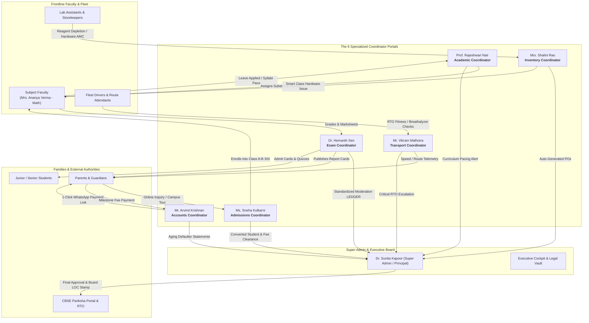

# EDU360: Coordinator Roles Architectural Specification & Cross-Role Interlock Guide

This reference document outlines the **6 Coordinator Roles** in EDU360, how modern top-tier K–12 institutional platforms (Toddle, ManageBac, Powerschool, Teachmint) architect these operations, how each role interacts with Admin, Teachers, Parents, and Students, and step-by-step test procedures.

---

## 1. Visual Orchestration Web: Cross-Role Interlocks

---

## 2. In-Depth Breakdown of the 6 Coordinator Portals

### 1. Academic Coordinator (`/academic_coordinator`)
* **Assigned Persona**: Prof. Rajeshwari Nair (Dean of Academics)
* **Credentials**: `academic_coordinator` / `academic123`
* **Market Equivalent**: Director of Curriculum & Instruction (in IB / Cambridge schools) or Academic Vice Principal (in CBSE).
* **Core Purpose**: Eliminates unmanned classrooms, audits syllabus delivery pacing against statutory term targets, and tracks pedagogical compliance.
* **Active Modules Inside Portal**:
  1. **Academic Tasks & SLAs**: Monitored tasks from SQLite (`GET /api/admin/tasks?domain=academic`). Can change status (`Pending` $\rightarrow$ `In Progress` $\rightarrow$ `Pending Review` $\rightarrow$ `Completed`) or trigger **Escalate to Principal** with custom reasoning.
  2. **Period Substitutions**: Real-time coverage matcher. Displays absent teachers, reason, and an interactive **Assign Substitute Teacher** modal that queries `GET /api/admin/substitutions/available-faculty` to auto-filter free faculty who have no class that period.
  3. **Curriculum Pacing Tracker**: Compares delivered syllabus units vs. academic calendar benchmarks (e.g. Class 8-B Math at 81.8% on-track; Class 8-B Science lagging by 2 lessons).
  4. **Faculty Roster**: Directory of academic department staff, qualification codes, and daily timetabled workload.
* **Cross-Role Interlock**:
  - *Input*: When a teacher requests leave via `TeacherPermissionRequest`, it flags in Academic Desk.
  - *Action*: Academic Coordinator matches an available teacher from the Physics/Math pool and locks the substitution.
  - *Output*: Both teachers receive updated schedules, and the Principal's KPI reflects zero unmanned classrooms.

---

### 2. Exam Coordinator (`/exam_coordinator`)
* **Assigned Persona**: Dr. Hemanth Sen (Controller of Examinations)
* **Credentials**: `exam_coordinator` / `exam123`
* **Market Equivalent**: Exam Officer / Assessment Director (e.g. in Powerschool / ManageBac).
* **Core Purpose**: Manages end-to-end examination lifecycle: question paper security vault, hall ticket generation, teacher marks moderation, and official CBSE List of Candidates (LOC) filing.
* **Active Modules Inside Portal**:
  1. **Examination Tasks & SLAs**: Priority tracking for board submissions (e.g., submitting Class 10 Board Exam LOC to CBSE before portal closure).
  2. **Marks Moderation Ledger**: Subject evaluation status across classes. Exam Coordinator audits class averages, standardizes grades, and clicks **Verify & Lock Marks** to cryptographically sign the evaluation.
  3. **Schedules & Hall Seating**: Master exam timetables, room capacity allocation, and invigilator deployment matrices.
  4. **Report Cards & Board LOC**:
     - **Generate Batch PDFs**: Instant one-click generation and browser download of official CBSE marks memo with institutional header, grades, and digital signatures.
     - **Download Official CBSE LOC Format (CSV)**: Exportable CSV matching CBSE Pariksha Sangam specification.
* **Cross-Role Interlock**:
  - *Input*: Teachers submit term assessment scores in `/teacher`.
  - *Action*: Exam Coordinator normalizes grade deviations, verifies roll numbers, and clicks "Verify & Lock".
  - *Output*: Notifies Super Admin for institutional sign-off, unlocks printable marks memos for Parents on `/parent`, and admit cards for Students on `/student`.

---

### 3. Transport Coordinator (`/transport_coordinator`)
* **Assigned Persona**: Mr. Vikram Malhotra (Fleet Operations Lead)
* **Credentials**: `transport_coordinator` / `transport123`
* **Market Equivalent**: Logistics & Fleet Manager.
* **Core Purpose**: Zero-incident pupil transit, live GPS telemetry monitoring, vehicle RTO fitness certifications, and driver sobriety/compliance tracking.
* **Active Modules Inside Portal**:
  1. **Fleet Tasks & SLAs**: Tracks vehicle fitness inspections, speed governor calibration, and route delay escalations.
  2. **Live Bus Radar Simulator**: Telemetry cockpit for 6 school routes (e.g., Bus #4 Bellandur Route, Bus #2 Whitefield Route) showing speed (km/h), next stop ETA, and moving/idle status.
  3. **RTO & Safety Compliance**: Tracks vehicle insurance validity, RTO Fitness Certificate (FC), Speed Governor seals, and Pollution (PUC) dates with status badges.
  4. **Driver Ledger**: Heavy vehicle license verification, driver emergency contacts, and police background clearance records.
* **Cross-Role Interlock**:
  - *Input*: GPS beacon delays (>10 mins) trigger automated telemetry warnings.
  - *Action*: Transport Coordinator verifies delay reason, conducts RTO speed inspection, and updates fleet status.
  - *Output*: Real-time bus coordinates update on the Parent Radar (`/parent`) and Junior Yellow Bus Radar (`/student`).

---

### 4. Inventory Coordinator (`/inventory_coordinator`)
* **Assigned Persona**: Mrs. Shalini Rao (Asset & Store Lead)
* **Credentials**: `inventory_coordinator` / `inventory123`
* **Market Equivalent**: Campus Facilities & Asset Manager.
* **Core Purpose**: Prevents stockouts of science reagents, audits smart classroom digital panels, tracks sporting goods depreciation, and manages vendor Purchase Orders (POs).
* **Active Modules Inside Portal**:
  1. **Store Tasks & SLAs**: Equipment audits, chemistry lab buffer alarms, and vendor dispatch verification.
  2. **Science Laboratories Consumables**: Real-time buffer tracker for chemicals (e.g., Hydrochloric Acid buffer alert when stock drops below 5L threshold).
  3. **Smart Classroom Digital Infrastructure**: Equipment register (Asset Tags, Installed Classrooms, AMC warranty expiry dates, and operational conditions).
  4. **Vendor Procurement Orders**: Active purchase orders (BioChem Lab Supplies, SmartEdu Tech) with delivery timelines and handover verification sign-offs.
* **Cross-Role Interlock**:
  - *Input*: Science teacher or lab assistant logs high reagent consumption or damaged projector.
  - *Action*: Inventory Coordinator inspects stock, triggers vendor PO, and updates asset ledger.
  - *Output*: Auto-generates high-priority purchase tasks for the Super Admin and updates store records.

---

### 5. Admissions Coordinator (`/admissions_coordinator`)
* **Assigned Persona**: Ms. Sneha Kulkarni (Admissions Director)
* **Credentials**: `admissions_coordinator` / `admissions123`
* **Market Equivalent**: Head of Enrollment Management & Student Outreach.
* **Core Purpose**: End-to-end student intake funnel from AI chatbot lead capture to campus walk-ins, entrance diagnostic testing, document collection, and SIS conversion.
* **Active Modules Inside Portal**:
  1. **Admissions Tasks & SLAs**: Telephone qualifications, entrance interview allocations, and document audits.
  2. **Applicant Pipeline Funnel**: Kanban-style CRM pipeline tracking prospective applicants through `New Enquiry` $\rightarrow$ `Campus Tour` $\rightarrow$ `Entrance Assessment` $\rightarrow$ `Fee Paid` $\rightarrow$ `Enrolled`.
  3. **Campus Tours & Walk-ins**: Schedule of confirmed campus walk-ins with counselor allocation.
  4. **AI Chatbot Inquiries**: Live lead capture feed from public web chatbot questions with 1-click **Initiate Counselor Call**.
* **Cross-Role Interlock**:
  - *Input*: Prospective parent submits inquiry or completes campus tour.
  - *Action*: Admissions Coordinator reviews entrance test results, verifies birth certificate and previous school TC, and clicks **Convert to Enrolled**.
  - *Output*: The student is officially provisioned into SQLite DB, assigned to Class 8-B, and appears on the Teacher's class attendance roster.

---

### 6. Accounts Coordinator (`/accounts_coordinator`)
* **Assigned Persona**: Mr. Arvind Krishnan (Bursar & Accounts Head)
* **Credentials**: `accounts_coordinator` / `accounts123`
* **Market Equivalent**: School Bursar / Director of Finance.
* **Core Purpose**: Fee collection targets, overdue fee aging analysis, payment reconciliation, and 1-click parent payment reminder dispatches.
* **Active Modules Inside Portal**:
  1. **Finance Tasks & SLAs**: Bank reconciliation, statutory fee digest dispatches, and fee defaulter audits.
  2. **Fee Defaulters & Aging Register**: Tabular breakdown of outstanding dues categorized by aging buckets (0–15 Days, 16–30 Days, 30+ Days overdue) with direct action to **Dispatch Payment Link**.
  3. **Term Milestone Schedule**: Term 1, Term 2, and Annual Activity collection deadlines and collection percentages.
  4. **Online Reconciliation**: Real-time payment gateway ledger (UPI, NetBanking, Credit Card transactions with transaction UTR numbers).
* **Cross-Role Interlock**:
  - *Input*: Due dates pass for Tuition Milestone 2.
  - *Action*: Accounts Coordinator audits defaulters register and clicks **Trigger Automated SMS & WhatsApp Broadcast**.
  - *Output*: Parents receive push alerts and payment links in `/parent`; fee clearance status updates in the Super Admin's SIS exit clearance vault.

---

## 3. How to Test Every Role Live in EDU360

| Step | Portal | Action to Perform | Expected Result |
| :---: | :--- | :--- | :--- |
| **1** | [Academic Coordinator](http://localhost:3000/academic_coordinator) | Go to **Period Substitutions** tab $\rightarrow$ Click **"Assign Substitute Teacher"** on Period 2 Math $\rightarrow$ Select Dr. Suresh Babu $\rightarrow$ Confirm. | Substitute is assigned, badge flips to emerald `Assigned`, and toast confirms coverage. |
| **2** | [Exam Coordinator](http://localhost:3000/exam_coordinator) | Go to **Report Cards & LOC** tab $\rightarrow$ Click **"Generate Batch PDFs (420 Students)"**. | Browser immediately downloads a certified HTML report card memo with full grades, aggregate %, and signatures. |
| **3** | [Exam Coordinator](http://localhost:3000/exam_coordinator) | Click **"Export CSV"** in the top header. | Real `.csv` file (`EDU360_Exam_Moderation_LOC_Report.csv`) downloads directly to your downloads folder. |
| **4** | [Transport Coordinator](http://localhost:3000/transport_coordinator) | Switch to **Live Bus Radar** tab $\rightarrow$ Observe moving telemetry pins and speed gauges. | Speedometers, moving status badges, and stop ETAs update smoothly without page reloading. |
| **5** | [Inventory Coordinator](http://localhost:3000/inventory_coordinator) | Switch to **Smart Hardware** tab $\rightarrow$ Inspect asset inventory table. | Assets display tags, installed room, and condition badges with zero layout shifts. |
| **6** | [Admissions Coordinator](http://localhost:3000/admissions_coordinator) | Click **"Export CSV"** $\rightarrow$ Click **"Print Dossier"**. | Real CSV file downloads; dossier opens print dialog with institutional header and auto-downloads standalone HTML report if popups are blocked. |
| **7** | [Accounts Coordinator](http://localhost:3000/accounts_coordinator) | Go to **Fee Defaulters & Aging** tab $\rightarrow$ Click **"Dispatch 1-Click Reminder Broadcast"**. | Dispatches instant push/SMS reminders and displays confirmation toast. |
