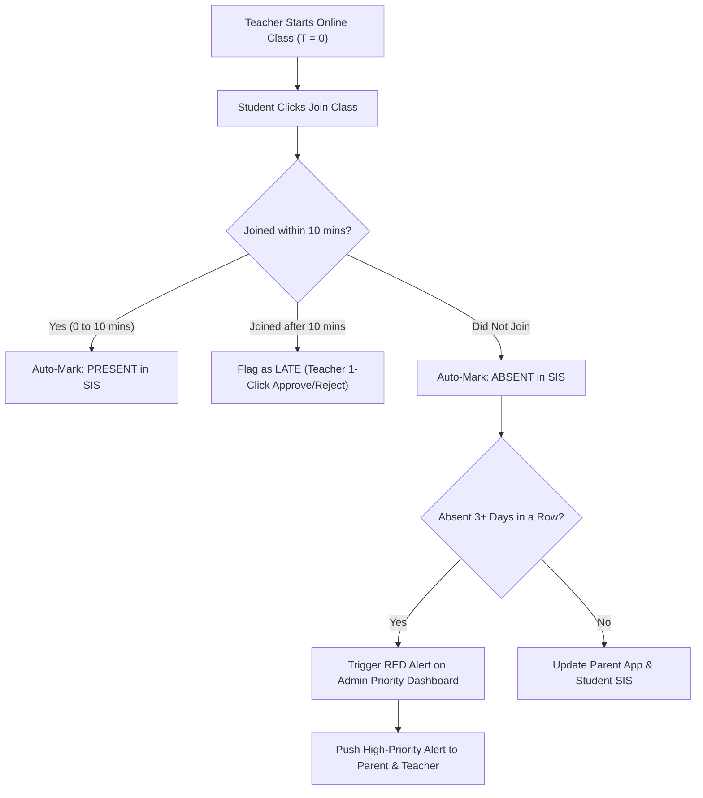
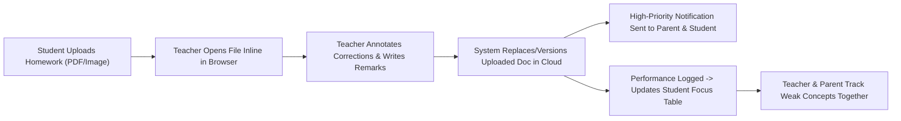
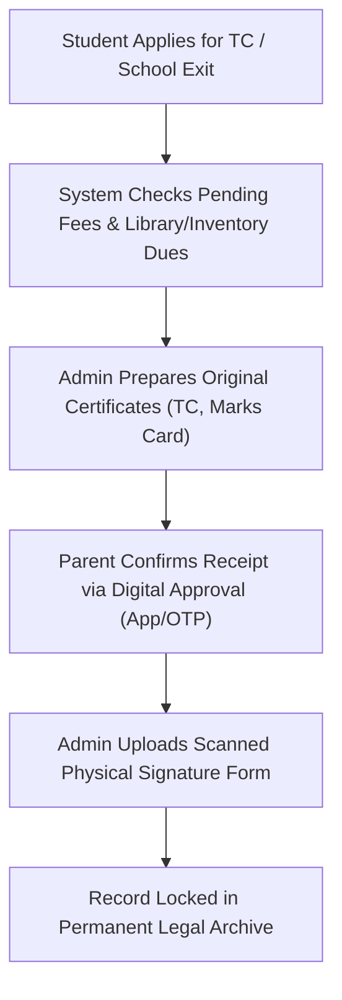

# Product Requirements Document (PRD): EDU360 (K–12 Edition)

**Document Version:** 1.0  
**Target Sector:** K–12 Education (Nursery to Class 12)  
**Platforms:** Web Application (Admin, Teachers, Students) & Mobile Application (Parents, Companion for Students/Teachers)  
**Prepared For:** Engineering, UI/UX Design, Product & QA Teams  

---

## 1. Executive Summary & Product Vision

### 1.1 What is EDU360?
**EDU360** is a next-generation **School Management & Student Outcomes Platform** built for K–12 schools. 

While traditional School ERPs act only as digital registers that store data and send repetitive alerts, **EDU360** acts as an **Action & Intelligence System**. It connects **Administration, Teachers, Parents, and Students** around three core principles:
1. **Actionable Management Intelligence:** Instead of forcing school leaders to search through dozens of reports, EDU360 highlights *what needs attention today, why it matters, and who needs to take action*.
2. **Outcome-Oriented Parent Involvement:** Instead of spamming parents with 15 notifications a day, EDU360 uses a clean moving-slider dashboard for routine updates and a shared **Student Focus Table** so teachers and parents can work together to improve a child's weak subjects.
3. **Zero Extra Burden for Teachers:** Automates routine work like online class attendance (via a 10-minute join rule) and allows teachers to correct and remark on homework directly inside the browser without downloading and re-uploading files.

---

## 2. Platform Strategy (Web vs. Mobile Usage)

Based on how school stakeholders actually work, EDU360 follows a **Role-Optimized Platform Strategy**:

| User Role | Primary Platform | Secondary Platform | Reason |
| :--- | :--- | :--- | :--- |
| **Administration / Management** | **Web App (Desktop/Laptop)** | Mobile Web / App (for quick alerts) | Needs large screens for priority triage, admissions CRM, fee tables, inventory, staff salaries, and event/vendor tracking. |
| **Teachers** | **Web App (Desktop/Tablet)** | Mobile App (for leave/quick chat) | Needs a comfortable screen to host live classes, annotate/correct student homework inline, and manage student Focus Tables. |
| **Students** | **Web App (Desktop/Tablet)** | Mobile App (for timetable/alerts) | Needs a larger screen to attend live online classes, watch class recordings, take online exams, and upload homework/achievements. |
| **Parents** | **Mobile App (Android & iOS)** | Web Portal (optional) | Parents check updates on the go—viewing moving dashboard banners, tracking the school bus via GPS, paying fees, and checking their child's Focus Table. |

---

## 3. User Roles & Permission Matrix

> [!IMPORTANT]
> **Strict Document Security Rule:** Official student documents in the Student Information System (SIS) can **ONLY** be uploaded, edited, or replaced by **Administration**. Teachers, Parents, and Students have **View/Download-Only** access.

| Module / Capability | Administration | Teacher | Parent | Student |
| :--- | :---: | :---: | :---: | :---: |
| **SIS Official Documents** | Create / Edit / Delete | View Only | View Only | View Only |
| **Student SIS Profile & Analytics** | Full Access | View Assigned Students | View Own Child | View Own Profile |
| **Live Online Classes & Recordings** | Monitor / View | Host / Record | View Schedule | Join Class / Watch Recordings |
| **Attendance** | Full Access + Override | Auto-Capture + Edit Class | View + Submit Leave | View Own Attendance |
| **Homework & Assignments** | View / Audit | Create + Inline Grade/Remark | View Remarks & Status | Upload Submission + View Corrected Doc |
| **Student "Focus Table"** | View All | Create / Edit / Track | View / Co-Track with Teacher | View Study Plan |
| **Exams & Marks** | Publish Results + Email Trigger | Enter / Bulk Upload Marks | View + Receive on Email | Attend Exam + View Results |
| **Fees & Receipts** | Set Milestones + Raise Alerts | View Status (Context Only) | Pay Online + Email Receipt | View Status |
| **Staff, Salaries & Vendors** | Full Access | View Own Profile / Apply Leave | No Access | No Access |
| **Inventory & School Assets** | Full Access | Request / View Assigned | No Access | No Access |
| **Events (Annual Day, etc.)** | Create + Assign Staff/Students/Vendors | View + Manage Assigned Tasks | View Event Banner & Child Role | View Event Banner & Assigned Tasks |
| **Entry/Exit & TC Clearance** | Full Control + Verify Signatures | No Access | Digital Sign-Off + Physical Sign | View Status |

---

## 4. Detailed Functional Requirements by Role

### 4.1 Role 1: Student Portal (Web-First)

1. **Live Class Dashboard & Recordings (LMS Layer)**
   * **Join Live Class:** A clean schedule showing today's classes with a **"Join Class"** button (powered by embedded video SDK like 100ms/LiveKit).
   * **Class Recordings:** Past recorded classes organized by Subject, Chapter, and Date so students can re-watch missed or difficult lessons anytime.
   * **Digital Study Material (LMS):** Access to syllabus, teacher-uploaded notes, and reference PDFs per subject.

2. **Student Information System (SIS - Global Profile)**
   * Acts as the single source of truth across all modules.
   * Displays personal details, academic results across terms, attendance percentage, leave history, and visual performance analytics charts.
   * **Document Vault (View-Only):** View and download official school documents (ID card, previous report cards, bonafide certificates).

3. **Attendance & Leave Tracking**
   * View daily and subject-wise attendance logs (Present, Absent, Late, Approved Leave) and monthly attendance percentage.

4. **Homework Module (Upload & Corrected View)**
   * View pending and completed homework by subject with due dates.
   * **Upload Homework:** Students can upload images or PDFs of their completed homework.
   * **View Teacher Corrections:** Once the teacher corrects the homework online, the student sees the **updated/annotated document** along with the teacher's remarks.

5. **Exams & Assignments (Online + Offline)**
   * **Online Mode:** Attend MCQ or descriptive timed tests/assignments directly in the portal.
   * **Offline Mode:** View exam schedules, syllabus, seating plans, and marks/grades once published.

6. **Participations & Achievements (Side-by-Side Portfolio)**
   * Designed as **two side-by-side sections** on the Student Dashboard:
     * **Left Section — Participations:** Lists all school events, sports, clubs, and competitions the student has participated in.
     * **Right Section — Achievements:** Students can upload certificates, medals, and awards they won (inside or outside school). Once verified by the teacher/admin, it becomes part of their permanent SIS portfolio.

7. **Timetable, Holidays & Transport**
   * **Timetable:** Weekly period-wise schedule and Student Focus Table view.
   * **Holidays:** Official school holiday list and academic calendar.
   * **Transport:** Displays the exact bus route number, pickup/drop stop name, timing, driver/attendant contact, and live route status.

---

### 4.2 Role 2: Teacher Portal (Web-First)

> [!TIP]
> **Design Rule for Engineers & Designers:** Every teacher screen must minimize typing and clicks. Teachers should never have to enter the same data twice.

1. **Teacher Dashboard & Profile**
   * Shows today's classes, pending homework submissions to check, student leave requests, own attendance/salary slip access, and assigned event duties.

2. **Live Class Host & 10-Minute Auto-Attendance Rule**
   * One-click **"Start Class"** button with automatic recording.
   * **Automatic Attendance Logic:**
     * When a live online class starts at time $T_0$, the system automatically tracks student join timestamps.
     * If a student joins between $T_0$ and $T_0 + 10\text{ minutes}$, the system **automatically marks the student Present**.
     * If a student joins after $T_0 + 10\text{ minutes}$, the system flags them as **Late** (teacher can approve or reject with 1 click).
     * If a student does not join, they are marked **Absent**.
   * For offline classroom sessions, all students default to *Present* so the teacher only taps the 2 or 3 absent students.

3. **Inline Homework Correction & Remarks Module**
   * Teachers see a queue of submitted student homework files.
   * Clicking a submission opens an **in-browser canvas/PDF annotator** (no need to download the file).
   * The teacher can draw tick marks, circle mistakes, type remarks, and click **"Save & Return"**.
   * The system overwrites/versions the uploaded homework document with the corrected copy and triggers a high-priority notification to the Parent and Student.

4. **Per-Student "Focus Table" (Shared Teacher–Parent Intervention Tool)**
   * Based on a student's exam marks, assignment scores, and class performance, the system helps generate a **personalized Focus Timetable** for that specific student.
   * Highlights *which subjects and specific concepts* the student needs extra time on during the week.
   * **Shared Access:** Visible on both the **Teacher Dashboard** and the **Parent App** so both can track if the student is improving in those weak areas.

5. **My Students List & 360° Student Access**
   * Complete list of students in the teacher's assigned sections.
   * Clicking any student opens their complete SIS dashboard (academic history, attendance trends, Focus Table, participations).

6. **Parental Connection Hub**
   * Direct chat/call trigger with a parent when a student's performance drops.
   * View student marks and fee status context before speaking with parents.
   * **Online PTM:** Schedule and host 1-on-1 online Parent-Teacher Meetings.
   * **Student Leave Approval:** Approve or reject student leave requests submitted by parents.

7. **Teacher Leave & Permission Requests**
   * **Leave Section:** Apply for casual/medical/paid leave.
   * **Short Permission Section:** Request approval from Management for late arrival, early departure, or on-duty movement.

---

### 4.3 Role 3: Parent Application (Mobile-First)

1. **Anti-Spam "Moving Slider" Home Dashboard**
   * **The Problem Solved:** Parents ignore school apps when they receive 10+ push notifications every day.
   * **How It Works:**
     * The top of the Parent App home screen features an interactive **Moving Banner Carousel (Sliders)**.
     * Routine announcements—such as *"Unit Test 2 Results Are Out"*, *"Annual Day in 7 Days"*, *"Sports Meet Registration Open"*, or *"Tomorrow is a Holiday"*—appear as visual slides.
     * Tapping any slide navigates the parent directly to that specific screen (e.g., tapping "Results Are Out" opens the child's Marks section).
     * Schools onboard parents with one simple rule: **open the app once a day to check the top banner.**

2. **High-Signal Notification Rules (Push vs. Email)**
   * **Mobile Push Notifications (Strictly Filtered):** Sent **ONLY** for critical matters:
     1. Direct Teacher Remarks on homework or behavior.
     2. Updates to the child's **Focus Table** (weak subject intervention).
     3. Absence alert / Emergency bus delay.
     4. Fee due alert raised by Admin.
   * **Automated Email Delivery:**
     1. Official Exam Marks / Report Cards (sent automatically as a clean PDF to the parent's email).
     2. Official Fee Payment Receipts (emailed immediately upon fee payment).

3. **5-Level Parent Involvement Experience**
   * **Level 1 (Visibility):** View child's SIS profile, daily attendance, timetable, and official documents.
   * **Level 2 (Communication):** Submit student leave requests, book/join online PTMs, message teachers directly.
   * **Level 3–5 (Participation, Intervention & Continuous Support):** Review and follow the child's **Focus Table** alongside the teacher, track homework corrections, and monitor progress in weak subjects over time.

4. **Fee Milestones & Online Payment**
   * View upcoming and completed fee milestones, pay online via UPI/Cards/NetBanking, and receive instant email + in-app receipts.

5. **Live Bus GPS Tracking**
   * Live map showing the child's assigned school bus moving along its route, estimated arrival time (ETA) at the stop, and driver contact details.

---

### 4.4 Role 4: Administration / Management Portal (Web-First — Super Admin)

1. **Priority Triage Command Center (🔴 / 🟠 / 🟢 Daily Action Engine)**
   * **Core Differentiator:** Instead of showing static charts, the top of the Management Dashboard answers: **"What do we need to solve first today, why, and who should act?"**
   * **Example Triage Cards:**
     * 🔴 **Red (Urgent Action Required):**
       * *Attendance:* "20 students absent today; **5 students absent for 3+ consecutive days**." $\rightarrow$ *[Action Button: Assign Class Teacher to Call Parents]*
       * *Academics:* "**Class 8 Maths average marks dropped by 18%** in Unit Test 2." $\rightarrow$ *[Action Button: Schedule Review with Maths Teacher]*
     * 🟠 **Orange (Operational Follow-Up Needed):**
       * *Fees:* "**30 students have overdue Fee Milestone 2**." $\rightarrow$ *[Action Button: Send Fee Reminder Notification & Assign Tele-caller]*
       * *Operations:* "**2 School Buses (Route 4 & Route 7) are not reporting GPS** for the last 15 minutes." $\rightarrow$ *[Action Button: Contact Transport Supervisor]*
     * 🟢 **Green (Scheduled Tasks & Deadlines):**
       * Displays today's scheduled administrative tasks and upcoming deadlines.

2. **Admin Task Manager (Urgent & Upcoming Tasks)**
   * Two dedicated widgets on the Admin Dashboard:
     1. **Urgent Tasks:** High-priority items due today/tomorrow.
     2. **Upcoming Tasks:** Scheduled operational tasks.
   * Admin can add new tasks, set a deadline, assign them to specific staff members, and track completion status.

3. **Admissions & Enquiry CRM (Chatbot + Human Follow-Up)**
   * **Hybrid Enquiry Capture:** An AI Chatbot answers common parent questions (fee range, curriculum, bus routes, age criteria) 24/7 and hands over interested parents to a human admission counselor.
   * **Follow-Up Call Tracker:** Logs every interested admission lead, schedules follow-up calls for the admission team, records call notes ("Interested", "Callback requested", "Campus visit booked"), and converts leads into SIS student profiles in 1 click.

4. **Fee Milestone Management & Automated Receipts**
   * Define fee structures and installment milestones per class/student.
   * Raise targeted fee notifications to parents with pending dues.
   * Automatically generate and email digital receipts to parents as soon as any fee milestone is paid.

5. **SIS & Strict Document Control**
   * Full control over all student records.
   * **Exclusive Document Edit Rights:** Only Administration can upload, update, or delete official documents inside a student's SIS vault. All other roles have strictly read-only access.

6. **Entry, Exit & Legal TC Clearance Module**
   * **Gate Entry/Exit Logs:** Track visitors, vendors, and late entries/early exits.
   * **Student Exit & Certificate Handover (Zero-Dispute Workflow):**
     * When a student leaves the school (TC / graduation / transfer), Admin initiates the **Exit Clearance Checklist** (Fee dues cleared, library/inventory returned, Original TC + Marks Memo + Bonafide ready).
     * **Dual Verification (Digital + Physical):**
       1. Parent gives **Digital Approval** (in-app sign-off / OTP confirmation confirming *"I have received all original certificates in good condition"*).
       2. Admin uploads a photo/scan of the **Physical Signature** on the handover register.
     * Both proofs are permanently locked in the archive so the school faces zero future legal or documentation complications.

7. **Complete Staff & Vendor Management**
   * Unified directory and individual dashboards for **Teaching Staff, Non-Teaching Staff, Drivers, and External Vendors**.
   * Manage staff salaries/payroll, daily attendance, approve teacher leave/short-permission requests, and view assigned classes or operational tasks.

8. **Inventory & Asset Management**
   * Track all school inventory across categories: **Books, Lab Equipment, Sports Gear, IT Hardware, and Classroom Resources**.
   * Monitor total stock, issued/assigned items, damaged items, and reorder alerts.

9. **Transparent Event & Vendor Command Center (e.g., Annual Day, Sports Day)**
   * When an upcoming school event is created:
     * **Global Visibility:** Appears on the moving banner/dashboard of Students, Teachers, Parents, and Admin.
     * **Staff & Student Task Hierarchy:** Clearly displays which Staff members are assigned to which event committees/tasks (e.g., Stage Decoration, Discipline, Cultural Dance), and **which Students are assigned under each Staff member**.
     * **Event Equipment & Vendor Handover Tracker:**
       * Lists all equipment required for the event (e.g., Sound System, LED Wall, 500 Chairs, Tents).
       * Links the assigned **Vendor's contact details** and contract terms.
       * Tracks **Handover Timestamps** (*Exact date & time the vendor delivered/handed over the equipment to the school* and *when it was returned after the event*).

---

## 5. Key System Workflows (Cross-Role Connections)

### 5.1 Online Class Auto-Attendance & Consecutive Absence Triage

### 5.2 Homework Submission, Inline Correction & Focus Table Flow

### 5.3 Student Exit & Dual-Signature Clearance Flow

---

## 6. UI/UX Screen Checklist (What Designers Need to Create in Figma)

### A. Web Application Screens (Desktop / Tablet Layout)
1. **Common:** Login / Role Switcher, Global Search, Notification Drawer.
2. **Admin Screens:**
   * **Priority Command Center (Home):** 🔴/🟠/🟢 Triage Cards + Urgent & Upcoming Task Widgets + Moving Event Banner.
   * **Admissions CRM:** Chatbot Transcript Viewer, Enquiry Pipeline table, Follow-up Call Logger.
   * **SIS & Document Vault:** Student Directory, 360° Student Profile, Document Manager (with Admin Edit lock).
   * **Fee Management:** Milestone Configurator, Defaulters List, 1-Click Reminder Trigger, Receipt Logs.
   * **Staff & Vendor Hub:** Staff Directory, Payroll/Salary View, Leave & Short-Permission Approval Queue, Vendor Directory.
   * **Inventory Manager:** Stock Dashboard (Books, Equipment, Resources), Issue/Return Log.
   * **Event Command Center:** Event Creator, Staff-to-Student Assignment Tree, Equipment & Vendor Handover Timestamp Tracker.
   * **Entry/Exit & TC Clearance:** Gate Log, Student Exit Checklist, Dual-Signature (Digital + Physical Scan) Upload Modal.
3. **Teacher Screens:**
   * **Teacher Home Dashboard:** Today's Classes, Pending Homework Queue, Leave/Permission Request Form.
   * **Live Class Studio:** Video Classroom View + Auto-Attendance Roster (showing join times & 10-min rule status).
   * **Inline Homework Grader:** Split-screen view with Student Document Canvas (draw/remark tools) on the left and Grading/Remarks panel on the right.
   * **Student 360 & Focus Table Builder:** Student Analytics view + interactive Weekly Focus Timetable editor shared with Parents.
   * **Parent Connection Hub:** Chat window, Online PTM scheduler, Student Leave Approval list.
4. **Student Screens:**
   * **Student Home Dashboard:** Moving Event Banner, Today's Live Classes, Quick Attendance/Exam summary.
   * **Classroom & LMS:** Live Class Join screen, Recorded Classes Video Library, Subject Notes.
   * **Homework & Exams:** Homework Upload modal, Corrected Homework Viewer, Online Exam/Quiz interface.
   * **SIS & Portfolio:** Personal Analytics, View-Only Document Vault, **Side-by-Side Participations & Achievements Upload** screen.

### B. Mobile Application Screens (Parent-First — Android & iOS)
1. **Parent Home Screen:** **Top Moving Banner Carousel (Sliders)** + Child Quick Summary (Attendance %, Next Fee Milestone, Bus Status) + Event Card.
2. **Focus Table & Remarks Screen:** Shared Teacher-Parent Focus Timetable + Corrected Homework Viewer with Teacher Remarks.
3. **Live Bus Tracker Screen:** Google Map view with live bus pin, route stops, and driver call button.
4. **SIS & Documents Screen:** View-only child profile, academic graphs, and downloadable documents.
5. **Fees & Receipts Screen:** Milestone payment screen (UPI/Card) + Email receipt history.
6. **Communication & Exit Screen:** Leave application form, Teacher chat/PTM join button, and Digital Certificate Receipt Approval screen.

---

## 7. Recommended Technology Stack & Architecture

| Layer | Technology | Why We Chose It for EDU360 |
| :--- | :--- | :--- |
| **Web Frontend** | **Next.js (React) + TypeScript + Tailwind CSS** | Fast, clean, desktop-grade dashboards for Admin, Teachers, and Students. |
| **Mobile App** | **React Native (Expo) + TypeScript** | Builds both **Android and iOS** apps from one codebase and shares API types and logic with the web app. |
| **Unified Single Backend** | **Python (FastAPI)** | **Unified Core + AI Engine.** One high-performance, asynchronous Python backend handles all SIS, Fees, Attendance, and Events APIs while executing native AI/analytics (Priority Triage, Focus Tables, Admissions Chatbot) in-process without microservice overhead. |
| **Primary Database** | **PostgreSQL (with Async SQLAlchemy 2.0)** | Relational database that guarantees 100% ACID accuracy across linked student, parent, fee, and inventory records, with strict role-based security. |
| **Cache & Background Jobs** | **Redis + ARQ (or Celery)** | Handles live Bus GPS location updates every few seconds and runs scheduled background jobs (consecutive absence checks, Focus Table generation, auto-emails). |
| **File & Recording Storage** | **Cloudflare R2 (or AWS S3)** | Stores student homework uploads, corrected PDFs, achievement certificates, and class recordings cheaply with zero download bandwidth fees. |
| **Inline PDF/Doc Grading** | **PDF.js + Fabric.js (HTML5 Canvas)** | Lets teachers draw corrections and write remarks directly on uploaded homework inside the browser and save the updated file. |
| **Live Classes & Recordings** | **100ms SDK or LiveKit** | Provides embedded live video classes, automatic cloud recording, and exact student join/leave webhooks for the **10-minute auto-attendance rule**. |
| **Notifications & Emails** | **Firebase (FCM) + Resend / AWS SES** | FCM sends free high-priority push notifications to the Parent App; Resend/SES emails automated PDF fee receipts and report cards. |
| **Maps & GPS** | **Google Maps SDK** | Renders live school bus routes and stops on the Parent App and Admin Dashboard. |

---

## 8. Phased Development Roadmap (How the Team Should Build It)

To deliver fast without bugs, the engineering and design teams should build EDU360 in **3 focused milestones**:

### Milestone 1: Core Foundation, SIS & Admin Control (Weeks 1–5)
* Authentication & Role-Based Access Control (Admin, Teacher, Parent, Student).
* Central Student Information System (SIS) + **Admin-only Document Vault lock**.
* Admissions Enquiry CRM (Lead logging + Follow-up call tracker) & Fee Milestones with **automated email PDF receipts**.
* Staff, Salary, Inventory, and Gate/TC Exit Clearance (with Digital + Physical signature upload).

### Milestone 2: Classroom, Homework Grading & Parent App (Weeks 6–10)
* Live Online Class integration + Recordings Library + **10-minute Auto-Attendance rule**.
* Student Homework Upload + **Teacher Inline Homework Correction & Remark Canvas**.
* Student **Side-by-Side Participations & Achievements** module.
* Parent Mobile App with **Moving Slider Banners**, Filtered Push Notifications, Leave Requests, and **Event + Vendor Handover Command Center**.

### Milestone 3: Intelligence Layer & Live GPS (Weeks 11–14)
* **Admin 🔴/🟠/🟢 Priority Triage Engine** + Urgent/Upcoming Task Manager.
* **Per-Student "Focus Table"** generator shared between Teacher and Parent.
* Admissions AI Chatbot integration + Live Bus GPS Route Tracking.
* End-to-end QA testing, security audit, and pilot school deployment.
