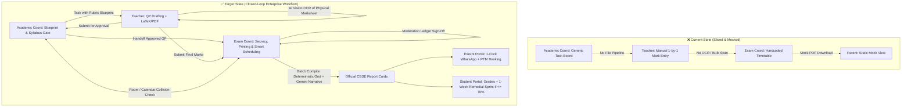
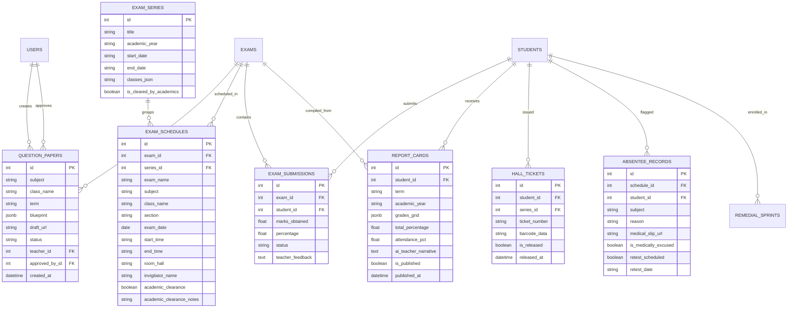

# EDU360: End-to-End Examination, Academic & Remedial Workflow Implementation Plan

> **Specification Version**: 2.0 (Comprehensive Plan with Live Application Gap Audit)  
> **Target Release**: EDU360 Sprint 5  
> **Authors & Council**: Software Architect, Trend Researcher, Workflow Architect, Workflow Optimizer, Database Optimizer, UX Researcher, UI Designer  
> **Impacted Systems**: 
> - [`frontend/src/app/academic_coordinator/page.tsx`](file:///e:/Diradz/EDU360/frontend/src/app/academic_coordinator/page.tsx)
> - [`frontend/src/app/teacher/page.tsx`](file:///e:/Diradz/EDU360/frontend/src/app/teacher/page.tsx)
> - [`frontend/src/app/exam_coordinator/page.tsx`](file:///e:/Diradz/EDU360/frontend/src/app/exam_coordinator/page.tsx)
> - [`frontend/src/app/student/page.tsx`](file:///e:/Diradz/EDU360/frontend/src/app/student/page.tsx)
> - [`frontend/src/app/parent/page.tsx`](file:///e:/Diradz/EDU360/frontend/src/app/parent/page.tsx)
> - [`backend/app/models/models.py`](file:///e:/Diradz/EDU360/backend/app/models/models.py)
> - [`backend/app/routers/exams.py`](file:///e:/Diradz/EDU360/backend/app/routers/exams.py)
> - [`backend/app/routers/admin.py`](file:///e:/Diradz/EDU360/backend/app/routers/admin.py)
> - [`backend/app/services/ai_analytics.py`](file:///e:/Diradz/EDU360/backend/app/services/ai_analytics.py)

---

## 1. Executive Summary & Problem Diagnosis

### 1.1 The Operational Gap
In modern K–12 schools (CBSE, ICSE, International Baccalaureate), examination cycles are **not isolated tasks**; they form a tightly coupled collaborative loop between:
1. **Academic Leadership**: Curricular pacing, blueprinting, Bloom's taxonomy balance, and syllabus deadline enforcement.
2. **Faculty (Teachers)**: Question paper authorship, rubrics, paper evaluation, and marks entry.
3. **Examination Cell**: Timetable conflict resolution, invigilation rosters, paper secrecy, grade moderation, board LOC filings, and report card compilation.
4. **Students & Parents**: Timely schedule visibility, transparent report cards, and targeted remediation.

### 1.2 Current State vs. Target State



### 1.3 Live Application Gap Audit (Discrepancies on Current Screen)

A forensic check of the live application (`http://localhost:3000/exam_coordinator` and backend `exams.py`) identified four specific gaps currently visible in the UI:

1. **Secrecy Vault Data Mismatch**:
   * *Problem*: In `frontend/src/app/exam_coordinator/page.tsx`, the Question Paper cards render `TOTAL MARKS: Marks` (no number) and `DURATION: Mins` (no number) because the backend stores marks in a nested JSON blueprint `p.blueprint = { total_marks: 80, duration_minutes: 180 }`, while frontend reads `qp.total_marks` directly on the root object.
   * *Fix*: Parse blueprint directly: `{qp.blueprint?.total_marks || qp.total_marks || 80} Marks` and display actual teacher name.
   * *Filtering Fix*: Filter out `draft` and `under_review` papers; the Secrecy Vault must only display papers officially handed over (`sent_to_exam_cell`).
2. **Top Header Button Placement Glitch**:
   * *Problem*: `[Export Moderation CSV]`, `[Print Official Dossier]`, and `[+ Delegate Exam Task]` sit in the global outer header, making moderation buttons clutter every tab.
   * *Fix*: Move CSV and Dossier print buttons strictly into Tab 4 (Marks Verification / Moderation).
3. **1-by-1 Scheduling Bottleneck**:
   * *Problem*: Scheduling forces entering 1 subject for 1 section at a time. For 3 classes with 6 exams each (18 exams), the user must fill out the form 18 times.
   * *Fix*: Class-wise batch timetable scheduler: pick a class (e.g. Class 8), select exam series (e.g. Term 1 Final), and enter all 5–6 subject dates together in one unified screen.
4. **Moderation Ledger Disconnected from Database**:
   * *Problem*: Tab 4 currently uses a hardcoded JavaScript array (`moderationList`).
   * *Fix*: Connect to live database submissions: displays real class completion (e.g. `Class 8-B Math: 38/38 Marks Submitted ✓`), flags missing entries, and provides 1-click **"Lock Gradebook"** to enable report card generation.

---

## 2. Cross-Role Architectural Specifications

### 2.1 Role 1: Academic Coordinator (`/academic_coordinator`)
* **Mission**: Ensure high pedagogical standards and prevent exam dates from encroaching on required instructional teaching days.
* **Dedicated Capabilities**:
  1. **Question Paper Governance Board (`tab: 'paper_blueprints'`)**:
     * Button: `Order Question Paper from Department Head / Faculty`.
     * Fields: Subject, Grade/Section, Term (e.g. Mid-Term 1), Syllabus Units Covered, Bloom's Distribution (Knowledge 40%, Application 40%, Higher Order Thinking 20%), Max Marks, and Deadline.
     * Review Drawer: View draft uploaded by Teacher, approve with digital signature stamp or request rework with inline comments.
  2. **Academic Calendar Sync Gate (`tab: 'calendar_clearance'`)**:
     * Receives timetable drafts submitted by the Exam Coordinator.
     * Automatically validates against syllabus completion pacing (e.g. flags: *"Class 9 Math syllabus is only 62% complete; scheduling exam on Oct 28 leaves Chapter 5 uncovered"*).
     * 1-Click "Approve Schedule for Exam Cell Execution".

### 2.2 Role 2: Teacher Portal (`/teacher`)
* **Mission**: Draft rigorous question papers with marking rubrics and evaluate student answer books without burdensome manual clerical data entry.
* **Dedicated Capabilities**:
  1. **Assigned Question Paper Queue (Under `tab: 'duties'` or `tab: 'exams_gradebook'`)**:
     * View Blueprint specifications dispatched by Academic Coordinator.
     * Upload Question Paper Draft (PDF/Doc) + Optional Answer Key.
     * Live status indicator: `Draft` $\to$ `Under Academic Review` $\to$ `Approved & Handed to Secrecy Cell`.
  2. **AI Marksheet & Answer Register OCR Scanner**:
     * Teacher clicks **"AI Scan Physical Marks Register / Answer Booklet"**.
     * Gemini Vision model extracts tabular data: `[{ roll_no, student_name, marks_obtained, feedback_summary }]`.
     * Interactive split review table: high confidence ($>95\%$) in green; uncertain numbers in amber for teacher confirmation.
     * One-click **"Commit to Gradebook"**.
  3. **Offline Excel/CSV Marks Download & Upload**:
     * Download pre-formatted spreadsheet template with student roster and roll numbers.
     * Teacher fills marks offline and uploads back with instant auto-validation.
  4. **Auto-Trigger to Focus Table**:
     * Students with final marks $\le 70\%$ automatically trigger `MarksPublishedEvent` and populate the 7-Day Remedial Focus Table.

### 2.3 Role 3: Exam Coordinator (`/exam_coordinator`)
* **Mission**: Maintain exam secrecy, optimize exam halls/invigilation, conduct statistical grade moderation, and publish official board-standard report cards.
* **Dedicated Capabilities**:
  1. **Operations & Attendance Check-in (`tab: 'tasks'`)**:
     * Class-scoped task view with invigilation rosters and emergency relief reassignment.
     * Attendance headcount entry (`Registered | Present | Absent`) directly feeding the absentee reconciliation desk.
  2. **Secrecy & Confidential Printing Vault (`tab: 'secrecy_vault'`)**:
     * Displays only papers handed over by Academic Coordinator (`sent_to_exam_cell`).
     * Real blueprint metadata parsed: total marks, duration, teacher name, and draft file link.
     * Removed mandatory answer-key gating for internal school exams where subject teachers grade their own sections.
     * Hall Printing Packet Calculator: auto-computes copies (`38 students + 2 buffer = 40 copies`) with printable envelope labels and barcodes.
  3. **Class-Wise Batch Timetable Scheduler (`tab: 'schedules'`)**:
     * Replaces 1-by-1 single-slot creation with a multi-subject class scheduler.
     * Select Class (e.g. `Class 8`), Exam Series (`Term 1 Final 2026`), and add all 5–6 subject dates simultaneously in one screen.
     * Handoff button: "Send Schedule to Academic Coordinator for Calendar Clearance".
  4. **Marks Submission Checklist & Ledger Lock (`tab: 'moderation'`)**:
     * Replaces abstract bell curves with a live submission checklist (e.g. `Class 8-B Math: 38/38 Marks Submitted ✓`, `Class 8-B Science: 35/38 — 3 Pending`).
     * `[Export Moderation CSV]` and `[Print Official Dossier]` placed strictly in this tab.
     * 1-Click **"Lock & Seal Gradebook"** to enable report card generation.
  5. **Batch Report Card Generation Engine (`tab: 'report_cards'`)**:
     * Hybrid Deterministic Engine + Gemini AI Pedagogical Synthesizer.
     * Deterministic CBSE grid: Theory + Practical marks, total percentage, and CBSE grade scale (A1, A2, B1, etc.).
     * Gemini AI Pedagogical Review: 3-sentence development narrative analyzing performance, attendance, and remedial trajectory.
     * One-click "Publish to Student & Parent Portals".
  6. **Digital Hall Ticket / Admit Card Generator**:
     * 1-Click generation of official digital admit cards once exam series is cleared by Academics.
  7. **Absentee & Medical Retest Reconciliation**:
     * Displays absent students, checks doctor note / parent leave application, and schedules supplementary exams.

### 2.4 Role 4: Student Portal (`/student`)
* **Mission**: Clear visibility of exam schedules, hall tickets, report cards, and targeted remediation.
* **Connected Capabilities**:
  * **Exam Schedule & Digital Hall Pass**: Download official Admit Card with photo, roll number, timetable, and hall assignment.
  * **Digital Report Card Viewer**: View and download official Term Report Card with school seal and AI growth feedback.
  * **Direct Remedial Transition**: If student scored $\le 70\%$ in any subject, active 7-Day Remedial Sprint displays beneath the report card.

### 2.5 Role 5: Parent Portal (`/parent`)
* **Mission**: Frictionless access to student assessment outcomes without anxiety, accompanied by actionable next steps.
* **Connected Capabilities**:
  * **Instant Result Push Notification**: Alert sent via portal and simulated WhatsApp notification.
  * **Interactive Report Card & Admit Card**: Transparent view of subject breakdown, exam timetable, and teacher's AI growth narrative.
  * **Remedial Accountability & 1-Click PTM**: Daily practice progress and direct 1-on-1 PTM slot booking.

### 2.6 Explicit Dropped Scope (To Prevent Feature Bloat)
* ❌ **Zig-Zag Seating Matrix**: Dropped. Standard hall allocation is sufficient for K–12 internal assessments.
* ❌ **Re-Evaluation Dispute Workflow**: Dropped. Unnecessary administrative overhead for school exams.
* ❌ **Question Psychometrics / Distractor Analysis**: Dropped. College/board-level psychometrics not relevant for school workflow.
* ❌ **Paper Leak Emergency Protocol**: Dropped. Redundant for digital and on-premises school tests.

---

## 3. Database Schema Architecture (PostgreSQL & SQLite)



### 3.1 Migration DDL Definitions

```sql
-- 1. Question Paper Lifecycle
CREATE TABLE IF NOT EXISTS question_papers (
    id SERIAL PRIMARY KEY,
    title VARCHAR(150) NOT NULL,
    subject VARCHAR(50) NOT NULL,
    class_name VARCHAR(20) NOT NULL,
    section VARCHAR(10) DEFAULT 'All',
    term VARCHAR(50) NOT NULL,
    blueprint_json JSONB NOT NULL,
    draft_file_url TEXT,
    draft_file_name VARCHAR(255),
    answer_key_url TEXT,
    status VARCHAR(30) DEFAULT 'draft' CHECK (status IN ('draft', 'under_review', 'revision_requested', 'approved', 'sent_to_exam_cell')),
    revision_notes TEXT,
    created_by_teacher_id INT NOT NULL REFERENCES users(id),
    reviewed_by_academic_id INT REFERENCES users(id),
    handed_over_at TIMESTAMPTZ,
    created_at TIMESTAMPTZ DEFAULT NOW(),
    updated_at TIMESTAMPTZ DEFAULT NOW()
);
CREATE INDEX IF NOT EXISTS idx_qp_status ON question_papers(status);
CREATE INDEX IF NOT EXISTS idx_qp_class_subject ON question_papers(class_name, subject);

-- 2. Exam Series & Multi-Exam Schedules
CREATE TABLE IF NOT EXISTS exam_series (
    id SERIAL PRIMARY KEY,
    title VARCHAR(100) NOT NULL,
    academic_year VARCHAR(20) DEFAULT '2025-2026',
    start_date VARCHAR(20) NOT NULL,
    end_date VARCHAR(20) NOT NULL,
    classes_json TEXT NOT NULL,
    is_cleared_by_academics BOOLEAN DEFAULT FALSE,
    created_at TIMESTAMPTZ DEFAULT NOW()
);

CREATE TABLE IF NOT EXISTS exam_schedules (
    id SERIAL PRIMARY KEY,
    series_id INT REFERENCES exam_series(id) ON DELETE SET NULL,
    exam_id INT REFERENCES exams(id) ON DELETE CASCADE,
    title VARCHAR(150) NOT NULL,
    subject VARCHAR(50) NOT NULL,
    class_name VARCHAR(50) NOT NULL,
    section VARCHAR(10) DEFAULT 'B',
    exam_date VARCHAR(30) NOT NULL,
    start_time VARCHAR(20) DEFAULT '09:00 AM',
    end_time VARCHAR(20) DEFAULT '12:00 PM',
    room_hall VARCHAR(100) NOT NULL,
    invigilator_name VARCHAR(100),
    academic_clearance BOOLEAN DEFAULT FALSE,
    academic_clearance_notes TEXT,
    created_at TIMESTAMPTZ DEFAULT NOW()
);
CREATE INDEX IF NOT EXISTS idx_sched_date ON exam_schedules(exam_date);
CREATE INDEX IF NOT EXISTS idx_sched_class ON exam_schedules(class_name);

-- 3. Digital Hall Tickets
CREATE TABLE IF NOT EXISTS hall_tickets (
    id SERIAL PRIMARY KEY,
    student_id INT NOT NULL REFERENCES students(id) ON DELETE CASCADE,
    series_id INT REFERENCES exam_series(id) ON DELETE CASCADE,
    ticket_number VARCHAR(50) UNIQUE NOT NULL,
    barcode_data VARCHAR(100) NOT NULL,
    is_released BOOLEAN DEFAULT FALSE,
    released_at TIMESTAMPTZ,
    created_at TIMESTAMPTZ DEFAULT NOW()
);

-- 4. Absentee & Medical Retest Records
CREATE TABLE IF NOT EXISTS absentee_records (
    id SERIAL PRIMARY KEY,
    schedule_id INT NOT NULL REFERENCES exam_schedules(id) ON DELETE CASCADE,
    student_id INT NOT NULL REFERENCES students(id) ON DELETE CASCADE,
    subject VARCHAR(50) NOT NULL,
    reason VARCHAR(100) DEFAULT 'Unexcused Absence',
    medical_slip_url VARCHAR(255),
    is_medically_excused BOOLEAN DEFAULT FALSE,
    retest_scheduled BOOLEAN DEFAULT FALSE,
    retest_date VARCHAR(20),
    created_at TIMESTAMPTZ DEFAULT NOW()
);

-- 5. Consolidated Term Report Cards
CREATE TABLE IF NOT EXISTS report_cards (
    id SERIAL PRIMARY KEY,
    student_id INT NOT NULL REFERENCES students(id) ON DELETE CASCADE,
    term VARCHAR(50) NOT NULL,
    academic_year VARCHAR(20) DEFAULT '2025-2026',
    grades_grid_json JSONB NOT NULL,
    total_marks_obtained FLOAT NOT NULL,
    max_total_marks FLOAT NOT NULL,
    overall_percentage FLOAT NOT NULL,
    overall_grade VARCHAR(10) NOT NULL,
    attendance_pct FLOAT NOT NULL,
    ai_teacher_narrative TEXT NOT NULL,
    is_moderated BOOLEAN DEFAULT FALSE,
    is_published BOOLEAN DEFAULT FALSE,
    published_at TIMESTAMPTZ,
    created_at TIMESTAMPTZ DEFAULT NOW()
);
CREATE UNIQUE INDEX IF NOT EXISTS uq_student_term_report ON report_cards(student_id, term, academic_year);
CREATE INDEX IF NOT EXISTS idx_rc_published ON report_cards(is_published);
```

---

## 4. API Endpoints Contract Specification

### 4.1 Question Paper & Handoff Endpoints (`/api/exams/question-papers`)
* `POST /api/exams/question-papers/order`: Academic Coordinator dispatches blueprint task to teacher.
* `GET /api/exams/question-papers`: List papers (returns blueprint metadata unpacked: `total_marks`, `duration_minutes`, `teacher_name`).
* `POST /api/exams/question-papers/{id}/submit-draft`: Teacher submits draft PDF.
* `POST /api/exams/question-papers/{id}/review`: Academic Coordinator approves or requests revision.
* `POST /api/exams/question-papers/{id}/handoff`: Hands over approved paper to Exam Coordinator strongroom.

### 4.2 Timetable & Class-Wise Batch Scheduling (`/api/exams/schedules`)
* `GET /api/exams/schedules`: List schedules filtered by class or series.
* `POST /api/exams/schedules/batch-class`: Schedules all exams for a selected class in one atomic request:
  ```json
  {
    "class_name": "Class 8",
    "series_name": "Term 1 Final 2026",
    "slots": [
      { "subject": "English", "exam_date": "2026-11-03", "start_time": "09:00 AM", "end_time": "12:00 PM", "room_hall": "Hall A", "invigilator_name": "Mrs. Sunitha Rao" },
      { "subject": "Mathematics", "exam_date": "2026-11-05", "start_time": "09:00 AM", "end_time": "12:00 PM", "room_hall": "Hall A", "invigilator_name": "Dr. K. Raman" }
    ]
  }
  ```
* `POST /api/exams/schedules/{id}/clearance`: Academic Coordinator calendar clearance approval.

### 4.3 AI Marksheet Scanning & Offline Excel Ledger (`/api/exams/{id}`)
* `POST /api/exams/{id}/ocr-scan`: Gemini Vision OCR parses handwritten marksheet photo and returns confidence scores.
* `GET /api/exams/{id}/marks-template`: Downloads pre-formatted CSV/Excel template with student roll numbers and names.
* `POST /api/exams/{id}/upload-marks-csv`: Bulk upload of completed spreadsheet, validating marks and updating gradebook.
* `POST /api/exams/{id}/batch-grade-commit`: Commits verified scores into `exam_submissions`.

### 4.4 Hall Tickets & Absentee Retest Endpoints
* `POST /api/exams/hall-tickets/release`: Exam Coordinator releases digital admit cards for cleared series.
* `GET /api/exams/hall-tickets/student/{student_id}`: Fetches student admit card for Student/Parent portals.
* `GET /api/exams/absentees`: Returns absentees cross-referenced with parent medical leaves.
* `POST /api/exams/absentees/{id}/schedule-retest`: Sets supplementary exam date and notifies parent.

### 4.5 Report Card Generation & Publication (`/api/exams/report-cards`)
* `POST /api/exams/report-cards/generate-batch`: Compiles deterministic CBSE marks grid + Gemini AI growth commentary per student.
* `POST /api/exams/report-cards/publish-batch`: Sets `is_published = TRUE`, dispatching alerts to Student and Parent portals.

---

## 5. UI/UX Component Blueprint

### 5.1 Exam Coordinator UI Refactoring (`exam_coordinator/page.tsx`)
1. **Outer Header Cleanup**:
   - Removed `[Export Moderation CSV]` and `[Print Official Dossier]` from lines 376–390.
   - Replaced with clean context: `Term 1 Final 2026` and `[➕ Schedule Exams for Class]`.
2. **Secrecy Vault Card Bug Fix**:
   - Fixed rendering so `total_marks` displays `80 Marks`, `duration` displays `180 Mins`, and teacher name displays properly.
   - Filtered view to only show `sent_to_exam_cell` papers.
3. **Class-Wise Batch Scheduling Modal**:
   - User picks Class (`Class 8`) and Series (`Term 1 Final`).
   - Single grid allows adding all 5–6 subjects with dates, times, and hall assignments in one step.
4. **Marks Verification Checklist (Tab 4)**:
   - Live database table showing: Subject, Class, Evaluated Count (`38 / 38 Submitted ✓`), and Missing Marks count.
   - `[Export Moderation CSV]` and `[Print Official Dossier]` placed right here in the toolbar.
   - 1-Click `[Lock & Seal Gradebook]`.

### 5.2 Student & Parent Admit Card Modal
* Accessible via `"🎟️ Download Official Admit Card"` in `/student` and `/parent`.
* Displays school crest, affiliation, student photograph, barcode, cleared exam dates, hall assignment, and reporting instructions.

---

## 6. Implementation Phasing & Milestones

| Phase | Milestone | Scope & Deliverables | Verification Gates |
| :---: | :--- | :--- | :--- |
| **Phase 1** | **UI Glitch Fixes & Secrecy Vault** | Move header buttons to Tab 4 only; fix `total_marks`/`duration`/teacher data rendering in Secrecy Vault; filter out drafts from strongroom. | Secrecy Vault cards show real numbers (`80 Marks`, `180 Mins`); header buttons only show in Tab 4. |
| **Phase 2** | **Class-Wise Batch Timetable Scheduler** | Implement `POST /api/exams/schedules/batch-class` and multi-row class scheduling modal in Exam Coordinator. | User selects Class 8 and schedules all 5 subjects at once; schedules reflect in Academic Coordinator clearance tab. |
| **Phase 3** | **Live Marks Submission Tracker & Ledger Lock** | Replace mock array in Tab 4 with live submission query from database; add 1-click Lock Gradebook action. | Coordinator sees live count of teacher submissions (e.g. 38/38) and locks ledger for report card compilation. |
| **Phase 4** | **Digital Hall Ticket / Admit Card** | Implement Hall Ticket generation and downloadable Admit Card modal in Student and Parent portals. | Student Aarav Sharma can view and print his official Term 1 Admit Card with exam dates and hall info. |
| **Phase 5** | **Absentee & Medical Retest Flow** | Implement absentee reconciliation table, linking doctor notes from parent leave requests and scheduling re-tests. | Absentees with medical slips are flagged as excused; supplementary slot scheduled with 1 click. |
| **Phase 6** | **Offline Excel/CSV Marks Download & Upload** | Add 1-click Download Pre-Formatted Template and Upload Completed Marks Spreadsheet with validation. | Teacher downloads roster CSV, edits marks offline, uploads back, and grades commit to gradebook. |
