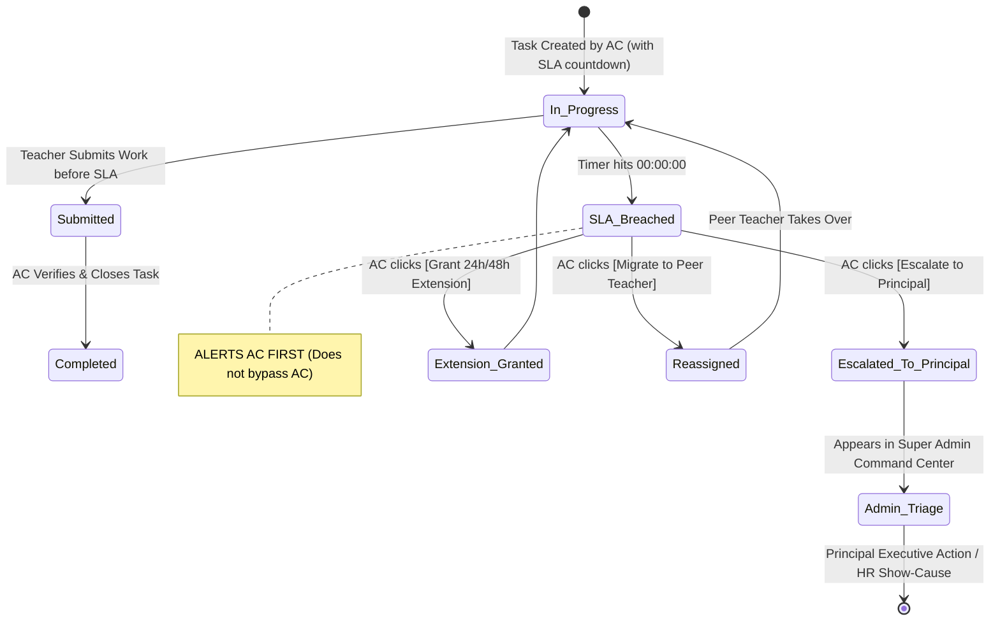
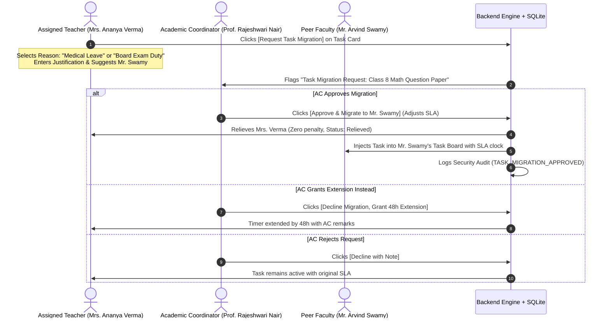

# EDU360: Academic Coordinator Cross-Role Workflows & Interlocks
## Comprehensive Engineering Implementation Plan (v1.1.0)

**Document Status:** Approved Architecture — Ready for Execution  
**Authors:** `/Trend Researcher` & `/Workflow Architect`  
**Target Roles:** Academic Coordinator (`academic_coordinator`), Teacher (`teacher`), School Admin (`admin`), Parent (`parent`)  
**Target Stack:** Next.js 16.4 (App Router) + FastAPI (Python) + SQLite  

---

## 1. Executive Summary & Root Cause Analysis

Based on our domain analysis of institutional K–12 schools (CBSE, ICSE, Cambridge, IB) and market benchmarks (**Toddle**, **ManageBac**, **PowerSchool Unified Operations**), we have redesigned the workflows to resolve operational gaps while respecting the academic chain of command.

```
┌────────────────────────────────────────────────────────────────────────────────────────┐
│                        CORE WORKFLOW PRINCIPLES & GAP RESOLUTIONS                      │
├────────────────────────────────────────────────────────────────────────────────────────┤
│ 1. CURRICULUM PACING CLERICAL ERROR RESOLVED                                           │
│    • AC Portal: Remove artificial "+1 Unit Delivered" button.                          │
│    • Teacher Portal: Add 1-click Lesson Delivery Tracker where classroom teachers tick  │
│      off completed units.                                                              │
│    • AC Console: Retains macro-surveillance and 1-click Remedial Mandate dispatch.     │
│                                                                                        │
│ 2. TWO-TIER SLA BREACH GOVERNANCE (NO BYPASSING THE AC)                                │
│    • When an SLA hits 00:00:00, it does NOT bypass the AC to ping the Principal.       │
│    • It flags an urgent RED BREACH ALERT on the Academic Coordinator's desk first.      │
│    • AC reviews the case and decides:                                                  │
│      (a) [Grant Extension] (e.g. 24h / 48h with justification),                         │
│      (b) [Migrate Task] (reassign to peer teacher), or                                 │
│      (c) [Escalate to Principal] (formal non-compliance report).                       │
│                                                                                        │
│ 3. TASK RELIEF & MIGRATION WORKFLOW (ACADEMIC / MEDICAL RELIEF)                        │
│    • If a teacher falls ill or faces academic workload surges (e.g. Board Duty), they   │
│      can click "[Request Task Relief / Migration]" directly on their task card.        │
│    • Relieves the teacher from unfair SLA penalties upon AC approval.                  │
│    • Reassigns task to a qualified peer faculty with a fresh/adjusted countdown.       │
│                                                                                        │
│ 4. TIMETABLE PROXY SYNCHRONIZATION                                                     │
│    • Assigning a substitute teacher auto-injects a `SUBSTITUTION_COVER` period badge   │
│      into the substitute's daily personal schedule in `/teacher`.                      │
│                                                                                        │
│ 5. INSTITUTIONAL PTM EVENT GOVERNANCE                                                  │
│    • AC declares school-wide PTM dates and audits teacher slot publishing readiness.   │
│    • Parents self-book 10-minute slots in `/parent`.                                   │
│    • AC mandates teachers to prepare Focus Table diagnostic sheets for <= 70% scorers. │
└────────────────────────────────────────────────────────────────────────────────────────┘
```

---

## 2. End-to-End Workflow Trees & State Machines

### 2.1 Workflow Tree: Task SLA Breach & Human-in-the-Loop Escalation



---

### 2.2 Workflow Tree: Teacher Task Relief & Migration Request

When a teacher is unable to complete an assigned task due to medical leave or academic emergency:



---

### 2.3 Workflow Tree: Curriculum Pacing & Remedial Interlock

```mermaid
sequenceDiagram
    autonumber
    actor Teacher as Subject Teacher
    actor AC as Academic Coordinator
    participant Engine as Backend Engine

    Teacher->>Engine: Delivers lesson & clicks [✓ Mark Unit Delivered] in /teacher
    Engine->>Engine: Pacing Status = Delivered Units - Calendar Benchmark
    
    alt Syllabus is On Track (Pacing >= 0)
        Engine->>AC: Dashboard reflects Green/Indigo On-Track Badge
    else Syllabus Lags (Pacing <= -2 Units)
        Engine->>AC: Flags Red Alert "Lagging: 2 Units Behind"
        AC->>Engine: Clicks [⚠️ Remedial Task] (SLA: 48 Hours)
        Engine->>Teacher: Spawns "Syllabus Catchup Task: Schedule 2 Zero-Hour Sessions"
        Teacher->>Engine: Conducts catchup sessions & marks units delivered
        Engine->>AC: Pacing restores to On-Track; Task auto-resolves
    end
```

---

## 3. Detailed Engineering Work Breakdown

### Phase 1: Task SLA Breach Notification & Migration Engine
* **Teacher Portal (`frontend/src/app/teacher/page.tsx`)**:
  * Add **Academic Tasks & SLAs Widget** displaying assigned mandates with live countdown clocks.
  * Add **`[Request Task Relief / Migration]`** modal on task cards:
    * Dropdown: `Medical Emergency / Sick Leave`, `Academic Workload Surge (Board Duty / Practical Moderation)`, `Family Emergency`.
    * Textarea: Rationale & mitigation notes.
    * Optional: Suggested peer replacement.
* **Academic Coordinator Portal (`frontend/src/app/academic_coordinator/page.tsx`)**:
  * **SLA Breached Alert Filter**: Displays tasks where countdown has expired.
  * Decision buttons on breached/pending tasks:
    * `[Grant Extension]` (prompts for +24h / +48h).
    * `[Migrate Task]` (opens peer faculty picker).
    * `[⚠️ Escalate to Principal]` (pushes to Super Admin Priority Triage).
  * **Pending Migration Requests Queue**: Dedicated card showing teacher relief requests awaiting AC approval.
* **Backend (`backend/app/routers/admin.py`)**:
  * `POST /api/admin/tasks/{id}/request-relief`: Teacher submits relief request.
  * `POST /api/admin/tasks/{id}/approve-relief`: AC approves migration, sets new assignee, resets SLA.
  * `POST /api/admin/tasks/{id}/extend-sla`: AC extends countdown hours.

---

### Phase 2: Curriculum Pacing & Lesson Check-off Interlock
* **Academic Coordinator Portal (`academic_coordinator/page.tsx`)**:
  * Remove `+1 Unit Delivered` button.
  * Display read-only surveillance: Delivered Units, Calendar Benchmark, Status (`On Track`, `Lagging`, `Ahead`).
  * `[⚠️ Remedial Task]` button: Dispatches 48h syllabus recovery mandate to the teacher.
* **Teacher Portal (`teacher/page.tsx`)**:
  * Add **Curriculum Delivery Tracker**: Shows syllabus units for the teacher's classes.
  * 1-Click `[✓ Mark Unit Complete: Linear Equations Ex 3.4]`.
* **Backend (`backend/app/routers/admin.py` & `teacher.py`)**:
  * `POST /api/teacher/curriculum/log-unit`: Teacher increments completed units and updates lesson title.
  * `POST /api/admin/academic/curriculum-pacing/{id}/intervene`: Dispatches the recovery mandate.

---

### Phase 3: Leave Approval $\rightarrow$ Substitution Timetable Sync
* **Backend Timetable Injection (`backend/app/routers/admin.py`)**:
  * In `assign_substitution` and `auto_resolve_substitutions`:
    * When proxy teacher (e.g. Mr. Deepak Rao) is assigned, auto-inject a `TeacherPersonalScheduleItem` into his personal daily timetable with `activity_type: "SUBSTITUTION_COVER"`.
* **Teacher Schedule UI (`teacher/page.tsx`)**:
  * Render proxy periods with a distinct **Purple/Amber "PROXY SUBSTITUTION" badge**, showing room number, absent colleague name, and lesson instructions.

---

### Phase 4: Institutional PTM Event Governance
* **Academic Coordinator Console (`academic_coordinator/page.tsx`)**:
  * Add **PTM Event Governance Module**:
    * Event Details: Title (*Term-2 Mid-Term PTM*), Date (*24 Oct*), Time Window (*09:00 AM – 01:00 PM*).
    * Readiness Meter: `28 of 30 Teachers Published Slots (93.3%)`.
    * Action: `[📢 Remind Defaulting Teachers]` — 1-click sends SLA task to teachers who haven't opened slots.
    * Focus Table Mandate: Reminds teachers to have rough work diagnostics ready for $\le 70\%$ scorers.
* **Parent Portal (`parent/page.tsx`)**:
  * Parents retain 100% self-service booking.

---

## 4. Rollout Checklist by File

| Target File | Modifications Required |
| :--- | :--- |
| `frontend/src/app/academic_coordinator/page.tsx` | Remove `+1 Unit Delivered`; add Task Relief/Migration approval queue; add Extension modal; add PTM Governance card. |
| `frontend/src/app/teacher/page.tsx` | Add Academic Tasks & SLAs widget with `[Request Task Relief]` button; add Curriculum Unit checkoff; render `SUBSTITUTION_COVER` badge in timetable. |
| `backend/app/routers/admin.py` | Add task relief endpoints (`request-relief`, `approve-relief`, `extend-sla`); inject proxy periods into teacher schedule; route escalated tasks to Admin Triage. |
| `backend/app/routers/teacher.py` | Add unit delivery endpoint `POST /api/teacher/curriculum/log-unit`. |
| `frontend/src/lib/api.ts` & `types.ts` | Update contracts for Task Migration requests, teacher unit delivery, and PTM governance. |

---
*Ready for implementation execution.*
