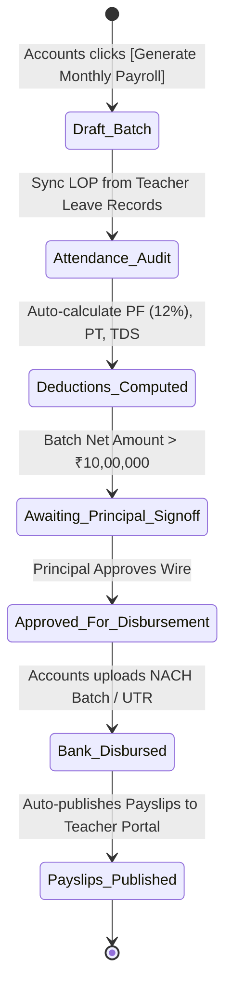
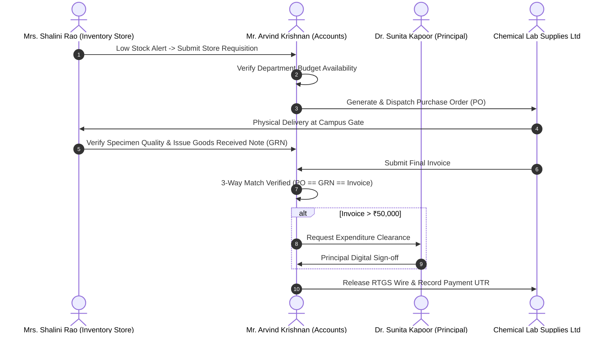

# EDU360: Accounts Coordinator Institutional Cash Outflows Engine
## Comprehensive Engineering Implementation Plan (v1.0.0)

**Document Status:** Architecture Plan & Specifications — Ready for Implementation  
**Lead Roles:** `/Trend Researcher` & `/Software Architect`  
**Target Roles:** Accounts Coordinator (`accounts_coordinator`), Inventory Coordinator (`inventory_coordinator`), Teachers & Staff (`teacher`), Principal / Admin (`admin`)  
**Target Stack:** Next.js 16.4 (App Router) + FastAPI (Python Uvicorn) + SQLite  

---

## 1. Executive Summary & Problem Framing

In modern K–12 institutional financial management (*Blackbaud Financial Edge, PowerSchool eFinancePlus, Teachmint X, Entab CampusCare*), the Bursar / Accounts Coordinator oversees both halves of the institutional ledger:
1. **Cash Inflows:** Student tuition fee collection, overdue aging recovery, and online gateway reconciliation. *(Implemented in Phase 1)*
2. **Cash Outflows (65%–82% of Annual Budget):** Staff payroll, inventory procurement, departmental operating expenses (OpEx), fleet fuel/maintenance, and statutory tax deductions. *(Focus of this Plan)*

```
┌─────────────────────────────────────────────────────────────────────────────────────────────────┐
│                       INSTITUTIONAL CASH OUTFLOW GOVERNANCE PILLARS                             │
├─────────────────────────────────────────────────────────────────────────────────────────────────┤
│ 1. MONTHLY PAYROLL RUN & STAFF SALARY DISBURSEMENT                                              │
│    • 1-Click Monthly Batch Run across all 42 Faculty & Support Staff.                           │
│    • Automatic deduction calculation: Loss of Pay (LOP) from leave logs, Provident Fund (PF),   │
│      Professional Tax (PT), and TDS withholding.                                                │
│    • Bank NACH / NEFT Batch Upload File generation.                                             │
│    • Teacher Portal integration: Digital payslip viewing & download in `/teacher`.             │
│                                                                                                 │
│ 2. INVENTORY PROCUREMENT 3-WAY MATCH (Store Requisition -> PO -> GRN -> Invoice)                │
│    • Store Coordinator (`inventory_coordinator`) raises Requisition when stock drops low.       │
│    • Accounts Coordinator issues approved Purchase Order (PO) with vendor pricing.              │
│    • Goods Received Note (GRN) digitally stamped upon campus security & store check.            │
│    • Auto-links to `VendorInvoice` for wire authorization, preventing phantom billing.          │
│                                                                                                 │
│ 3. DEPARTMENTAL BUDGETS & PETTY CASH IMPREST DESK                                               │
│    • Annual allocated budget tracking across Science Lab, Sports, IT, Transport, and Library.   │
│    • Live budget burn-rate meter (e.g. Science Lab: 68% utilized, ₹1,28,000 remaining).         │
│    • Discretionary daily petty cash ledger (vouchers < ₹5,000 for emergency exam print, meals)  │
│      with weekly automated imprest re-balancing approved by the Principal.                     │
│                                                                                                 │
│ 4. FLEET & FACILITY AMC (ANNUAL MAINTENANCE CONTRACTS) CALENDAR                                 │
│    • Statutory bus maintenance (RTO fitness, speed governor certification, insurance).          │
│    • Scheduled recurring wire disbursements linked to Transport Coordinator fleet records.     │
└─────────────────────────────────────────────────────────────────────────────────────────────────┘
```

---

## 2. End-to-End Workflow Trees & State Machines

### 2.1 Workflow Tree: Monthly Staff Payroll Run



### 2.2 Workflow Tree: 3-Way Procurement Match (Store Requisition $\to$ PO $\to$ GRN $\to$ Invoice)



---

## 3. Database Schema Extensions ([`models.py`](file:///e:/Diradz/EDU360/backend/app/models/models.py))

### 3.1 Payroll Batch & Payslip Models
```python
class PayrollBatch(Base):
    """Monthly institutional payroll run across all faculty and administrative staff."""
    __tablename__ = "payroll_batches"
    id = Column(Integer, primary_key=True, index=True)
    payroll_month = Column(String(50), nullable=False, unique=True) # e.g. "October 2026"
    total_staff_count = Column(Integer, default=0)
    gross_total = Column(Float, default=0.0)
    total_deductions = Column(Float, default=0.0) # PF, ESI, TDS, LOP
    net_payable = Column(Float, default=0.0)
    status = Column(String(50), default="Draft") # Draft | Audit Pending | Approved | Disbursed
    authorized_by = Column(String(100), nullable=True) # Principal signoff
    authorized_at = Column(DateTime, nullable=True)
    disbursed_at = Column(DateTime, nullable=True)
    bank_batch_ref = Column(String(100), nullable=True) # HDFC / SBI Corporate CMS batch ID
    notes = Column(Text, nullable=True)
    created_at = Column(DateTime, default=datetime.datetime.utcnow)

class StaffPayslip(Base):
    """Individual monthly salary slip for faculty/staff with granular statutory deductions."""
    __tablename__ = "staff_payslips"
    id = Column(Integer, primary_key=True, index=True)
    batch_id = Column(Integer, ForeignKey("payroll_batches.id"), nullable=False, index=True)
    staff_id = Column(Integer, ForeignKey("staff_members.id"), nullable=False, index=True)
    staff_name = Column(String(100), nullable=False)
    role_designation = Column(String(80), nullable=False)
    department = Column(String(80), nullable=False)
    bank_account_no = Column(String(50), nullable=False)
    bank_ifsc = Column(String(20), nullable=False)
    
    # Earnings
    basic_salary = Column(Float, nullable=False)
    hra_allowance = Column(Float, default=0.0)
    special_allowance = Column(Float, default=0.0)
    gross_earnings = Column(Float, nullable=False)
    
    # Deductions
    provident_fund = Column(Float, default=0.0) # PF (12% of basic)
    professional_tax = Column(Float, default=200.0) # PT
    income_tax_tds = Column(Float, default=0.0)
    loss_of_pay_days = Column(Integer, default=0)
    loss_of_pay_deduction = Column(Float, default=0.0)
    total_deductions = Column(Float, default=0.0)
    
    net_salary = Column(Float, nullable=False)
    disbursement_status = Column(String(30), default="Pending") # Pending | Disbursed | On Hold
    payment_utr = Column(String(100), nullable=True)
    disbursed_at = Column(DateTime, nullable=True)
```

### 3.2 Departmental Budget & Petty Cash Models
```python
class DepartmentalBudget(Base):
    """Fiscal budget allocation and real-time utilization meter per school department."""
    __tablename__ = "departmental_budgets"
    id = Column(Integer, primary_key=True, index=True)
    fiscal_year = Column(String(30), default="2026-2027")
    department_name = Column(String(80), nullable=False, unique=True) # Science Lab, Sports, IT, Transport, Academics
    head_of_department = Column(String(100), nullable=False)
    allocated_budget = Column(Float, nullable=False)
    utilized_amount = Column(Float, default=0.0)
    reserved_po_amount = Column(Float, default=0.0)
    notes = Column(Text, nullable=True)

class PettyCashVoucher(Base):
    """Daily discretionary cash disbursements (< ₹5,000) for school operations."""
    __tablename__ = "petty_cash_vouchers"
    id = Column(Integer, primary_key=True, index=True)
    voucher_no = Column(String(50), unique=True, nullable=False) # e.g. "PCV-2026-104"
    department = Column(String(80), nullable=False)
    claimant_name = Column(String(100), nullable=False) # Teacher or Lab Assistant
    expense_category = Column(String(80), nullable=False) # Lab Specimens, Emergency Fuel, Postage, Hospitality
    amount = Column(Float, nullable=False)
    purpose = Column(Text, nullable=False)
    receipt_attachment_url = Column(String(255), nullable=True)
    status = Column(String(30), default="Approved") # Approved | Rejected | Reimbursed
    approved_by = Column(String(100), default="Mr. Arvind Krishnan")
    disbursed_at = Column(DateTime, default=datetime.datetime.utcnow)
```

### 3.3 Purchase Order (PO) & Requisition Integration
```python
class PurchaseOrder(Base):
    """Formal procurement contract generated from low-stock store requisitions."""
    __tablename__ = "purchase_orders"
    id = Column(Integer, primary_key=True, index=True)
    po_number = Column(String(50), unique=True, nullable=False) # e.g. "PO-2026-OCT-012"
    requisition_department = Column(String(80), nullable=False)
    vendor_name = Column(String(150), nullable=False)
    items_json = Column(Text, nullable=False) # [{item_name, quantity, unit_price, total}]
    total_amount = Column(Float, nullable=False)
    expected_delivery_date = Column(String(50), nullable=True)
    status = Column(String(50), default="Issued") # Issued | Goods Received (GRN Verified) | Invoiced | Settled
    grn_number = Column(String(50), nullable=True)
    grn_verified_by = Column(String(100), nullable=True)
    grn_verified_at = Column(DateTime, nullable=True)
    linked_invoice_no = Column(String(50), nullable=True)
    created_at = Column(DateTime, default=datetime.datetime.utcnow)
```

---

## 4. Backend Endpoints Architecture ([`finance.py`](file:///e:/Diradz/EDU360/backend/app/routers/finance.py))

| Endpoint | Method | Role Access | Purpose |
| :--- | :---: | :---: | :--- |
| `/api/finance/payroll/batches` | `GET` | `accounts_coordinator`, `admin` | List all historical and active monthly payroll runs. |
| `/api/finance/payroll/generate` | `POST` | `accounts_coordinator` | 1-Click calculation of monthly payroll for all active staff, deducting LOP and statutory taxes. |
| `/api/finance/payroll/batches/{id}/authorize` | `POST` | `admin` (Principal) | Executive sign-off for bank salary wire (> ₹10L). |
| `/api/finance/payroll/batches/{id}/disburse` | `POST` | `accounts_coordinator` | Finalize wire transfer, record bank batch UTR, and auto-dispatch digital payslips to staff. |
| `/api/finance/payroll/payslips/my-slip` | `GET` | `teacher` | Enables teachers to view/download their current and past official salary slips in `/teacher`. |
| `/api/finance/budgets` | `GET` | `accounts_coordinator`, `admin` | Return real-time departmental budget allocations and live burn rate percentages. |
| `/api/finance/petty-cash` | `GET` / `POST` | `accounts_coordinator` | Log daily cash expense vouchers and monitor the imprest counter balance. |
| `/api/finance/purchase-orders` | `GET` / `POST` | `accounts_coordinator`, `inventory_coord` | Create and track procurement POs linked to store stock requisitions and 3-way GRN matching. |
| `/api/finance/purchase-orders/{id}/grn` | `POST` | `inventory_coordinator` | Digital Goods Received Note (GRN) stamp confirming physical items received at campus store. |

---

## 5. Frontend UI/UX Specifications

### 5.1 Accounts Coordinator Portal Enhancements ([`accounts_coordinator/page.tsx`](file:///e:/Diradz/EDU360/frontend/src/app/accounts_coordinator/page.tsx))
Expand the Bursar Console with 3 new dedicated tabs alongside the existing fee recovery and gateway tabs:
1. **Tab 1: Staff Payroll & Disbursements (`payroll`)**
   - Monthly payroll runner card with aggregate Gross Pay, Statutory Deductions (PF/TDS), and Net Payout.
   - 1-Click "Execute October 2026 Payroll".
   - Staff breakdown table: Staff Member, Department, Base Salary, LOP Deductions, PF, Net Payout, and Bank Status.
   - 1-Click "Download Bank NACH CSV" and "Authorize Salary Wire".
2. **Tab 2: Departmental Budgets & Petty Cash (`budgets_pettycash`)**
   - High-impact budget progress bars for Science Lab, Sports, IT, Transport, and Library.
   - Petty cash counter balance card (e.g. ₹24,500 Available) with "Record Cash Voucher" modal.
3. **Tab 3: Procurement & PO 3-Way Match (`procurement_po`)**
   - Active Purchase Orders table showing PO Status: `Issued` $\to$ `GRN Verified` $\to$ `Invoiced` $\to$ `Settled`.
   - 1-Click 3-way match validation before vendor wire release.

### 5.2 Teacher Portal Integration ([`teacher/page.tsx`](file:///e:/Diradz/EDU360/frontend/src/app/teacher/page.tsx))
- Add a **"My Salary Slips & Tax Summary"** section under the Teacher profile / settings drawer where Mrs. Ananya Verma and faculty can view their breakdown (Basic, HRA, PF deductions, Net pay) and download official PDF payslips.

### 5.3 Inventory Portal Integration ([`inventory_coordinator/page.tsx`](file:///e:/Diradz/EDU360/frontend/src/app/inventory_coordinator/page.tsx))
- Connect the existing stock records to an "Issue Requisition to Accounts" button whenever stock falls below threshold.

---

## 6. Implementation Phasing & Milestones

```
┌────────────────────────────────────────────────────────────────────────────────────────┐
│                                 PHASED ROLLOUT TIMELINE                                │
├────────────────────────────────────────────────────────────────────────────────────────┤
│ PHASE 1: Staff Payroll & Salary Disbursement Engine (Days 1–2)                         │
│ • Database Models: PayrollBatch, StaffPayslip                                          │
│ • Calculation & disbursement backend endpoints in finance.py                           │
│ • Accounts Coordinator "Staff Payroll" tab with NACH bank export                       │
│ • Teacher portal salary slip viewing card                                              │
│                                                                                        │
│ PHASE 2: Departmental Budget Centers & Petty Cash Imprest (Day 3)                      │
│ • Database Models: DepartmentalBudget, PettyCashVoucher                                │
│ • Budget burn-rate analytics and voucher submission modal                              │
│ • Petty cash ledger with photo receipt uploads                                         │
│                                                                                        │
│ PHASE 3: Procurement 3-Way Match & Store PO Integration (Day 4)                        │
│ • PurchaseOrder model with Requisition -> PO -> GRN -> VendorInvoice link              │
│ • Cross-role notification handshake between Store and Bursar                           │
│ • Verification with strict TypeScript checking & automated cURL tests                  │
└────────────────────────────────────────────────────────────────────────────────────────┘
```

---

## 7. Verification & Acceptance Criteria

1. **Deterministic Payroll Calculation:**  
   $Net = (Basic + HRA + Allowances) - (PF + PT + TDS + (PerDayRate \times LOPDays))$  
   Verified against faculty salaries in `StaffMember` table.
2. **Cross-Role Loop:**  
   When the Accounts Coordinator disburses a payroll batch, all affected faculty immediately receive an in-app notification and can inspect their payslip in `/teacher`.
3. **Procurement Integrity (No Phantom Billing):**  
   Vendor invoices originating from inventory stock cannot be approved for wire transfer until a Goods Received Note (GRN) is logged by the store team.
4. **Zero Compiler/Runtime Regressions:**  
   Full validation with `npx tsc --noEmit` and PowerShell API verification scripts.
