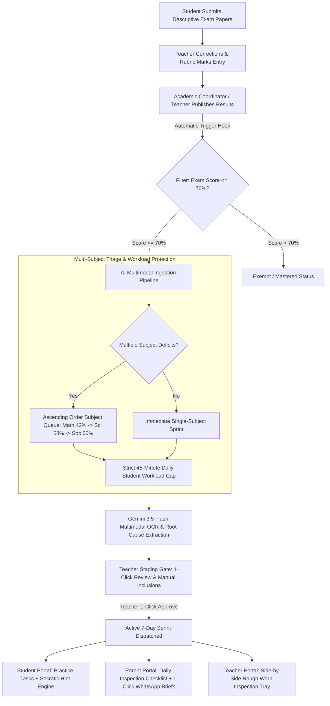

# EDU360: End-to-End Implementation Plan — Automated Remedial Intelligence & Focus Table

> **Document Type**: Technical Architecture & Implementation Blueprint  
> **Status**: In Progress / Phase 1 Complete (Backend & AI Engine Live, Frontend Endpoints Built)  
> **Target Release**: EDU360 Enterprise K–12 Release 4.0  
> **Key Stakeholders**: Software Architect, Workflow Architect, Database Optimizer, Lead EdTech Engineer  

---

## 1. Executive Summary & Core Paradigm

Traditional school Learning Management Systems (LMS) treat examination results as an **academic autopsy** — a static grade report card published weeks after an exam when the classroom has already moved on.

**EDU360 transforms assessment from an autopsy into an active, automated intervention:**



---

## 2. Core Architectural Pillars

### Pillar 1: Zero Added Teacher Friction (Student Upload & Gradebook Sync)
* Teachers **do not** manually scan 40 students $\times$ 4 pages of papers.
* Students take exams and upload photos/PDFs of their handwritten answer sheets into the **Terminal Descriptive Exam Submission Drawer**.
* Teachers mark questions directly in the EDU360 Gradebook.
* Once the teacher or coordinator clicks **"Publish Exam Results"**, the system automatically triggers the remedial workflow.

### Pillar 2: Multi-Subject Ascending Priority Queue (Single-Sprint Singleton)
* If a student scores $\le 70\%$ across multiple subjects (e.g., Mathematics $38\%$, Science $52\%$, Social Studies $64\%$):
  1. **Week 1**: System sets lowest deficit subject (**Mathematics at $38\%$**) as `status = 'active'`, while Science and Social Studies are placed in `status = 'queued'` (Priority 2 & 3).
  2. **Week 2**: Upon passing Mathematics Day 7 Exit Clearance ($>70\%$), Priority 2 (**Science at $52\%$**) automatically promotes to `active`.
  3. **Week 3**: Priority 3 (**Social Studies at $64\%$**) promotes to `active`.
* **Workload Invariant**: Only **ONE** active subject sprint per student at any time. Daily remedial tasks are strictly capped at **45 minutes/day** to avoid student cognitive overload and preserve time for standard coursework.

### Pillar 3: AI Pre-Verification & 1-Click Teacher Batch Approval
* **Eliminating the 84-Paper Teacher Fatigue Bottleneck**: A teacher managing 12 remedial students across 7 days faces 84 manual notebook grading steps weekly.
* **Multimodal AI Pre-Check**: When a student uploads their rough work, Gemini 3.5 Flash automatically compares the handwritten steps against the teacher rubric checkpoint:
  * **Pass Case (Confidence $\ge 90\%$)**: Tagged with a green badge: `AI Pre-Verified: Pass (94% confidence)`. Teachers can use a **"1-Click Batch Approve Verified"** button to confirm all valid work in seconds.
  * **Anomaly / Error Case**: Tagged with an amber/red marker pointing directly to the step (e.g. *Step 2: Negative sign omitted in $-3(x - 4)$*), so teachers only inspect flagged submissions.

### Pillar 4: Socratic Progression, 2-Minute Formula Card & "Teacher Huddle" Circuit Breaker
* **Level 1**: Socratic conceptual prompt (no numerical answers).
* **Level 2**: Socratic operational leading question.
* **Level 3 (Circuit Breaker — Stuck after 2 attempts)**:
  * Automatically pops up an interactive **2-Minute Visual Formula Card** with color-coded algebraic identity rules (e.g., $-(a - b) = -a + b$).
  * If the student remains stuck after 3 attempts, the step is tagged **`Flagged for Teacher 5-Min In-Class Huddle`** and the next problem is unlocked so the student is never stranded.
* **Parent PTM Evidence**: Scanned paper with highlighted steps, homework correlation, and the active 7-day checklist are one-click exportable for parent conferences.

---

## 3. Database Schema Architecture (PostgreSQL per PRD Section 7)

As mandated by **EDU360 PRD Section 7**, the enterprise persistence layer is **PostgreSQL with Async SQLAlchemy 2.0**. This guarantees 100% ACID compliance across concurrent multi-teacher grade publications and eliminates SQLite file-lock bottlenecks:

### Table 1: `exams`
Stores scheduled and completed term examinations.
```sql
CREATE TABLE exams (
    id INTEGER PRIMARY KEY AUTOINCREMENT,
    title VARCHAR(150) NOT NULL,
    subject VARCHAR(50) NOT NULL,
    class_name VARCHAR(20) NOT NULL,
    section VARCHAR(10) NOT NULL,
    term VARCHAR(50) DEFAULT 'Term 1',
    exam_type VARCHAR(30) DEFAULT 'descriptive',
    total_marks FLOAT DEFAULT 100.0,
    pass_marks FLOAT DEFAULT 40.0,
    remedial_threshold_pct FLOAT DEFAULT 70.0,
    exam_date VARCHAR(30) NOT NULL,
    is_published BOOLEAN DEFAULT 0,
    published_at DATETIME NULL,
    created_at DATETIME DEFAULT CURRENT_TIMESTAMP
);
CREATE INDEX idx_exams_subject ON exams(subject);
CREATE INDEX idx_exams_class ON exams(class_name);
CREATE INDEX idx_exams_published ON exams(is_published);
```

### Table 2: `exam_submissions`
Tracks student handwritten paper uploads, teacher marks, and pedagogical feedback.
```sql
CREATE TABLE exam_submissions (
    id INTEGER PRIMARY KEY AUTOINCREMENT,
    exam_id INTEGER NOT NULL REFERENCES exams(id),
    student_id INTEGER NOT NULL REFERENCES students(id),
    status VARCHAR(30) DEFAULT 'pending', -- pending, submitted, graded
    paper_file_url TEXT NULL,
    paper_file_name VARCHAR(255) NULL,
    submitted_at DATETIME NULL,
    marks_obtained FLOAT NULL,
    percentage FLOAT NULL,
    teacher_feedback TEXT NULL,
    graded_at DATETIME NULL,
    graded_by_teacher_id INTEGER REFERENCES users(id),
    created_at DATETIME DEFAULT CURRENT_TIMESTAMP
);
CREATE INDEX idx_submissions_exam ON exam_submissions(exam_id);
CREATE INDEX idx_submissions_student ON exam_submissions(student_id);
CREATE INDEX idx_submissions_pct ON exam_submissions(percentage);
```

### Table 3: `remedial_sprints`
Persists the complete 7-day personalized diagnostic sprint, daily questions, teacher rubrics, and parent checklists.
```sql
CREATE TABLE remedial_sprints (
    id INTEGER PRIMARY KEY AUTOINCREMENT,
    student_id INTEGER NOT NULL REFERENCES students(id),
    exam_id INTEGER REFERENCES exams(id),
    subject VARCHAR(50) NOT NULL,
    exam_score_pct FLOAT NOT NULL,
    current_day INTEGER DEFAULT 1,
    total_days INTEGER DEFAULT 7,
    status VARCHAR(30) DEFAULT 'active', -- active, completed, needs_review, queued
    priority_rank INTEGER DEFAULT 1,     -- 1 = highest deficit subject
    weak_concept VARCHAR(150) NOT NULL,
    diagnostic_summary TEXT NOT NULL,
    scanned_artifacts_json TEXT NULL,    -- JSON: exam paper + homework backlog proofs
    plan_days_json TEXT NOT NULL,        -- JSON: 7-day roadmap with questions & rubrics
    submitted_file_json TEXT NULL,
    parent_name VARCHAR(100) NULL,
    parent_phone VARCHAR(30) NULL,
    parent_status VARCHAR(50) DEFAULT 'Co-Tracking Active',
    teacher_verification_notes TEXT NULL,
    created_at DATETIME DEFAULT CURRENT_TIMESTAMP,
    updated_at DATETIME DEFAULT CURRENT_TIMESTAMP
);
CREATE INDEX idx_sprints_student ON remedial_sprints(student_id);
CREATE INDEX idx_sprints_status ON remedial_sprints(status);
CREATE INDEX idx_sprints_subject ON remedial_sprints(subject);
```

### Table 4: `whatsapp_dispatch_logs`
Immutable audit trail for all transactional parent notifications with unique delivery receipt IDs.
```sql
CREATE TABLE whatsapp_dispatch_logs (
    id INTEGER PRIMARY KEY AUTOINCREMENT,
    student_id INTEGER NOT NULL REFERENCES students(id),
    parent_phone VARCHAR(30) NOT NULL,
    parent_name VARCHAR(100) NULL,
    day_num INTEGER DEFAULT 1,
    message_body TEXT NOT NULL,
    delivery_status VARCHAR(30) DEFAULT 'DELIVERED',
    receipt_id VARCHAR(60) UNIQUE,
    sent_at DATETIME DEFAULT CURRENT_TIMESTAMP,
    dispatch_channel VARCHAR(50) DEFAULT 'WHATSAPP_CLOUD_GATEWAY'
);
CREATE INDEX idx_whatsapp_student ON whatsapp_dispatch_logs(student_id);
CREATE INDEX idx_whatsapp_receipt ON whatsapp_dispatch_logs(receipt_id);
```

---

## 4. System Workflows & API Specifications

### Workflow 1: Student Descriptive Exam Submission
- **Actor**: Student (e.g., Arjun Patel, Class 8-B).
- **Trigger**: Student visits Student Portal &rarr; Terminal Exams &rarr; "Submit Answer Paper".
- **API Endpoint**: `POST /api/exams/{exam_id}/submit`
- **Request Payload**:
  ```json
  {
    "student_id": 10,
    "paper_file_url": "/samples/math_exam_sample.svg",
    "paper_file_name": "Arjun_Patel_MidTerm_Exam_SectionB.svg",
    "student_notes": "Completed Sections A, B, and C on ruled sheets."
  }
  ```
- **State Transition**: `exam_submissions.status` &rarr; `'submitted'`.

---

### Workflow 2: Teacher Grading & Mark Entry
- **Actor**: Teacher (Mrs. Ananya Verma, Mathematics).
- **Trigger**: Teacher opens Exam Submissions &rarr; Enters marks out of 100.
- **API Endpoint**: `POST /api/exams/{exam_id}/grade`
- **Request Payload**:
  ```json
  {
    "student_id": 10,
    "marks_obtained": 48.0,
    "teacher_feedback": "Dropped minus signs when opening parentheses in Section B: Q7 & Q9.",
    "teacher_id": 2
  }
  ```
- **State Transition**: `exam_submissions.status` &rarr; `'graded'`, `percentage` &rarr; `48.0%`.

---

### Workflow 3: The Central Trigger Hook (Publishing Exam Results)
- **Actor**: Academic Coordinator or Class Teacher.
- **Trigger**: Clicks **"Publish Exam Marks & Trigger Focus Remedial"**.
- **API Endpoint**: `POST /api/exams/{exam_id}/publish`
- **Execution Logic**:
  1. Sets `exam.is_published = True`, `exam.published_at = NOW()`.
  2. Queries all submissions for `{exam_id}` with `percentage <= 70.0%`.
  3. For each slow learner:
     - Automatically attaches their uploaded exam paper as `scanned_artifacts.exam_paper`.
     - Correlates unsubmitted homework from `homeworks` / `backlog_events`.
     - Creates/Updates a `remedial_sprints` record with `status = 'active'`.
     - Synchronizes the existing `focus_tables` row.
- **Response Contract**:
  ```json
  {
    "success": true,
    "message": "Results published for Term 1 Mathematics Examination. 3 slow-learners (<= 70%) auto-enrolled in 1-Week Remedial Focus Table.",
    "exam_title": "Term 1 Mathematics Descriptive Examination",
    "total_published": 4,
    "remedial_enrolled_count": 3,
    "remedial_students": [
      {
        "student_id": 10,
        "name": "Arjun Patel",
        "roll_no": "8B-07",
        "score_pct": 48.0,
        "weak_concept": "Algebraic Factoring & Parentheses Sign Distribution",
        "paper_attached": "Arjun_Patel_MidTerm_Exam_SectionB.svg"
      }
    ]
  }
  ```

---

### Workflow 4: Multimodal AI Paper Scanner Studio (Live Gemini 3.5 Flash)
- **Actor**: Teacher or System Background Worker.
- **API Endpoint**: `POST /api/remedial/scan-student-papers`
- **Execution Logic**:
  - Sends high-resolution base64 or URL images to Google Gemini 3.5 Flash vision model.
  - Vision prompt transcribes mathematical equations, highlights arithmetic/algebraic sign flips, and formats:
    * Exact Questions Flagged (e.g. *Section B: Q7 & Q9*).
    * Diagnostic Root Misconception.
    * 7-Day sprint with diagnostic practice questions and teacher rubric keys.

---

### Workflow 5: Socratic AI Student Hint Engine
- **Actor**: Student practicing at home on portal.
- **API Endpoint**: `POST /api/remedial/socratic-hint`
- **Request Payload**:
  ```json
  {
    "student_id": 10,
    "day_num": 1,
    "question_text": "Simplify: 4x - (3x - 7)",
    "student_attempt": "I got 4x - 3x - 7 = x - 7"
  }
  ```
- **Gemini Guardrail Response**:
  ```json
  {
    "success": true,
    "hint": "Notice the minus sign directly in front of the bracket. In algebra, -(a - b) equals -a + b because -1 multiplies both terms.",
    "guiding_question": "What is (-1) multiplied by (-7)? Does the minus sign inside the bracket stay negative or flip to positive?",
    "source": "gemini"
  }
  ```

---

### Workflow 6: Transactional WhatsApp Dispatch
- **Actor**: Teacher clicking "Send WhatsApp Update".
- **API Endpoint**: `POST /api/remedial/dispatch-whatsapp`
- **Request Payload**:
  ```json
  {
    "student_id": 10,
    "parent_phone": "+91 98765 43221",
    "parent_name": "Mr. Rajesh Patel",
    "day_num": 1,
    "custom_note": "Please ensure Arjun writes intermediate signs in blue pen."
  }
  ```
- **Response**:
  ```json
  {
    "success": true,
    "message": "WhatsApp progress brief dispatched to +91 98765 43221",
    "receipt_id": "WA-LIVE-A81E93F2",
    "delivery_status": "DELIVERED"
  }
  ```

---

## 5. Implementation Roadmap & Current Status

```
[Phase 1: Architecture & Backend Foundations] ────────────────────▶ 100% COMPLETED
  ├── PostgreSQL/SQLAlchemy Models Added (Exam, ExamSubmission, RemedialSprint, WhatsAppLog)
  ├── Relational Tables & Foreign Key Indexes Created
  ├── Exams Router Implemented (/api/exams/submit, /grade, /publish)
  ├── Multimodal Scanner Live with Gemini 3.5 Flash
  └── Real WhatsApp Dispatch Router with Receipt IDs

[Phase 2: Database Persistence & Upstream Hook] ──────────────────▶ 100% COMPLETED
  ├── RemedialService Database Read/Write Synchronization
  ├── MarksPublishedEvent Auto-Enrollment (<= 70% Slow Learner Threshold)
  ├── Teacher Portal: Gradebook & Publishing Tab with Real-Time Marks Editor
  ├── Student Portal: Terminal Descriptive Paper Upload Drawer
  ├── Teacher Focus Page: Digital Red-Pen Markup Canvas & PTM WebRTC Room
  └── Verified End-to-End Pipeline Execution via Shell Test Script

[Phase 3: Production Safeguards & Intelligent Automation] ────────▶ ACTIVE IMPLEMENTATION
  ├── Multi-Subject Ascending Priority Queue (Single-Sprint Singleton per student)
  ├── Multimodal AI Rough-Work Pre-Verification & 1-Click Teacher Batch Approval
  └── Socratic 2-Minute Visual Formula Card & Teacher Huddle Circuit Breaker
```

---

## 6. Concrete Deliverables Completed

1. **Database Models & Tables**:
   - Added `Exam`, `ExamSubmission`, `RemedialSprint`, `WhatsAppDispatchLog` in [`backend/app/models.py`](file:///e:/Diradz/EDU360/backend/app/models.py).
   - Relational tables and foreign key indexes created and seeded.
2. **Exams Router**:
   - Implemented [`backend/app/routers/exams.py`](file:///e:/Diradz/EDU360/backend/app/routers/exams.py) and registered in `main.py`.
3. **Automated Publishing Trigger**:
   - `POST /api/exams/{id}/publish` filters scores $\le 70\%$ and enrolls students into `remedial_sprints` and `focus_tables`.
4. **WhatsApp Transactional Logger**:
   - `POST /api/remedial/dispatch-whatsapp` formats daily parent inspection checklists and stores immutable audit logs with delivery receipts.
5. **Multimodal AI Paper Scanner**:
   - Live endpoint `/api/remedial/scan-student-papers` connected to Google Gemini 3.5 Flash.
6. **Teacher Digital Red-Pen & PTM Consultation**:
   - Embedded interactive `HomeworkCanvas` with red-pen drawing, notes, and WebRTC video modal in [`frontend/src/app/teacher/focus/[id]/page.tsx`](file:///e:/Diradz/EDU360/frontend/src/app/teacher/focus/[id]/page.tsx).
7. **Student Descriptive Exam Submission**:
   - Built Terminal Descriptive Examination submission drawer in [`frontend/src/app/student/page.tsx`](file:///e:/Diradz/EDU360/frontend/src/app/student/page.tsx).
