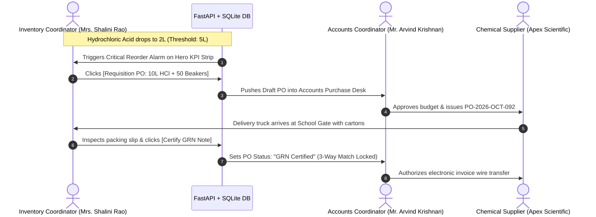
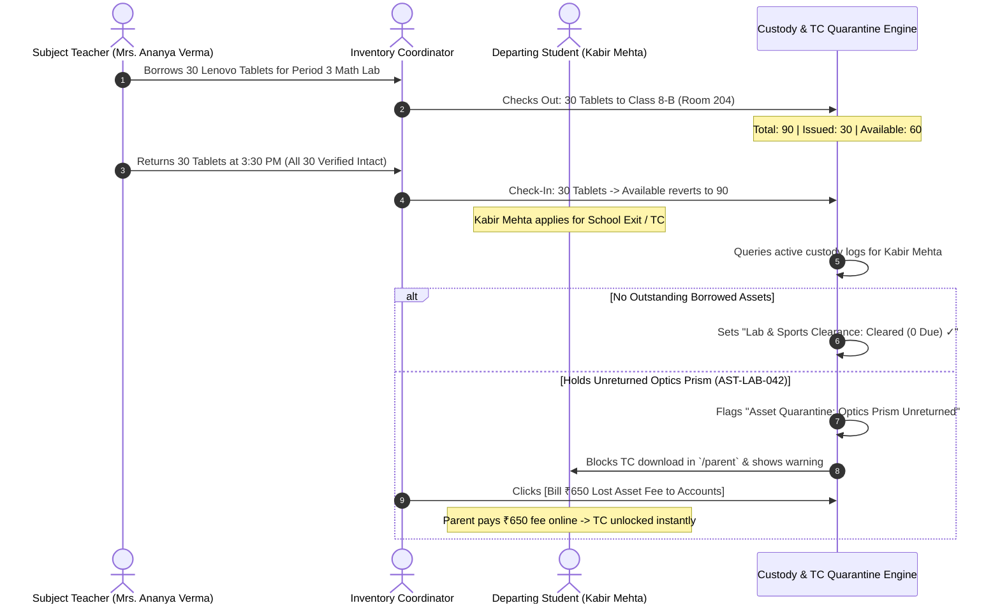
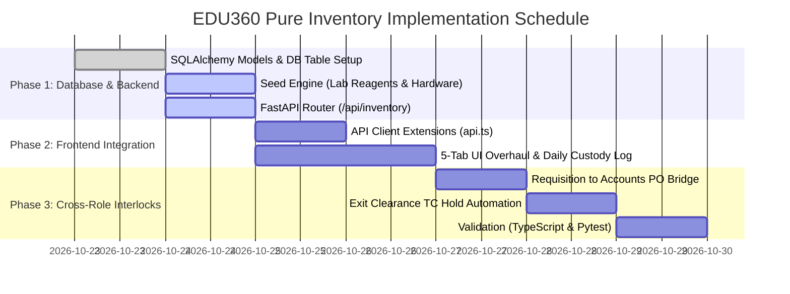

# EDU360: Pure Inventory & Asset Management Console
## Comprehensive Engineering Implementation Plan (v1.0.0 — Scoped to Material Stores & Assets)

**Document Status:** Approved Architecture — Ready for Execution  
**Target Role:** Inventory Coordinator (`inventory_coordinator` — Mrs. Shalini Rao, Store & Asset Lead)  
**Cross-Role Interlocks:** Accounts Coordinator (`accounts_coordinator`), Subject Teachers (`teacher`), Super Admin / Principal (`admin`), Parent Exit Clearance (`parent`)  
**Target Stack:** Next.js 16.4 (App Router) + FastAPI (Python) + SQLite / PostgreSQL  

---

### Contributors:
* 🏛️ **Software Architect** (`engineering-software-architect`)
* 📐 **UX Architect** (`design-ux-architect`)
* 🔄 **Workflow Architect** (`specialized-workflow-architect`)
* 🔭 **Trend Researcher** (`product-trend-researcher`)
* 🗄️ **Database Optimizer** (`engineering-database-optimizer`)
* 🎨 **UI Designer** (`design-ui-designer`)

---

## 1. Executive Summary & Root Cause Forensic Audit

### 1.1 Scope Definition: Pure Material & Asset Inventory
Per institutional standards, the **Inventory Coordinator** is strictly the custodian of **Movable Educational Goods, Consumables, and Capital Equipment**. All civil and building infrastructure (such as masonry, painting, floor tiles, and structural plumbing) is handled outside this portal.

### 1.2 Identified Gaps & Deficiencies in Existing Portal:
1. **Frontend Mock Data Dependency**: Currently, inventory items are hardcoded in client fallback arrays (`fallbackInventory` in `api.ts`), with zero database persistence in FastAPI.
2. **Static Lab Consumable Buffers**: The chemical reagents (HCl, NaOH, microscope slides) on Tab 2 are static UI widgets. Adjusting stocks or recording usage does not mutate any persistent ledger.
3. **Missing Daily Equipment Custody (Check-In / Check-Out)**: When a teacher borrows 30 coding tablets or sports kits for an afternoon period, there is no digital transaction logging who holds the items and when they must be returned.
4. **Disconnected Exit Clearance (TC No-Dues Hold)**: The Transfer Certificate modal (`exit-clearance-modal.tsx`) shows "Lab & Sports Cleared" as a static green checkmark, even if a departing student is holding an unreturned robotics kit or optics prism.
5. **No 1-Click Reorder-to-PO Bridge**: When chemical buffers hit emergency reorder alarms (< 20%), the coordinator cannot auto-draft a purchase requisition to the Accounts Coordinator.

```
┌────────────────────────────────────────────────────────────────────────────────────────┐
│                        CORE ARCHITECTURAL REDESIGN PRINCIPLES                         │
├────────────────────────────────────────────────────────────────────────────────────────┤
│ 1. PURE ASSET & STORE SCOPE (ZERO CIVIL OVERHEAD)                                      │
│    • Laser-focus on movable school assets: Science Reagents & Glassware, Smart Classroom│
│      AV Hardware, Student Coding Tablets, Sports Depot, and Central Textbooks.          │
│                                                                                        │
│ 2. DYNAMIC RELATIONAL PERSISTENCE IN FASTAPI & SQLITE                                  │
│    • True database entities: `InventoryItem`, `InventoryMovement`, `AssetCustodyLog`.   │
│                                                                                        │
│ 3. DAILY CUSTODY REGISTER (CHECK-IN / CHECK-OUT)                                       │
│    • 10-second issuance workflow: Issue item to Teacher/Class -> Track Return condition│
│      (Intact / Damaged / Missing).                                                     │
│                                                                                        │
│ 4. TC EXIT CLEARANCE ASSET QUARANTINE                                                  │
│    • Automatic block on student Transfer Certificate release if unreturned school      │
│      property is flagged in active custody. Direct 1-click option to waive or bill.    │
│                                                                                        │
│ 5. REQUISITION TO 3-WAY MATCH PURCHASE ORDER (PO)                                      │
│    • Depleted stock triggers 1-click Requisition PO to Accounts Coordinator.           │
│    • Physical gate inward unboxing triggers Goods Received Note (GRN) certification.   │
└────────────────────────────────────────────────────────────────────────────────────────┘
```

---

## 2. The 5 Core Modules of Pure Inventory Management

```
┌────────────────────────────────────────────────────────────────────────────────────────┐
│               INVENTORY & ASSET CONTROLLER (MRS. SHALINI RAO)                          │
└──────────────────────────────────────────┬─────────────────────────────────────────────┘
                                           │
    ┌───────────────────┬──────────────────┼──────────────────┬──────────────────┐
    ▼                   ▼                  ▼                  ▼                  ▼
┌───────────────┐ ┌───────────────┐ ┌──────────────┐ ┌────────────────┐ ┌───────────────┐
│ 1. Store Tasks│ │ 2. Lab Stores │ │ 3. Smart AV  │ │ 4. Daily       │ │ 5. Vendor POs │
│ & Stock Audits│ │ & Consumables │ │ & Hardware   │ │ Custody & TC   │ │ & Gate GRN    │
│ (SLA Clocks)  │ │ (HCl Buffers) │ │ (AMC & Tags) │ │ (Check-in/out) │ │ (3-Way Match) │
└───────────────┘ └───────────────┘ └──────────────┘ └────────────────┘ └───────────────┘
```

1. **Store Tasks & Stock Audits**:
   - Central priority task board for physical store audits, annual stock-takes, and shelf counts.
   - SLA tracking with Human-in-the-Loop budget escalation to the Principal/Bursar.
2. **Science Laboratories & Consumable Stores**:
   - Departmental stocks: Chemistry, Physics, Biology, Exam Paper Reams, Sports Depot.
   - Statutory CBSE/ICSE chemical safety buffers with automated reorder alarm triggers (e.g. HCl 35% below 5 Litres).
   - Practical Exam Readiness Certification.
3. **Smart Classroom & Capital Hardware Assets**:
   - Serialized asset ledger: Interactive Flat Panels, Laser Projectors, Lenovo Coding Tablets, Charging Carts.
   - Tracking Asset Tags (`AST-IT-092`), installation locations, conditions (`Optimal`, `Under Service`, `Condemned`), and AMC/Warranty dates.
4. **Daily Custody & Exit Clearance (TC Quarantine)**:
   - Quick check-out drawer for staff and students borrowing shared kits.
   - Direct integration with Transfer Certificate (TC) clearance: blocks TC generation if unreturned items exist.
5. **Vendor Procurement & Gate GRN (Goods Received Note)**:
   - Direct operational interlock with Accounts Coordinator.
   - Gate delivery inspection, physical counting against vendor delivery challan, and digital GRN certification.

---

## 3. End-to-End Workflow Trees & State Machines

### 3.1 Consumable Reorder Alarm to 3-Way Match Vendor Flow



---

### 3.2 Daily Check-In / Check-Out & Exit Clearance TC Hold



---

## 4. Relational Database Architecture (FastAPI & SQLAlchemy)

### 4.1 Schema Definitions (`backend/app/models/models.py`)

```python
from sqlalchemy import Column, Integer, String, Float, Boolean, DateTime, ForeignKey, Text
from sqlalchemy.orm import relationship
from datetime import datetime
from app.db.base import Base

class InventoryItem(Base):
    """Movable store items, consumables, laboratory chemicals, and smart hardware."""
    __tablename__ = "inventory_items"

    id = Column(Integer, primary_key=True, index=True)
    asset_tag = Column(String(64), unique=True, index=True, nullable=False) # e.g. "AST-IT-092", "CON-CHEM-001"
    name = Column(String(255), nullable=False)
    category = Column(String(64), index=True, nullable=False) # 'Lab Consumable', 'IT Hardware', 'Sports Gear', 'Books/Stationery'
    sub_category = Column(String(64), nullable=True) # 'Chemistry Reagent', 'Smart Display', 'Coding Tablets'
    location = Column(String(128), index=True, nullable=False) # 'Chemistry Lab 2 Cabinet A', 'Computer Lab 1 Cart'
    total_stock = Column(Integer, default=1, nullable=False)
    available_stock = Column(Integer, default=1, nullable=False)
    issued_count = Column(Integer, default=0, nullable=False)
    damaged_count = Column(Integer, default=0, nullable=False)
    reorder_level = Column(Integer, default=5, nullable=False)
    unit_of_measure = Column(String(32), default="Units") # 'Litres', 'Units', 'Boxes', 'Sets', 'Kg'
    unit_cost = Column(Float, default=0.0)
    amc_vendor = Column(String(128), nullable=True) # e.g. "Promethean India Support"
    amc_valid_until = Column(String(32), nullable=True)
    condition = Column(String(32), default="Optimal") # 'Optimal', 'Low Buffer', 'Under Service', 'Condemned'
    last_audited = Column(String(32), default=lambda: datetime.utcnow().strftime("%d %b %Y"))
    created_at = Column(DateTime, default=datetime.utcnow)

    custody_logs = relationship("AssetCustodyLog", back_populates="item")
    movements = relationship("InventoryMovement", back_populates="item")


class InventoryMovement(Base):
    """Audit ledger for every stock change (inward purchase, lab consumption, write-off)."""
    __tablename__ = "inventory_movements"

    id = Column(Integer, primary_key=True, index=True)
    item_id = Column(Integer, ForeignKey("inventory_items.id"), nullable=False)
    movement_type = Column(String(32), nullable=False) # 'Inward GRN', 'Lab Consumption', 'Damage Write-off', 'Stock Audit Adjustment'
    quantity = Column(Integer, nullable=False) # Positive or negative delta
    reference_no = Column(String(64), nullable=True) # PO Number or Audit ID
    recorded_by = Column(String(128), nullable=False) # "Mrs. Shalini Rao"
    notes = Column(Text, nullable=True)
    created_at = Column(DateTime, default=datetime.utcnow)

    item = relationship("InventoryItem", back_populates="movements")


class AssetCustodyLog(Base):
    """Daily check-in / check-out register and TC clearance asset quarantine."""
    __tablename__ = "asset_custody_logs"

    id = Column(Integer, primary_key=True, index=True)
    item_id = Column(Integer, ForeignKey("inventory_items.id"), nullable=False)
    borrower_name = Column(String(128), nullable=False) # "Mrs. Ananya Verma" or "Kabir Mehta"
    borrower_role = Column(String(32), nullable=False) # 'Teacher', 'Student', 'Staff'
    borrower_ref_id = Column(String(64), nullable=True) # Roll No: "8B-15" or Teacher ID: "EMP-042"
    class_room = Column(String(64), nullable=True) # "Class 8-B"
    quantity = Column(Integer, default=1, nullable=False)
    checkout_time = Column(DateTime, default=datetime.utcnow)
    expected_return_time = Column(DateTime, nullable=True)
    actual_return_time = Column(DateTime, nullable=True)
    condition_on_return = Column(String(32), default="Intact") # 'Intact', 'Damaged', 'Lost'
    fine_assessed = Column(Float, default=0.0)
    status = Column(String(32), index=True, default="Active") # 'Active', 'Returned', 'Overdue', 'Waived'

    item = relationship("InventoryItem", back_populates="custody_logs")
```

---

## 5. REST API Specifications (`backend/app/routers/inventory.py`)

### 5.1 Endpoints Overview

| Method | Endpoint | Purpose | Query / Body Payload |
| :--- | :--- | :--- | :--- |
| `GET` | `/api/inventory/items` | List inventory items with category filter | `?category=&condition=&search=` |
| `POST` | `/api/inventory/items` | Provision new asset or consumable | `InventoryItemCreatePayload` |
| `PATCH` | `/api/inventory/items/{id}/stock` | Quick stock adjustment (+/- count) | `{ "delta": -2, "reason": "Class 9 Practical" }` |
| `GET` | `/api/inventory/custody` | Active checkouts & loans | `?status=Active&borrower_role=` |
| `POST` | `/api/inventory/custody/checkout` | Issue equipment to staff or student | `{ "item_id": 3, "borrower_name": "Mrs. Verma", "qty": 30 }` |
| `POST` | `/api/inventory/custody/{id}/return` | Check-in returned equipment | `{ "condition": "Intact", "damaged_qty": 0 }` |
| `GET` | `/api/inventory/custody/check-clearance/{student_id}` | Check if student has pending unreturned items | Returns `{ "cleared": bool, "pending_items": [] }` |
| `POST` | `/api/inventory/items/{id}/requisition-po` | 1-Click Draft PO to Accounts Coordinator | `{ "quantity": 10, "vendor_name": "Apex Scientific" }` |

---

## 6. Frontend UX & UI Blueprint (`frontend/src/app/inventory_coordinator/page.tsx`)

### 6.1 Layout Structure (5 Focused Tabs)

```
┌────────────────────────────────────────────────────────────────────────────────────────┐
│ NAVBAR: EDU360 | Asset & Store Directorate | Mrs. Shalini Rao (Store Lead)              │
├────────────────────────────────────────────────────────────────────────────────────────┤
│ HERO KPI STRIP:                                                                        │
│ [ 🧪 1 Reorder Alarm ] [ 💻 ₹48.5L Audited Assets ] [ 📦 14 Items In Custody ] [ 100% Exam Buffer ]│
├──────────────┬─────────────────────────────────────────────────────────────────────────┤
│ SIDEBAR:     │ ACTIVE TAB CONTENT CANVAS                                               │
│              │                                                                         │
│ 📑 Tasks &   │ [BUTTONS: Export Inventory CSV | Print Store Dossier | Log Store Task]  │
│ SLAs         │                                                                         │
│              │ ── LAB REAGENTS & BUFFER SAFETY ALARMS ──                               │
│ 🧪 Lab Stores │ ┌─────────────────────────────────────────────────────────────────────┐ │
│ & Consumables│ │ Hydrochloric Acid (HCl 35%) · Chemistry Lab                          │ │
│              │ │ In Stock: 2 Litres | Minimum Buffer: 5 Litres                        │ │
│ 💻 Smart     │ │ Status: ⚠️ REORDER ALARM TRIGGERED                                   │ │
│ Hardware     │ │ [1-Click Draft Requisition PO to Accounts Coordinator]               │ │
│              │ └─────────────────────────────────────────────────────────────────────┘ │
│ 📦 Daily     │                                                                         │
│ Custody Log  │ ── ACTIVE CUSTODY REGISTER (DAILY CHECKOUTS) ──                         │
│              │ ┌─────────────────────────────────────────────────────────────────────┐ │
│ 🚚 Vendor POs│ │ 30x Lenovo Coding Tablets (Cart 1) -> Issued to Mrs. Ananya Verma     │ │
│ & Gate GRN   │ │ Purpose: Class 8-B Math Scratch Lab · Issued: 09:30 AM · Due: 3:30 PM │ │
│              │ │ [Check-In All Intact ✓]               [Flag Damaged / Missing]       │ │
│              │ └─────────────────────────────────────────────────────────────────────┘ │
└──────────────┴─────────────────────────────────────────────────────────────────────────┘
```

---

## 7. Phased Implementation Roadmap



### Milestone Deliverables:
* **Milestone 1**: Dynamic SQLite database persistence for inventory items, stock transactions, and custody logs.
* **Milestone 2**: Daily check-in/check-out ledger for tablets, lab kits, and sports gear.
* **Milestone 3**: 1-click Requisition-to-PO bridge with Accounts Coordinator.
* **Milestone 4**: Automated Transfer Certificate (TC) quarantine if student holds unreturned school assets.
