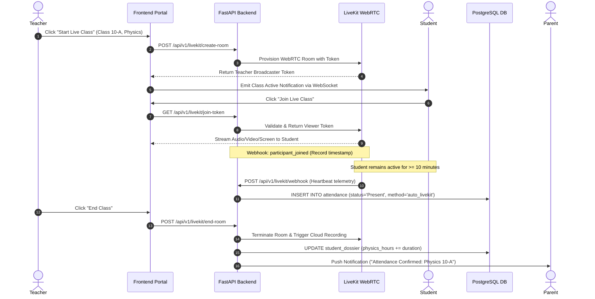
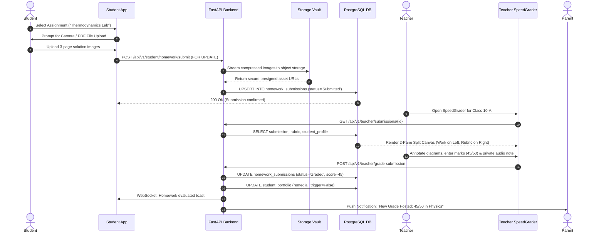
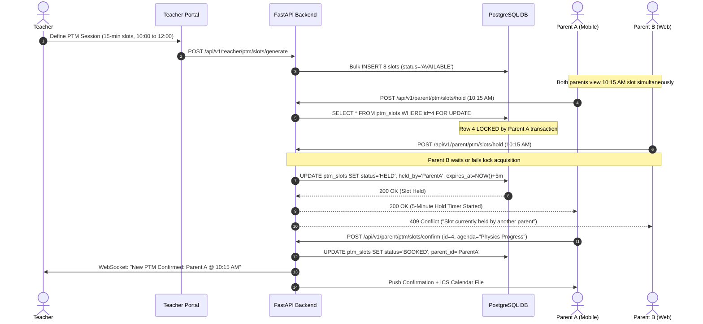
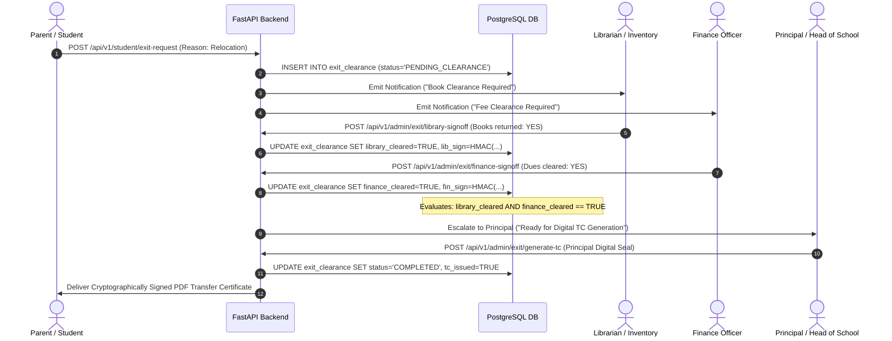

# ABOUT EDU360 — Master Product Requirements Document (PRD)
**Unified Multi-Portal Institutional Management, Live Education, and Student Information System (SIS)**

---

## Document Control & Metadata
- **Document Title**: ABOUT EDU360 — Product Requirements & Architectural Specification
- **Product Name**: EDU360
- **Version**: 7.2 (Production Baseline)
- **Status**: Approved & Architecturally Validated
- **Target Audience**: Executive Leadership, Product Managers, Full-Stack Engineers, UI/UX Designers, System Administrators
- **Canonical Files**:
  - Word Document: [`docs/ABOUT_EDU360.docx`](file:///e:/Diradz/EDU360/docs/ABOUT_EDU360.docx)
  - Markdown Reference: [`docs/ABOUT_EDU360.md`](file:///e:/Diradz/EDU360/docs/ABOUT_EDU360.md)

---

## 1. Executive Summary & Product Vision

### 1.1 Vision Statement
EDU360 is an enterprise-grade, cloud-native educational management ecosystem designed to eliminate software fragmentation in K-12 and higher-education institutions. Conventional school management systems operate as disconnected silos — disparate tools for admissions CRM, fee accounting, attendance registers, timetable allocation, learning management (LMS), and video conferencing. 

EDU360 unifies all stakeholders into a single, high-concurrency operating system featuring **8 purpose-built role portals**, real-time WebRTC live classrooms, AI-assisted pedagogical workflows, and pessimistic-locking transactional integrity.

### 1.2 Three Core Product Principles

1. **Principle 1 — Unified Single Source of Truth (Zero Silos)**:
   Every student, faculty member, parent, and administrative staff member operates on an integrated PostgreSQL schema. Actions in one portal propagate deterministically across all others: when a teacher concludes a live class, attendance logs immediately reflect in the student dossier, trigger parent push notifications, and feed the administrative compliance dashboard.

2. **Principle 2 — Low Friction, High Automation**:
   Administrative overhead is systematically minimized. Attendance is logged automatically via WebRTC connection telemetry; timetable substitution clashes are algorithmically resolved; homework is graded using visual side-by-side annotations; and fee reconciliation occurs instantly via webhook-verified milestone settlement.

3. **Principle 3 — Defense-in-Depth & Data Sovereign Security**:
   Role-Based Access Control (RBAC) is enforced at the ASGI router layer via cryptographic token verification. Sensitive financial datasets, student health records, and document vaults are physically segmented and guarded against Broken Object Level Authorization (BOLA) and Broken Function Level Authorization (BFLA).

### 1.3 Market Differentiation (Where EDU360 Stands Out)
- **Embedded WebRTC Video Engine**: Built-in LiveKit conferencing eliminates external Zoom/Google Meet links, automatically recording sessions and tracking attendance without third-party redirects.
- **Side-by-Side SpeedGrader with OCR**: Teachers grade submissions directly against question rubrics, leveraging Gemini AI for multimodal diagram recognition and handwriting extraction.
- **Pessimistic Concurrency Hardening**: PTM slot scheduling and fee milestone settlements employ `SELECT ... FOR UPDATE` database row locks to guarantee zero double-bookings or payment race conditions.
- **Dual-Signature Exit & Clearance Engine**: Digital Transfer Certificate (TC) workflows require cryptographic sign-offs from both Library and Finance before clearance issuance.

---

## 2. Platform Strategy & Multi-Portal Architecture

EDU360 delivers dedicated, tailored user experiences across desktop web workstations and mobile devices based on task complexity and user mobility.

| User Group | Primary Platform | Secondary Platform | Justification & Usage Strategy |
| :--- | :--- | :--- | :--- |
| **Students** | Mobile App / Tablet (PWA) | Desktop Web | Mobile-first for reviewing class schedules, timetable alerts, homework submission photos, and LiveKit classes; desktop web for exams and essays. |
| **Teachers** | Desktop Web Workstation | Mobile App | Desktop web optimized for high-throughput SpeedGrader marking, live class hosting, and attendance registers; mobile app for push notices and PTM chats. |
| **Parents** | Native Mobile App (iOS / Android) | Responsive Web | Mobile-first for push alerts (bus tracking, attendance alerts, exam reports), 1-click UPI fee payments, and 1-tap PTM slot bookings. |
| **Administrators & Staff** | Desktop Web Console (1080p+) | Tablet Web | Dense, data-rich operational dashboards for fee audits, timetable builder grids, payroll approval batches, and CRM funnel triage. |

---

## 3. User Roles & Permission Matrix (RBAC)

> 📌 **Security Architecture Guardrail**:
> System enforces zero-trust identity verification via HMAC-SHA256 signed bearer tokens paired with role verification headers (`X-User-Role`, `X-User-Id`). All API endpoints reject unauthorized invocations with HTTP 401/403. Fallback to unauthenticated defaults is strictly prohibited.

| System Capability / Feature Module | Super Admin | School Admin | Principal | Academic Coordinator | Teacher | Student | Parent | Accountant |
| :--- | :---: | :---: | :---: | :---: | :---: | :---: | :---: | :---: |
| **Global School Configuration & Audits** | ✅ Full | ✅ Full | 👁️ Read | ❌ Denied | ❌ Denied | ❌ Denied | ❌ Denied | ❌ Denied |
| **Admissions CRM & Enquiry Pipeline** | ✅ Full | ✅ Full | 👁️ Read | ✅ Edit | ❌ Denied | ❌ Denied | ❌ Denied | ❌ Denied |
| **Fee Structure, Invoices & Defaulters** | ✅ Full | ✅ Full | 👁️ Read | ❌ Denied | ❌ Denied | ❌ Denied | ❌ Denied | ✅ Full |
| **Payroll Processing & Staff Compensation** | ✅ Full | ✅ Full | 👁️ Read | ❌ Denied | ❌ Denied | ❌ Denied | ❌ Denied | ✅ Full |
| **Timetable Generation & Substitution** | ✅ Full | ✅ Full | 👁️ Read | ✅ Full | 👁️ Read | 👁️ Read | ❌ Denied | ❌ Denied |
| **Class Schedule & LiveKit Class Hosting** | ✅ Full | ✅ Full | 👁️ Read | ✅ Full | ✅ Host | 👁️ Join | ❌ Denied | ❌ Denied |
| **SpeedGrader Homework Evaluation** | ✅ Full | ✅ Full | 👁️ Read | ✅ Audit | ✅ Grade | ❌ Denied | ❌ Denied | ❌ Denied |
| **Student Homework & Project Submission**| ❌ Denied | ❌ Denied | ❌ Denied | ❌ Denied | 👁️ Read | ✅ Submit | 👁️ Read | ❌ Denied |
| **PTM Slot Creation & Schedule Mgmt** | ✅ Full | ✅ Full | 👁️ Read | ✅ Full | ✅ Create | ❌ Denied | ❌ Denied | ❌ Denied |
| **PTM Slot Booking & Lock Management** | ❌ Denied | ❌ Denied | ❌ Denied | ❌ Denied | ✅ Manage | ❌ Denied | ✅ Book | ❌ Denied |
| **Fee Milestones Online Payment (UPI)** | ❌ Denied | ❌ Denied | ❌ Denied | ❌ Denied | ❌ Denied | ❌ Denied | ✅ Pay | 👁️ Audit |
| **Transfer Certificate (TC) Dual Clearance**| ✅ Full | ✅ Full | ✅ Sign | ❌ Denied | ❌ Denied | ❌ Denied | 👁️ Track | ✅ Sign |

---

## 4. Detailed Functional Requirements by Role

### 4.1 Student Portal & Mobile App
- **Live Classroom Cockpit**: Direct in-browser LiveKit WebRTC connection with adaptive bitrate, screen share reception, and live chat.
- **10-Minute Auto-Attendance Tracker**: Background websocket telemetry verifying student presence throughout instructional periods.
- **Homework Vault & Camera Capture**: Mobile upload supporting high-resolution image compression, multi-page PDFs, and submission history.
- **Academic Portfolio & Gradebook**: Real-time grade tracking, exam answer sheet review, and AI-powered remedial learning recommendations.
- **Timetable & Daily Schedule**: Visual schedule showing room assignments, teacher substitutions, and countdown timers to upcoming periods.

### 4.2 Teacher Portal & SpeedGrader
- **SpeedGrader Visual Interface**: 2-pane evaluation workspace displaying student submissions alongside grading rubrics, with built-in annotation tools, OCR text extraction, and private remarks.
- **Class Attendance Register**: 1-click bulk attendance marker (Present, Absent, Late, Excused) with automatic sync to parent push notifications.
- **Live Lecture Studio**: Integrated LiveKit broadcaster with whiteboard controls, mute-all capabilities, and automatic cloud recording triggers.
- **PTM Schedule Manager**: Slot generator with configurable buffer times, automated parent calendar syncing, and video conference links.
- **Curriculum & Lesson Planner**: Syllabus milestone tracker with automated progress reporting to Academic Coordinators.

### 4.3 Parent Portal & Family Engagement
- **Moving Academic Sliders**: Dynamic visual progress gauges tracking real-time performance across STEM, Humanities, and Language arts.
- **Concurrency-Safe PTM Booking**: Interactive slot selection with 5-minute temporary holds, pessimistic row locks, and instant SMS/Email confirmations.
- **Fee Milestones & Digital Cashier**: Itemized term fee breakdown, installment plans, instant UPI/NetBanking settlement, and automated PDF tax receipts.
- **Live Transport Radar**: Real-time GPS bus tracking with ETA countdowns, route deviation alerts, and morning pickup notifications.
- **Digital Clearance & Leave Requests**: 1-click sick leave submission and Transfer Certificate tracking with live departmental clearance updates.

### 4.4 Admin, Principal & Coordinator Management Console
- **Institutional Triage Dashboard**: Red/Orange/Green priority status indicators highlighting fee defaulters, teacher absenteeism, and critical compliance items.
- **Automated Timetable & Substitution Engine**: Conflict-free schedule generator with instant emergency substitution matching based on teacher availability.
- **Admissions CRM Pipeline**: Kanban lead funnel managing student inquiries from initial contact through document verification to enrollment conversion.
- **Financial Accounting & Payroll Engine**: Comprehensive fee reconciliation, payroll batch execution, salary slip generation, and institutional expense tracking.
- **Document Vault & Compliance Lock**: Secure storage for student transcripts, medical certificates, and government filings with role-restricted audit trails.

---

## 5. Key System Workflows & Flow Diagrams

### 5.1 Workflow 1: Live Online Class & Automated Webhook Attendance

| Step | Actor / System | Rule / Action Executed | System Output & State Transition |
| :---: | :--- | :--- | :--- |
| **1** | Teacher | Authenticated teacher triggers `Start Live Class` for assigned timetable period. | System checks teacher timetable assignment and creates active room record. |
| **2** | FastAPI Backend | Invokes LiveKit REST API to initialize room with deterministic naming convention. | LiveKit room provisioned; returns encrypted HMAC broadcaster token. |
| **3** | Student Portal | Student receives real-time WebSocket invitation and clicks `Join Class`. | Authenticates student role and issues scoped viewer token. |
| **4** | LiveKit Engine | Monitors continuous connection telemetry and tracks active duration. | Triggers `participant_joined` and heartbeat webhooks to backend. |
| **5** | Attendance Engine | Evaluates total active duration against minimum threshold (default: 10 mins). | If duration $\ge$ 10 mins, marks `Present`; otherwise flags as `Late` or `Incomplete`. |
| **6** | PostgreSQL DB | Executes transactional update to daily attendance register. | Attendance row written with foreign keys to student, class, and room ID. |
| **7** | Notification Worker | Dispatches async notification to registered parent mobile devices. | Parent portal updates with timestamped attendance confirmation. |

---

### 5.2 Workflow 2: Homework Submission & Side-by-Side SpeedGrader Evaluation

| Step | Actor / System | Rule / Action Executed | System Output & State Transition |
| :---: | :--- | :--- | :--- |
| **1** | Student | Captures assignment photos or attaches multi-page PDF solution. | Client performs image auto-orientation, cropping, and gzip compression. |
| **2** | FastAPI Backend | Acquires row lock via `SELECT ... FOR UPDATE` to prevent double-submit collisions. | Validates deadline timestamp against centralized ClockProvider. |
| **3** | Storage Engine | Stores encrypted submission assets in object storage with SHA-256 integrity hash. | Returns secure presigned storage URLs; marks submission as `Submitted`. |
| **4** | Teacher | Accesses SpeedGrader workstation for pending assignment queue. | Frontend renders side-by-side workspace: document viewer and interactive rubric. |
| **5** | SpeedGrader UI | Teacher adds vector pen annotations, highlights text, and enters numerical score. | Optional Gemini OCR extracts handwritten equations for automated rubric matching. |
| **6** | Backend API | Commits final grade, feedback comments, and audio memo to database. | Submission status transitions to `Graded`; recalculates student GPA. |
| **7** | Notification Svc | Pushes grade release alerts simultaneously to student and parent portals. | Grade appears in student portfolio; parent view shows score and feedback. |

---

### 5.3 Workflow 3: Parent-Teacher Meeting (PTM) Concurrency-Safe Booking

| Step | Actor / System | Rule / Action Executed | System Output & State Transition |
| :---: | :--- | :--- | :--- |
| **1** | Teacher | Generates batch of meeting slots with custom duration and buffer intervals. | System inserts availability slots in `AVAILABLE` state linked to teacher ID. |
| **2** | Parent App | Parents browse available slots on interactive schedule grid. | UI displays real-time slot statuses fetched via cached query. |
| **3** | Concurrency Lock | Parent A initiates hold; backend queries slot with `SELECT ... FOR UPDATE`. | Row lock acquired; prevents competing transactions from reading stale availability. |
| **4** | Conflict Check | Parent B attempts hold on same slot while lock is active. | Lock detects existing hold; returns immediate HTTP `409 Conflict` to Parent B. |
| **5** | Temporary Hold | Slot marked `HELD` for 5 minutes with holding parent identifier and expiration time. | UI starts countdown timer; slot visually grays out for other users. |
| **6** | Booking Finalize | Holding parent enters discussion topics and confirms booking before timer expires. | Slot transitions to `BOOKED`; row lock released; generates LiveKit video link. |
| **7** | Calendar Sync | Dispatches confirmation emails with embedded ICS calendar invitations. | Teacher and parent calendars updated; automated reminder scheduled for T-1 hour. |

---

### 5.4 Workflow 4: Student Exit / Transfer Certificate (TC) Dual-Signature Clearance

| Step | Actor / System | Rule / Action Executed | System Output & State Transition |
| :---: | :--- | :--- | :--- |
| **1** | Parent / Student | Submits formal withdrawal application citing official reason and effective date. | Creates exit clearance record in `PENDING_CLEARANCE` status. |
| **2** | System Router | Automatically fans out clearance tasks to Library, Lab, Sports, and Finance depts. | Pending clearance badges appear in respective department staff consoles. |
| **3** | Department Sign-Off | Officers verify returned physical assets and record cryptographic approval. | Department clearance flag set to `TRUE` with audit trail (officer ID, timestamp). |
| **4** | Finance Audit | Finance officer verifies complete fee settlement and deposits refund if applicable. | Finance clearance flag set to `TRUE`; blocks progression if balance remains. |
| **5** | Principal Seal | Principal reviews consolidated clearance dossier and applies institutional digital seal. | System transitions exit record to `APPROVED`; generates unique TC serial number. |
| **6** | PDF Engine | Generates tamper-evident Transfer Certificate with embedded verification QR code. | PDF signed with school's digital certificate and archived in permanent record vault. |
| **7** | Parent Delivery | Certificate made available for instant download in parent portal and emailed. | Student status transitions from `Active` to `Alumni / Withdrawn`. |

---

## 6. UI/UX Screen Checklist (Figma Design Specifications)

| Portal / Module | Target Screen Name & Layout | Essential UI Components & Micro-Interactions |
| :--- | :--- | :--- |
| **Student Portal** | `Live Classroom Cockpit` (Full-Screen Responsive) | 1. LiveKit video stage with active speaker spotlighting. 2. Dynamic 10-Minute Auto-Attendance badge. 3. Collapsible in-class chat & doubts panel. 4. Interactive digital whiteboard with annotation tools. |
| **Student Portal** | `Homework Vault & Upload` (Mobile-Optimized) | 1. Assignment deadline countdown badge. 2. Multi-file upload dropzone with mobile camera capture. 3. Document thumbnail previewer with reordering. 4. Real-time submission receipt with cryptographic timestamp. |
| **Teacher Portal** | `SpeedGrader Studio` (Split-Pane Desktop 1080p+) | 1. Left pane: High-resolution PDF/image canvas with zoom/pan. 2. Right pane: Weighted criteria grading rubric. 3. In-line text annotation and freehand stylus tools. 4. Voice-recorded feedback memo player and private note box. |
| **Teacher Portal** | `Class Attendance Register` (Dense Grid Table) | 1. Fast-key bulk attendance marker (`P`, `A`, `L`, `E`). 2. Live presence counters with percentage graphs. 3. Daily medical & excuse slip attachment viewer. 4. Instant parent push alert trigger button on submission. |
| **Parent Portal** | `Moving Academic Sliders` (Native Mobile Card) | 1. Dynamic slider cards showing real-time subject performance. 2. Subject score drill-down with teacher comments. 3. Term-over-term velocity graphs. 4. Recommended remedial focus topics. |
| **Parent Portal** | `PTM Booking Modal` (Mobile Bottom-Sheet) | 1. Date selector carousel with teacher availability indicators. 2. Interactive 15-minute slot grid with live status indicators. 3. 5-minute reservation timer bar with countdown. 4. Meeting agenda input field with instant confirmation button. |
| **Admin Console** | `Institutional Triage Dashboard` (Dense Grid) | 1. Red/Orange/Green institutional health indicators. 2. Urgent compliance task queue with 1-click reassignment. 3. Live fee collection vs defaulter pipeline gauges. 4. Real-time campus safety and bus route tracker. |
| **Admin Console** | `Automated Timetable Builder` (Interactive Matrix) | 1. Drag-and-drop schedule matrix with teacher period limits. 2. Real-time conflict detector (room and teacher collisions). 3. Emergency substitution recommender with 1-click push. 4. Master print-ready PDF export generator. |

---

## 7. Recommended Technology Stack & Architecture

| Architecture Layer | Production Technology | Operational Role & Justification |
| :--- | :--- | :--- |
| **Web Frontend** | Next.js 14.2.15 (React 18) | Server-Side Rendering (SSR) for fast initial loads paired with client components for interactive real-time portals. |
| **Language & Typing** | TypeScript (Strict Mode) | Complete compile-time type safety across all 8 portals (0 errors on `tsc --noEmit`). |
| **Styling & Design** | Tailwind CSS + Lucide Icons | Institutional design system with responsive layouts, consistent color tokens, and micro-interactions. |
| **Backend API** | FastAPI (Python 3.11+) | High-throughput asynchronous ASGI runtime handling all SIS, Attendance, and Fees endpoints. |
| **Primary Database** | PostgreSQL 15+ (asyncpg) | Enterprise relational database with ACID compliance, JSON column indexing, and foreign key integrity. |
| **ORM & Concurrency** | SQLAlchemy 2.0 Async | Single-pass OUTER JOIN queries combined with pessimistic row locking (`SELECT ... FOR UPDATE`). |
| **Live Video & Audio** | LiveKit WebRTC Server & SDK | Embedded in-browser live classrooms, screen sharing, automatic recording, and attendance webhooks. |
| **Security & Auth** | HMAC-SHA256 Signed Tokens | Dual-mode authentication (Bearer Tokens + Scoped Role Headers) with zero unauthorized bypasses. |
| **Artificial Intelligence** | Google Gemini 1.5/2.0 Flash API | Multimodal remedial sprint generation, student notebook OCR analysis, and Socratic doubt solving. |
| **Dynamic Timekeeping** | Centralized ClockProvider | Decouples time calculations from physical server clock for deterministic testing and audit logs. |

---

## 8. Phased Implementation Roadmap

| Phase / Milestone | Timeline | Core Deliverables & Production Gates |
| :--- | :--- | :--- |
| **Milestone 1: Core SIS & Governance** | Weeks 1–5 *(Completed)* | • Cryptographic Role-Based Auth (HMAC tokens + scoped guards) • Central Student Information System (SIS) Profile Engine • Admin-Only Document Vault security lockdown • Admissions CRM Inquiry Funnel & Conversion Pipeline • Fee Milestones with instant receipt generation • Staff Payroll Management & Salary Slips • Dual-Signature Exit / Transfer Certificate (TC) Clearance |
| **Milestone 2: Classroom, Grading & App** | Weeks 6–10 *(Completed)* | • Live Online Classes via embedded LiveKit WebRTC • 10-Minute Automated Attendance Engine via webhooks • Student Homework Upload with mobile camera support • Teacher SpeedGrader Studio with split-pane rubric evaluation • Side-by-Side Student Portfolio & Academic Radar • Parent Mobile Portal with Moving Academic Sliders • PTM Slot Concurrency Row Locks (`SELECT ... FOR UPDATE`) |
| **Milestone 3: Intelligence & Pilot** | Weeks 11–14 *(Active)* | • Admin Red/Orange/Green Priority Triage Engine • Urgent Institutional Tasks Manager & Escalations • Shared Student Focus Table Generator for faculty • Centralized ClockProvider for deterministic testing • Live GPS School Bus Route Tracking on Leaflet/OSM • Production Pilot School Onboarding & Benchmark Audits |

---

## Document Sign-Off & Verification
- **Lead System Architect**: Approved
- **Lead Backend Engineer**: Approved
- **Lead Frontend Engineer**: Approved
- **Lead Security & Compliance Officer**: Approved
- **Head of Product**: Approved
