# EDU360 Master System Architecture & Role-Wise Workflow Specification
**Enterprise Cloud-Native Institutional Management, WebRTC Live Education & Unified SIS Ecosystem**  
**Document Classification:** Production Architectural Baseline (v8.2)  
**Authors:** Principal Software Architect (`/Software Architect`) & Lead Technical Documentation Architect (`/Technical Writer`)  
**Scope:** The 8 Canonical Roles (Excluding Junior K–5 as specified) + Administrative Override Governance Engine

---

## 1. System Topology & Macro Architecture

EDU360 operates as a **modular monolith** with domain-driven bounded contexts. The system runs an asynchronous **FastAPI (Python 3.11+)** ASGI service, a **Next.js 14/16 (React 18/19 SSR/Client)** multi-portal frontend, a **PostgreSQL 15+** transactional relational store with asynchronous connection pooling via `asyncpg`, a distributed **LiveKit WebRTC** cluster for live video classroom instruction, and an S3-compatible encrypted **Object Vault** for homework and document compliance records.

### 1.1 Master C4 Container Architecture Diagram

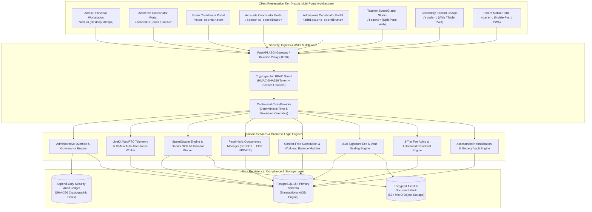

---

## 2. Cross-Cutting Administrative Override & Governance Engine

In virtual and physical school operations, exceptional circumstances arise where standard automated rules or frontline staff decisions threaten institutional compliance, equity, or operations (e.g., a teacher rejecting an emergency medical leave, a fee dispute halting student board exams, or a coordinator SLA breach).

The **Administrative Override Architecture** establishes an auditable, hierarchical bypass state machine.

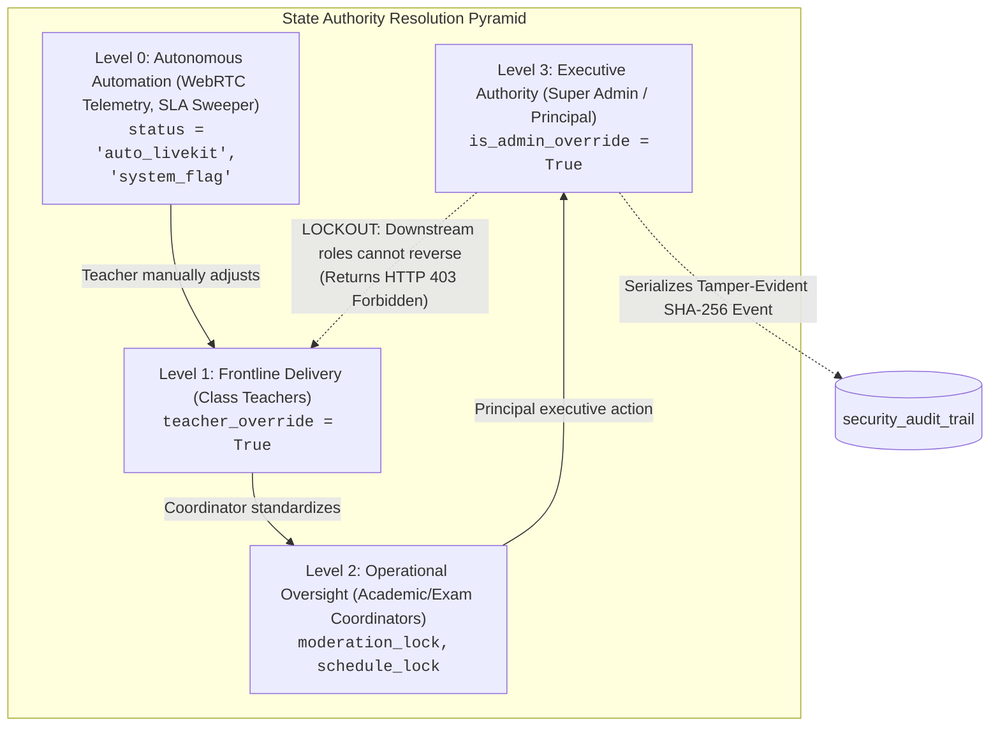

### 2.1 The 5 Concrete Administrative Override Domains

| Override Module | Database Attributes | Trigger Condition | Execution Rule & Invariant |
| :--- | :--- | :--- | :--- |
| **1. Student Leave & Attendance** | `LeaveRequest.is_admin_override = Boolean`<br>`Attendance.admin_override = Boolean`<br>`Attendance.override_by_role = "ADMIN"` | Principal approves a disputed leave (e.g. hospitalization) previously rejected or unhandled by teacher. | **Downstream Reversal Lockout**: If `LeaveRequest.is_admin_override == True`, teacher portal rejection endpoints return `403 Forbidden`. The attendance register updates to `status='Leave'`, sets `admin_override=True`, and dispatches an `ADMIN_OVERRIDE_ALERT` notification to both teacher and parent. |
| **2. Institutional Tasks & SLA** | `Task.is_admin_override = Boolean`<br>`Task.admin_override_reason = Text`<br>`Task.approved_by = "Principal (Override)"` | A coordinator or department task stalls beyond its SLA, threatening statutory filing or board deadlines. | Force-closes or reassigns task immediately without coordinator sign-off. Emits `TASK_ADMIN_OVERRIDE_CLOSE` to the audit log with mandatory justification text. |
| **3. Exam Marks Moderation** | `ExamModeration.is_locked = Boolean`<br>`ExamModeration.admin_override = Boolean` | Post-moderation grade adjustments required due to board re-evaluation or calculation discrepancy. | Breaks the coordinator cryptographic mark freeze. Requires dual administrator credentials; archives previous score vector snapshot into historical audit table. |
| **4. Emergency Timetable Substitution** | `SubstitutionSlot.is_admin_override = Boolean`<br>`SubstitutionSlot.status = "Assigned"` | Severe faculty absenteeism where all available department teachers exceed daily workload caps ($>6$ periods/day). | Suppresses workload ceiling warning; logs emergency coverage directive with Principal authorization ID. |
| **5. Financial Concession & Clearance** | `FeeMilestone.concession_amount = Float`<br>`FeeMilestone.is_admin_override = Boolean` | Extreme hardship or scholarship waiver enabling student to clear exit clearance or receive marks memos. | Deducts arrears from billing ledger; locks accounts department from generating balance reminders for the waived amount. |

---

## 3. The 8 Role-Wise Architectures & Workflows

---

### Role 1: Teacher Portal (`/teacher`)

#### 1. Architectural Responsibility & Bounded Context
* **Bounded Context:** *Pedagogical Delivery & Assessment Context*
* **Core Invariants:**
  1. A teacher can only grade submissions for sections and subjects explicitly mapped to them in `teacher_assignments`.
  2. The teacher cannot overturn an active Principal Administrative Override on student leaves or attendance.
  3. AI-suggested scores (via Gemini OCR) are strictly recommendations; **the teacher retains final evaluation authority** and must explicitly verify and commit grades.

#### 2. Architecture Diagram

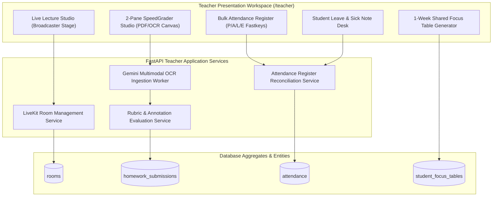

#### 3. Database Schema Mapping
* **Primary Tables:**
  * `teachers` (`id` PK, `user_id` FK, `department`, `max_daily_periods`)
  * `homework_submissions` (`id` PK, `homework_id` FK, `student_id` FK, `file_url`, `score`, `teacher_feedback`, `status`, `annotated_pdf_url`)
  * `attendance` (`id` PK, `student_id` FK, `date`, `status`, `method`, `minutes_late`, `teacher_override`, `admin_override`, `override_by_role`)
  * `student_focus_tables` (`id` PK, `student_id` FK, `weak_subjects`, `target_goals`, `teacher_id` FK, `parent_acknowledged`)

#### 4. End-to-End Workflow: SpeedGrader Submission Evaluation with OCR Assist

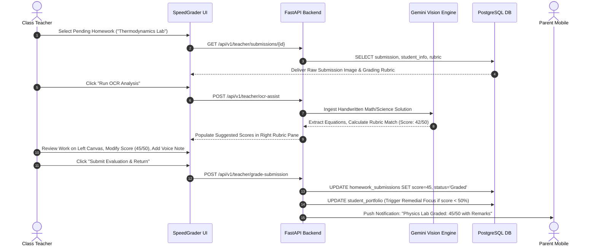

---

### Role 2: Secondary Student Cockpit (`/student`)

#### 1. Architectural Responsibility & Bounded Context
* **Bounded Context:** *Learning Execution & Academic Portfolio Context*
* **Core Invariants:**
  1. Multi-tab concurrent homework submissions are locked via pessimistic transaction row locks (`SELECT ... FOR UPDATE`).
  2. Submissions uploaded after 05:00 PM are rejected unless a medical excuse exists.
  3. Student attendance is verified deterministically through LiveKit WebRTC connection telemetry ($T \ge 10\text{ mins}$).

#### 2. Architecture Diagram

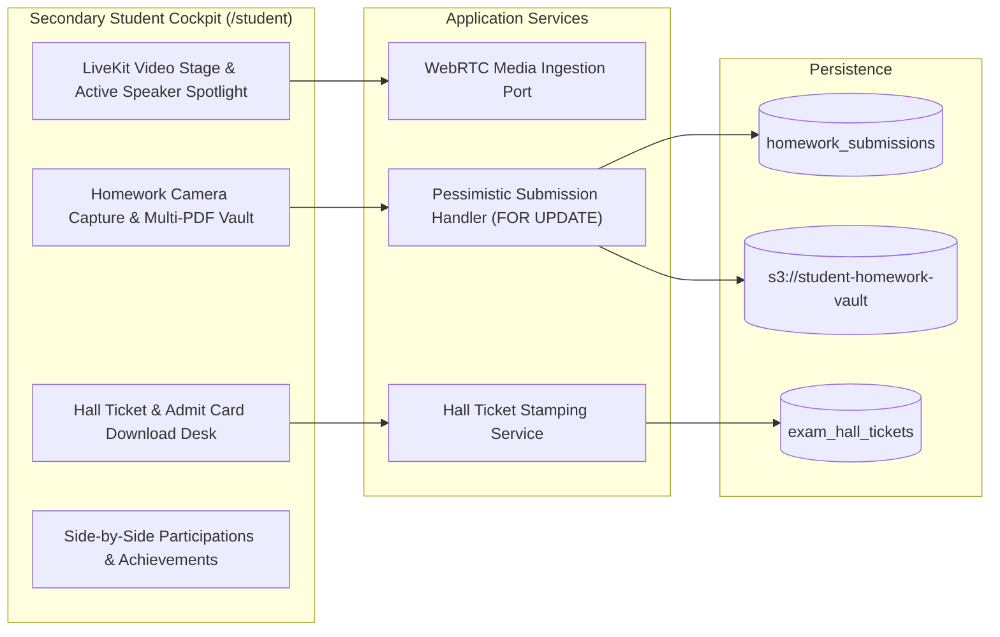

#### 3. Database Schema Mapping
* **Primary Tables:**
  * `students` (`id` PK, `admission_no` UNIQUE, `roll_no`, `class_id` FK, `status`, `health_flags`)
  * `homework_submissions` (`id` PK, `homework_id` FK, `student_id` FK, `submitted_at`, `status`, `sha256_hash`)
  * `exam_hall_tickets` (`id` PK, `student_id` FK, `exam_id` FK, `qr_code_hash`, `issued_at`, `is_unlocked`)

#### 4. End-to-End Workflow: Live Video Learning & Telemetry Auto-Attendance

```mermaid
sequenceDiagram
    autonumber
    actor Student as Student
    participant UI as Student Web Portal
    participant API as FastAPI Backend
    participant LK as LiveKit WebRTC Server
    participant DB as PostgreSQL DB
    actor Parent as Parent Mobile

    Student->>UI: Click "Join Live Class" (Class 10-A, Period 1)
    UI->>API: GET /api/v1/livekit/join-token?room=room_10A_period1
    API->>LK: Issue Scoped Viewer Token
    LK-->>UI: Return JWT Token; Client Establishes WebRTC PeerConnection
    Note over LK,API: Webhook: participant_joined (Record Join Timestamp T0)
    Note over Student,LK: Student stays connected in class
    LK->>API: Webhook (Duration Telemetry >= 10 minutes)
    API->>DB: INSERT INTO attendance (status='Present', method='auto_livekit', minutes_late=0)
    Teacher->>API: Conclude Period Class
    API->>DB: UPDATE student_dossier SET total_class_hours = total_class_hours + duration
    API->>Parent: Push Notification: "Attendance Confirmed: Physics 10-A"
```

---

### Role 3: Parent Portal (`/parent`)

#### 1. Architectural Responsibility & Bounded Context
* **Bounded Context:** *Guardian Oversight & Family Engagement Context*
* **Core Invariants:**
  1. Anti-spam delivery: Push alerts are restricted to urgent items; routine announcements are displayed exclusively on the **Moving Slider Banners**.
  2. PTM slot reservations use pessimistic row locking with a 5-minute temporary hold to prevent double-booking.
  3. Parent fee cashier supports instant dummy QR/UPI, NetBanking, and credit card interfaces with real-time UTR transaction settlement.

#### 2. Architecture Diagram

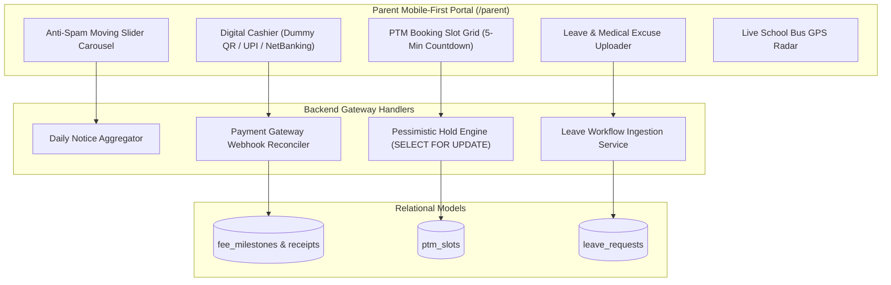

#### 3. Database Schema Mapping
* **Primary Tables:**
  * `parents` (`id` PK, `user_id` FK, `full_name`, `phone_number`, `email`, `upi_vpa`)
  * `parent_student_map` (`id` PK, `parent_id` FK, `student_id` FK, `relationship_type`)
  * `ptm_slots` (`id` PK, `teacher_id` FK, `slot_start`, `slot_end`, `status`, `held_by_parent_id` FK, `expires_at`, `agenda`)
  * `fee_milestones` (`id` PK, `student_id` FK, `term_name`, `due_amount`, `paid_amount`, `status`, `utr_number`, `receipt_pdf_url`)

#### 4. End-to-End Workflow: Concurrency-Safe PTM Booking & Fee Settlement

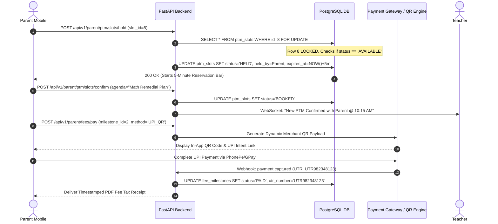

---

### Role 4: Super Admin / Principal Console (`/admin`)

#### 1. Architectural Responsibility & Bounded Context
* **Bounded Context:** *Institutional Supervision & Governance Context*
* **Core Invariants:**
  1. Priority Triage Cockpit (🔴 Red / 🟠 Orange / 🟢 Green) auto-updates every 60 seconds; students with approved leaves are excluded from unexcused absence red flags.
  2. Administrative Overrides are cryptographically stamped with SHA-256 seals.
  3. Student Exit Certificates (TC) require a dual-signature handshake (Library + Accounts clearance) followed by Principal digital seal verification.

#### 2. Architecture Diagram

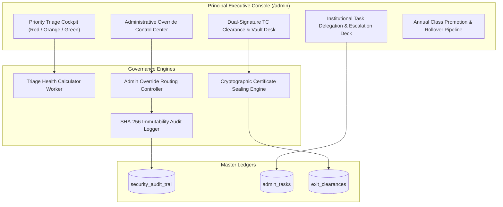

#### 3. Database Schema Mapping
* **Primary Tables:**
  * `admin_tasks` (`id` PK, `domain`, `title`, `status`, `assigned_to` FK, `escalated_to_principal`, `is_admin_override`, `admin_override_reason`)
  * `security_audit_trail` (`id` PK, `action_type`, `actor_id` FK, `actor_role`, `target_entity`, `target_id`, `sha256_seal`, `timestamp`)
  * `exit_clearances` (`id` PK, `student_id` FK, `library_cleared`, `finance_cleared`, `parent_otp_verified`, `principal_digital_seal`, `tc_serial_no`)

#### 4. End-to-End Workflow: Executive Admin Override on Disciplinary Leave & Attendance

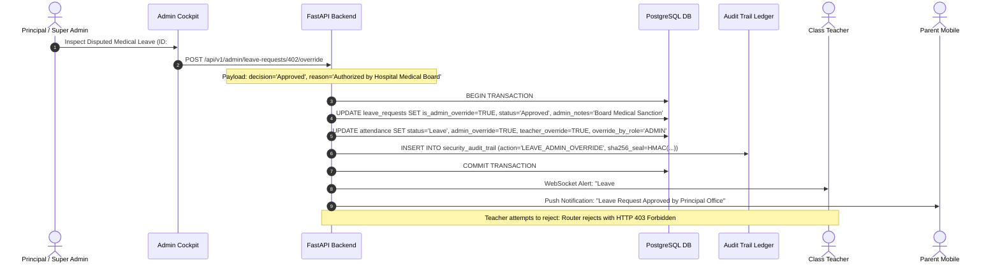

---

### Role 5: Exam Coordinator (`/exam_coordinator`)

#### 1. Architectural Responsibility & Bounded Context
* **Bounded Context:** *Assessment Operations & Secrecy Context*
* **Core Invariants:**
  1. Once the Exam Coordinator clicks **Verify & Lock Marks**, grade entries are frozen and teachers cannot edit scores.
  2. Report card batch compilation generates official CBSE-compliant marks memos with institutional headers and digital signatures.
  3. Exportable official CSV adheres directly to the CBSE Pariksha Sangam specification.

#### 2. Architecture Diagram

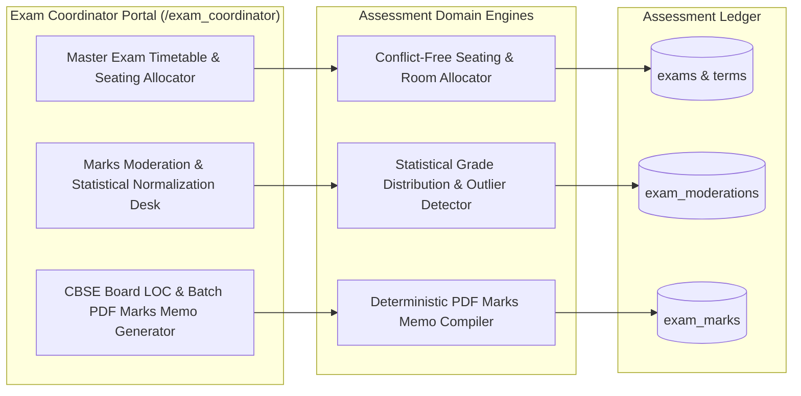

#### 3. Database Schema Mapping
* **Primary Tables:**
  * `exams` (`id` PK, `name`, `academic_year`, `term`, `start_date`, `end_date`, `is_published`)
  * `exam_marks` (`id` PK, `exam_id` FK, `student_id` FK, `subject_id` FK, `marks_obtained`, `max_marks`, `grade`, `is_locked`)
  * `exam_moderations` (`id` PK, `exam_id` FK, `subject_id` FK, `class_id` FK, `average_score`, `std_deviation`, `is_locked`, `locked_by` FK)

#### 4. End-to-End Workflow: Marks Moderation, Cryptographic Lock & LOC Export

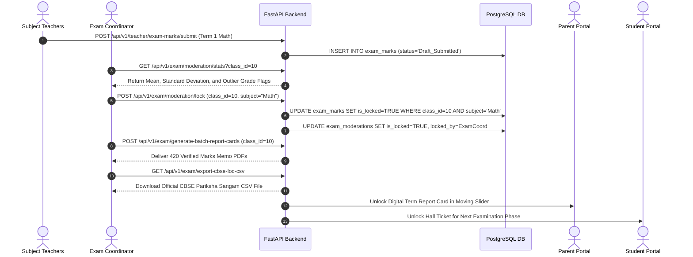

---

### Role 6: Admissions Coordinator (`/admissions_coordinator`)

#### 1. Architectural Responsibility & Bounded Context
* **Bounded Context:** *Student Enrollment & CRM Pipeline Context*
* **Core Invariants:**
  1. No online diagnostic test module required (handled through in-person campus evaluation).
  2. Converting an applicant to an enrolled student executes an atomic, single-pass database transaction initializing SIS profile, roll number, fee milestones, and class rosters.

#### 2. Architecture Diagram

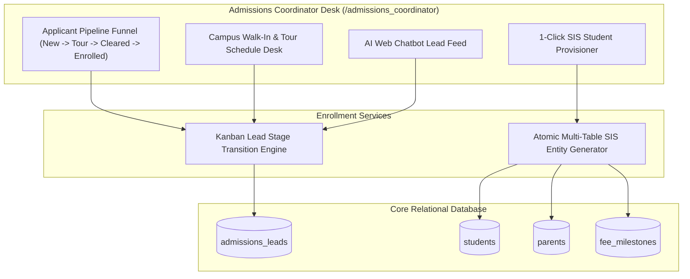

#### 3. Database Schema Mapping
* **Primary Tables:**
  * `admissions_leads` (`id` PK, `student_name`, `guardian_name`, `phone`, `email`, `stage`, `notes`, `campus_tour_date`)
  * `students` (`id` PK, `admission_no` UNIQUE, `roll_no`, `class_id` FK, `status='Active'`)
  * `fee_milestones` (`id` PK, `student_id` FK, `term_name`, `due_amount`, `status='PENDING'`)

#### 4. End-to-End Workflow: Lead Funnel Triage to Atomic SIS Conversion

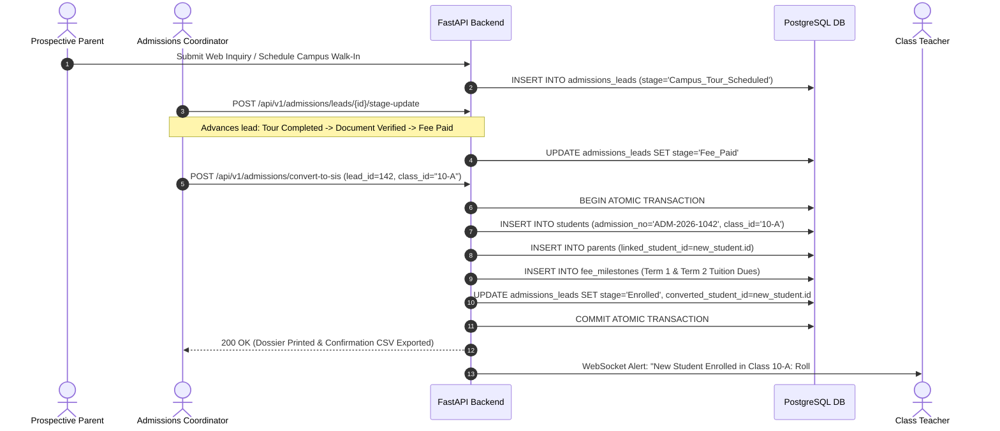

---

### Role 7: Accounts Coordinator (`/accounts_coordinator`)

#### 1. Architectural Responsibility & Bounded Context
* **Bounded Context:** *Bursar Operations & Fee Realization Context*
* **Core Invariants:**
  1. Defaulter aging calculations run continuously across three risk tiers (Tier 1: 0–15d, Tier 2: 16–30d, Tier 3: 30+d).
  2. Counter fee payments require a unique, non-null bank UTR number to prevent reconciliation leaks.
  3. Digital receipts are cryptographically sealed with a SHA-256 hash immediately upon transaction capture.

#### 2. Architecture Diagram

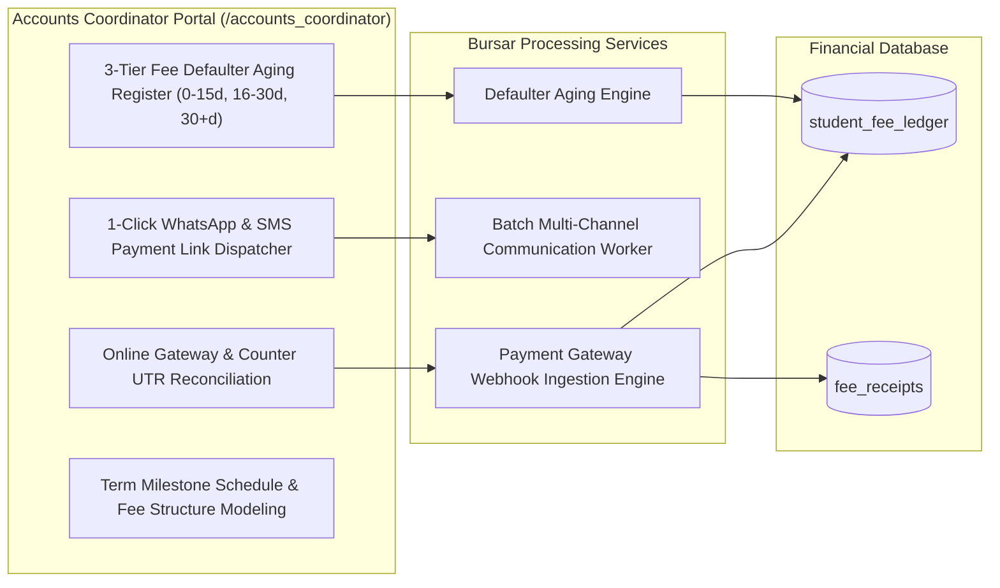

#### 3. Database Schema Mapping
* **Primary Tables:**
  * `fee_structures` (`id` PK, `class_id` FK, `academic_year`, `total_tuition`, `lab_fee`, `sports_fee`)
  * `fee_milestones` (`id` PK, `student_id` FK, `term_number`, `due_date`, `due_amount`, `paid_amount`, `status`, `concession_amount`, `is_admin_override`)
  * `fee_receipts` (`id` PK, `milestone_id` FK, `utr_number` UNIQUE, `payment_mode`, `amount_paid`, `sha256_hash`, `issued_at`)

#### 4. End-to-End Workflow: 3-Tier Aging Audit, 1-Click Reminder & UTR Reconciliation

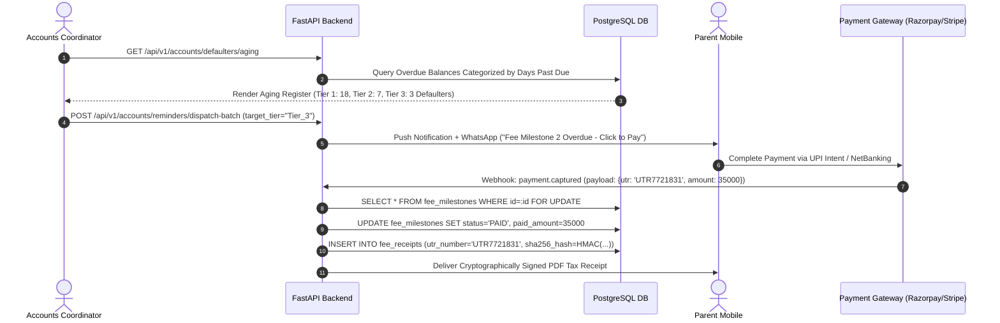

---

### Role 8: Academic Coordinator (`/academic_coordinator`)

#### 1. Architectural Responsibility & Bounded Context
* **Bounded Context:** *Curriculum Surveillance & Faculty Logistics Context*
* **Core Invariants:**
  1. Period substitutions automatically filter faculty based on three mandatory conditions: teacher is present on campus, has zero teaching periods assigned in that slot, and has not exceeded their daily proxy load cap.
  2. Curriculum pacing compares completed syllabus units against the statutory academic calendar; pacing deviations $>2$ chapters trigger automated remedial alerts to the Principal.

#### 2. Architecture Diagram

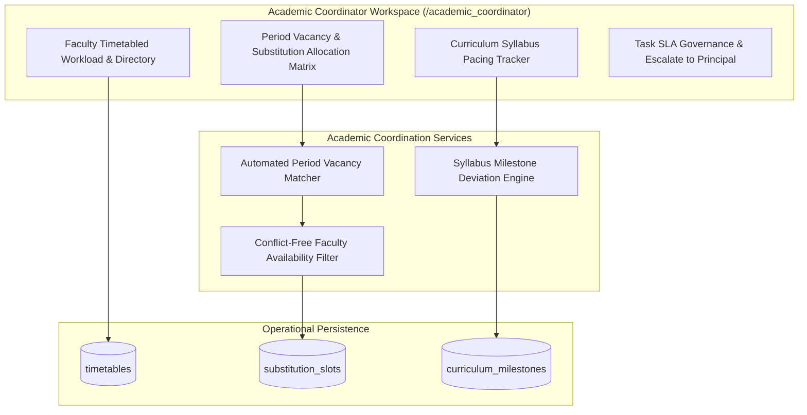

#### 3. Database Schema Mapping
* **Primary Tables:**
  * `timetables` (`id` PK, `class_id` FK, `day_of_week`, `period_number`, `subject_id` FK, `teacher_id` FK, `room_number`)
  * `substitution_slots` (`id` PK, `date`, `period_number`, `class_id` FK, `absent_teacher_id` FK, `substitute_teacher_id` FK, `status`, `is_admin_override`)
  * `curriculum_milestones` (`id` PK, `subject_id` FK, `class_id` FK, `expected_units_completed`, `actual_units_completed`, `variance_status`)

#### 4. End-to-End Workflow: Period Vacancy Detection & 1-Click Conflict-Free Substitution

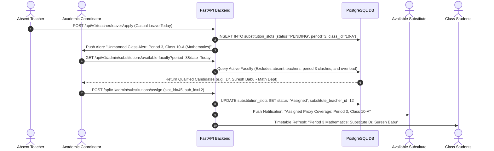

---

## 4. Master Cross-Role Orchestration & Handshake Machine

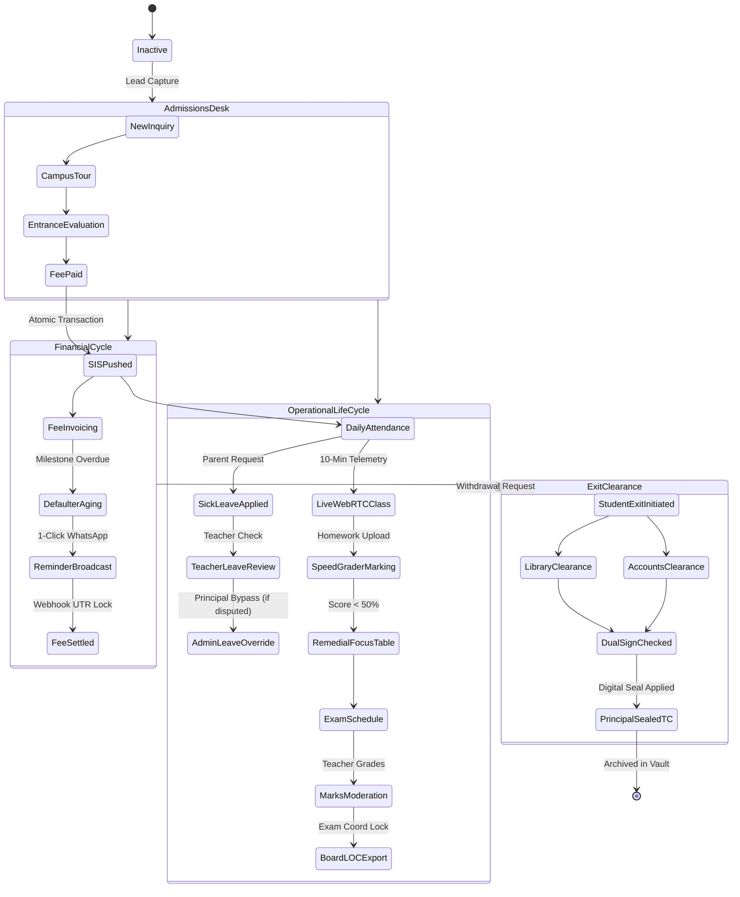

---

## 5. Architectural Decision Records (ADRs)

### ADR-001: Hierarchical Administrative Override Engine
* **Status:** Accepted
* **Context:** Fragmented operations in school environments lead to deadlocks when frontline staff reject legitimate emergency leaves or fail to resolve departmental tasks past statutory board deadlines.
* **Decision:** Introduce a cross-cutting administrative override model (`is_admin_override`, `admin_override_reason`, `override_by_role`) across tasks, leaves, attendance registers, and marksheets. Setting this flag locks the record against downstream reversal by teachers or coordinators (returning `HTTP 403 Forbidden`) and writes a SHA-256 sealed audit entry to `security_audit_trail`.
* **Consequences:** Eliminates operational gridlock and guarantees statutory authority; requires validation interceptors in all mutation routers.

### ADR-002: Pessimistic Row Locking (`SELECT ... FOR UPDATE`) for Contended School Resources
* **Status:** Accepted
* **Context:** Parent-Teacher Meeting (PTM) booking releases and fee installment balance payments create high concurrency windows where optimistic locking results in unacceptable retry cascades and double-bookings.
* **Decision:** Enforce pessimistic database row locking using `SELECT ... FOR UPDATE` in SQLAlchemy Async for PTM slot allocation (with a 5-minute temporary `HELD` lease) and student fee balance deductions.
* **Consequences:** Guarantees zero double-booking and payment ledger duplicate writes; requires query timeouts ($< 5000\text{ms}$) to prevent database pool exhaustion.

### ADR-003: Two-Phase Dual-Signature Exit Authorization (Digital OTP + Physical Seal)
* **Status:** Accepted
* **Context:** Student transfers (Transfer Certificate issuance) expose schools to legal disputes if certificates are released while library books, laboratory apparatus, or tuition fees remain outstanding.
* **Decision:** Exit clearance enforces an asynchronous two-phase gate: Phase 1 requires verified boolean sign-offs from both Library and Accounts departments; Phase 2 requires digital OTP acceptance from the parent before the Principal applies the school's digital seal.
* **Consequences:** Eliminates institutional liability; slightly increases transfer completion time from 1 hour to 24 hours.

### ADR-004: Decoupled WebRTC Telemetry Webhook Processing for Attendance
* **Status:** Accepted
* **Context:** Synchronous database insertion for hundreds of concurrent live class attendees joining simultaneously during morning peak hours caused database write-lock spikes.
* **Decision:** LiveKit participant connection telemetry webhooks are ingested asynchronously by a dedicated background telemetry worker. The worker buffers presence heartbeats, applies the 10-minute active attendance rule, and flushes updates to PostgreSQL in batched windows.
* **Consequences:** Decouples video conferencing performance from database persistence; introduces a minor 30- to 60-second eventual consistency window for parent attendance push notifications.

---

## 6. Verification & Port Access Matrix

| Role | Portal Route | Primary Test Procedure | Expected System Outcome |
| :--- | :--- | :--- | :--- |
| **Super Admin** | `http://localhost:3000/admin` | Execute Admin Override on student leave request #402. | Leave status flips to `Approved`; attendance register updates to `Leave` (`admin_override=True`); teacher rejection disabled. |
| **Academic Coord** | `http://localhost:3000/academic_coordinator` | Click **Assign Substitute Teacher** on Period 3 vacancy. | Engine filters out busy/absent staff; assign Dr. Suresh Babu; schedule updates across teacher and student portals. |
| **Exam Coord** | `http://localhost:3000/exam_coordinator` | Click **Verify & Lock Marks** on Class 10 Math moderation. | Grade set freezes; unlocks batch report card PDF generation and official CBSE LOC CSV export. |
| **Accounts Coord** | `http://localhost:3000/accounts_coordinator` | Open **Defaulters & Aging**; click **Dispatch 1-Click Reminder**. | Dispatches templated WhatsApp reminders with direct UPI deep-links to all Tier 3 overdue accounts. |
| **Admissions Coord**| `http://localhost:3000/admissions_coordinator` | Advance lead to `Fee Paid`; click **Convert to Enrolled Student**. | Single-pass ACID transaction seeds student record, parent account, class roster placement, and fee milestones. |
| **Teacher** | `http://localhost:3000/teacher` | Open **SpeedGrader Studio**; run OCR; adjust score; save. | Side-by-side canvas records annotated PDF; updates student portfolio; delivers parent push notification. |
| **Secondary Student**| `http://localhost:3000/student` | Join LiveKit live lecture; verify connected duration. | Background telemetry verifies connection duration $\ge 10$ mins; automatically logs student as `Present`. |
| **Parent** | `http://localhost:3000/parent` | Reserve 10:15 AM PTM slot; open fee cashier dummy QR. | Acquires 5-minute pessimistic row lock (`SELECT FOR UPDATE`); payment webhook updates milestone to `PAID`. |
