# EDU360 Master System Architecture & Role-Wise Workflow Specification
**Enterprise Cloud-Native Institutional Management, WebRTC Live Education & Unified SIS Ecosystem**  
**Document Classification:** Production Architectural Baseline (v9.0 — Fully Synchronized Cross-Role Ecosystem)  
**Authors:** Principal Software Architect (`/Software Architect`), Backend Architect (`/Backend Architect`), Database Optimizer (`/Database Optimizer`), Frontend Developer (`/Frontend Developer`), Codebase Archaeologist (`/Codebase Archaeologist`), Lead Technical Writer (`/Technical Writer`)  
**Scope:** The 8 Canonical Roles (Excluding Junior K–5 as specified) + Administrative Override Governance Engine + Cross-Role Real-Time Synchronization Bus

---

## 1. System Topology & Macro Architecture

EDU360 operates as a **modular monolith** with domain-driven bounded contexts. The system runs an asynchronous **FastAPI (Python 3.11+)** ASGI service, a **Next.js 14/16 (React 18/19 SSR/Client)** multi-portal frontend, a **PostgreSQL 15+** transactional relational store with asynchronous connection pooling via `asyncpg`, a distributed **LiveKit WebRTC** cluster for live video classroom instruction, a centralized **ClockProvider** simulation engine, a real-time **In-App Notification Center**, a reactive cross-portal **Fee Ledger Synchronization Bus**, and an S3-compatible encrypted **Object Vault** for homework and document compliance records.

### 1.1 Master C4 Container Architecture Diagram

```mermaid
graph TD
    subgraph ClientTiers ["Client Presentation Tier (Next.js Multi-Portal Architecture)"]
        UI_ADMIN["Admin / Principal Workstation<br/><code>/admin</code> (Desktop 1080p+)"]
        UI_ACAD["Academic Coordinator Portal<br/><code>/academic_coordinator</code>"]
        UI_EXAM["Exam Coordinator Portal<br/><code>/exam_coordinator</code>"]
        UI_ACC["Accounts Coordinator Portal<br/><code>/accounts_coordinator</code>"]
        UI_ADM["Admissions Coordinator Portal<br/><code>/admissions_coordinator</code>"]
        UI_TEACH["Teacher SpeedGrader Studio<br/><code>/teacher</code> (Split-Pane Web)"]
        UI_STUD["Secondary Student Cockpit<br/><code>/student</code> (Web / Tablet PWA)"]
        UI_PAR["Parent Mobile Portal<br/><code>/parent</code> (Mobile-First / PWA)"]
    end

    subgraph CrossCuttingEdge ["Cross-Cutting Reactive Edge Services"]
        NOTIF_BELL["Unified In-App Notification Center<br/>(Live Audio Chime, Unread Badges & Action Deep-Links)"]
        DYNAMIC_CLOCK["Dynamic ClockProvider Reactive Hook<br/>(30-Second Timetable & Exam Lifecycle Ticker)"]
        FEE_SYNC_BUS["Reactive Client-Side Fee Ledger Sync (fee-ledger.ts)<br/>(Immediate Dual-Portal Sync: Accounts & Admin)"]
        AUTHENTIC_QR["Authentic 29x29 UPI QR Generator (authentic-qr.tsx)<br/>(Dynamic Merchant Payload: PhonePe / GPay / BHIM)"]
    end

    subgraph GatewayTier ["Security, Ingress & ASGI Middleware"]
        INGRESS["FastAPI ASGI Gateway / Reverse Proxy (:8000)"]
        AUTH_RBAC["Cryptographic RBAC Guard<br/>(HMAC-SHA256 Token + Scoped Headers)"]
        CLOCK_SVC["Centralized ClockProvider Service<br/>(Deterministic Time & Simulation Overrides)"]
    end

    subgraph ServiceEngines ["Domain Services & Business Logic Engines"]
        OVERRIDE_ENG["Administrative Override & Governance Engine"]
        LIVEKIT_WORKER["LiveKit WebRTC Telemetry & 10-Min Auto-Attendance Worker"]
        SPEEDGRADER_ENG["SpeedGrader Engine & Gemini OCR Multimodal Worker"]
        CONCURRENCY_MGR["Pessimistic Concurrency Manager (SELECT ... FOR UPDATE)"]
        SUB_MATCHER["Conflict-Free Substitution & Workload Balance Matcher"]
        EXIT_CLEARANCE["Dual-Signature Exit & Vault Sealing Engine"]
        FEE_AGING["3-Tier Fee Aging & Counter Payment Engine (Overdue Balance Cap)"]
        PAYROLL_ENG["Staff Salaries & Payroll Engine (LOP Deductions & Four-Eye Maker-Checker)"]
        BATCH_EXAM_ENG["Batch Class Exam Scheduling & Dynamic Admit Card Engine"]
        ACADEMIC_SYNC["Academic & Exam Coordinator Syllabus Sync Protocol (ExamSyncRequest)"]
        ATOMIC_ENROLL["Admissions Atomic SIS Entity Inception Engine"]
        MODERATION_LEDGER["Assessment Normalization & Secrecy Vault Engine"]
    end

    subgraph PersistenceTier ["Data Persistence, Compliance & Storage Layer"]
        PG_MASTER[("PostgreSQL 15+ Primary Schema<br/>(Transactional ACID Engine via asyncpg)")]
        AUDIT_CHAIN[("Append-Only Security Audit Ledger<br/>(SHA-256 Cryptographic Seals)")]
        S3_VAULT[("Encrypted Asset & Document Vault<br/>(S3 / MinIO Object Storage)")]
    end

    UI_ADMIN & UI_ACAD & UI_EXAM & UI_ACC & UI_ADM & UI_TEACH & UI_STUD & UI_PAR --> NOTIF_BELL & DYNAMIC_CLOCK
    UI_PAR --> AUTHENTIC_QR
    UI_ACC & UI_ADMIN & UI_PAR --> FEE_SYNC_BUS
    NOTIF_BELL & DYNAMIC_CLOCK & FEE_SYNC_BUS --> INGRESS
    INGRESS --> AUTH_RBAC
    AUTH_RBAC --> CLOCK_SVC
    CLOCK_SVC --> OVERRIDE_ENG & LIVEKIT_WORKER & SPEEDGRADER_ENG & CONCURRENCY_MGR & SUB_MATCHER & EXIT_CLEARANCE & FEE_AGING & PAYROLL_ENG & BATCH_EXAM_ENG & ACADEMIC_SYNC & ATOMIC_ENROLL & MODERATION_LEDGER

    OVERRIDE_ENG & PAYROLL_ENG --> AUDIT_CHAIN
    OVERRIDE_ENG & LIVEKIT_WORKER & SPEEDGRADER_ENG & CONCURRENCY_MGR & SUB_MATCHER & EXIT_CLEARANCE & FEE_AGING & PAYROLL_ENG & BATCH_EXAM_ENG & ACADEMIC_SYNC & ATOMIC_ENROLL & MODERATION_LEDGER --> PG_MASTER
    SPEEDGRADER_ENG & EXIT_CLEARANCE --> S3_VAULT
```

---

## 2. Cross-Cutting Administrative Override & Governance Engine

In virtual and physical school operations, exceptional circumstances arise where standard automated rules or frontline staff decisions threaten institutional compliance, equity, or operations (e.g., a teacher rejecting an emergency medical leave, a fee dispute halting student board exams, or a coordinator SLA breach).

The **Administrative Override Architecture** establishes an auditable, hierarchical bypass state machine.

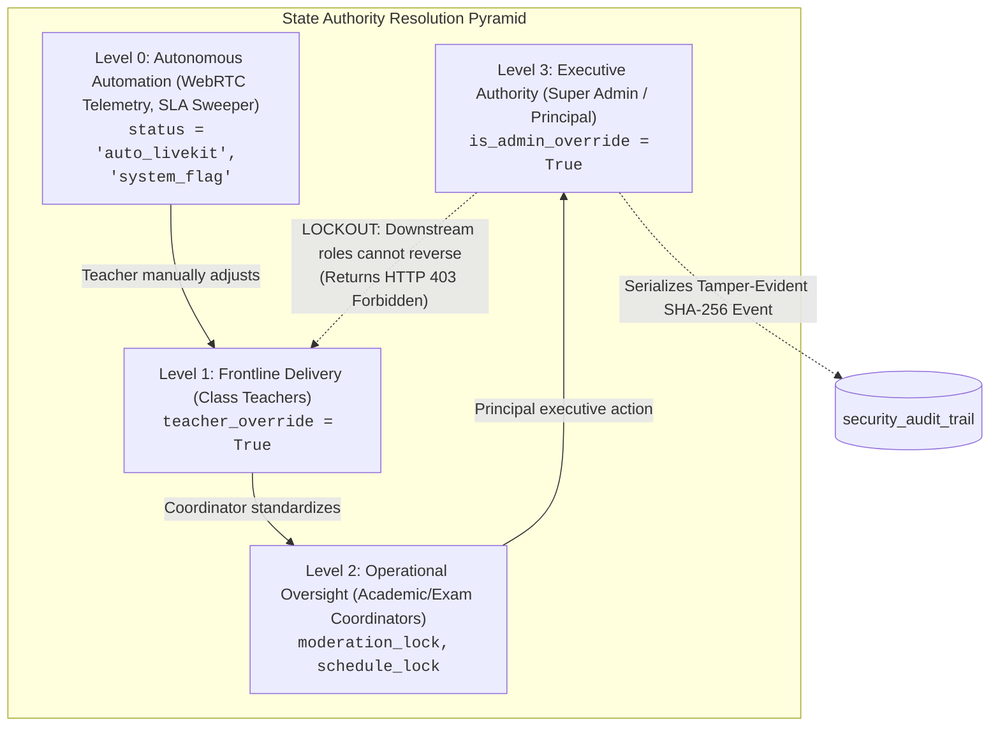

### 2.1 The 5 Concrete Administrative Override Domains

| Override Module | Database Attributes | Trigger Condition | Execution Rule & Invariant |
| :--- | :--- | :--- | :--- |
| **1. Student Leave & Attendance** | `LeaveRequest.is_admin_override = Boolean` `Attendance.admin_override = Boolean` `Attendance.override_by_role = "ADMIN"` | Principal approves a disputed leave (e.g. hospitalization) previously rejected or unhandled by teacher. | **Downstream Reversal Lockout**: If `LeaveRequest.is_admin_override == True`, teacher portal rejection endpoints return `403 Forbidden`. The attendance register updates to `status='Leave'`, sets `admin_override=True`, and dispatches an `ADMIN_OVERRIDE_ALERT` notification to both teacher and parent. |
| **2. Institutional Tasks & SLA** | `Task.is_admin_override = Boolean` `Task.admin_override_reason = Text` `Task.approved_by = "Principal (Override)"` | A coordinator or department task stalls beyond its SLA, threatening statutory filing or board deadlines. | Force-closes or reassigns task immediately without coordinator sign-off. Emits `TASK_ADMIN_OVERRIDE_CLOSE` to the audit log with mandatory justification text. |
| **3. Exam Marks Moderation** | `ExamModeration.is_locked = Boolean` `ExamModeration.admin_override = Boolean` | Post-moderation grade adjustments required due to board re-evaluation or calculation discrepancy. | Breaks the coordinator cryptographic mark freeze. Requires dual administrator credentials; archives previous score vector snapshot into historical audit table. |
| **4. Emergency Timetable Substitution** | `SubstitutionSlot.is_admin_override = Boolean` `SubstitutionSlot.status = "Assigned"` | Severe faculty absenteeism where all available department teachers exceed daily workload caps ($>6$ periods/day). | Suppresses workload ceiling warning; logs emergency coverage directive with Principal authorization ID. |
| **5. Financial Concession & Clearance** | `FeeMilestone.concession_amount = Float` `FeeMilestone.is_admin_override = Boolean` | Extreme hardship or scholarship waiver enabling student to clear exit clearance or receive marks memos. | Deducts arrears from billing ledger; locks accounts department from generating balance reminders for the waived amount. |

---

## 3. The 8 Role-Wise Architectures & Workflows

---

### Role 1: Teacher Portal (`/teacher`)

#### 1. Architectural Responsibility & Bounded Context
* **Bounded Context:** *Pedagogical Delivery, Assessment & Faculty Workforce Context*
* **Core Invariants:**
  1. A teacher can only grade submissions for sections and subjects explicitly mapped to them in `teacher_assignments`.
  2. The teacher cannot overturn an active Principal Administrative Override on student leaves or attendance.
  3. AI-suggested scores (via Gemini OCR) are strictly recommendations; **the teacher retains final evaluation authority** and must explicitly verify and commit grades.
  4. **Leave Categorization Invariant**: Teacher leave requests must declare a formal category:
     * `Casual Leave (CL)`
     * `Medical Leave (ML)` (with required medical documentation)
     * `On-Duty (OD)` (academic/exam proctoring duties)
     * `Loss of Pay / Unpaid (LOP)` (direct interlock with Accounts Coordinator payroll deductions)
  5. **Attendance Integrity**: Teachers log daily check-in and check-out via `StaffAttendanceDaily` (`staff_attendance_daily`), providing ground truth for substitute allocation and daily on-campus verification.
  6. **Dynamic Class Roster Sync**: When the Admissions Coordinator converts a CRM lead into an enrolled student, the student profile and Day 1 attendance baseline automatically appear in the assigned class teacher's live register without manual database re-seeding.

#### 2. Architecture Diagram

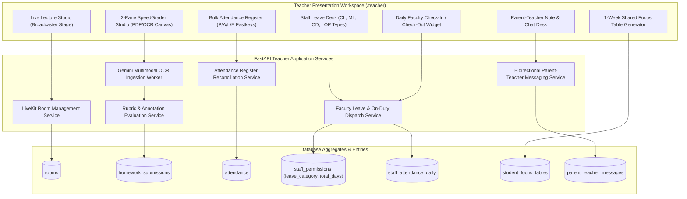

#### 3. Database Schema Mapping
* **Primary Tables:**
  * `teachers` (`id` PK, `user_id` FK, `department`, `max_daily_periods`)
  * `homework_submissions` (`id` PK, `homework_id` FK, `student_id` FK, `file_url`, `score`, `teacher_feedback`, `status`, `annotated_pdf_url`)
  * `attendance` (`id` PK, `student_id` FK, `date`, `status`, `method`, `minutes_late`, `teacher_override`, `admin_override`, `override_by_role`)
  * `staff_permissions` (`id` PK, `staff_id` FK, `leave_category`, `total_days`, `affected_periods`, `reason`, `status`, `approved_by`, `reviewed_at`)
  * `staff_attendance_daily` (`id` PK, `staff_id` FK, `attendance_date`, `check_in_time`, `check_out_time`, `status`, `notes`)
  * `student_focus_tables` (`id` PK, `student_id` FK, `weak_subjects`, `target_goals`, `teacher_id` FK, `parent_acknowledged`)
  * `parent_teacher_messages` (`id` PK, `student_id` FK, `sender_role`, `sender_name`, `message_text`, `timestamp`, `is_read`)

#### 4. End-to-End Workflow: SpeedGrader Submission Evaluation with OCR Assist

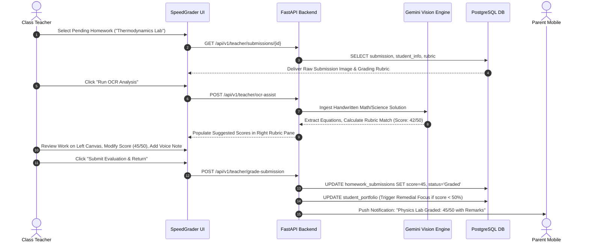

---

### Role 2: Secondary Student Cockpit (`/student`)

#### 1. Architectural Responsibility & Bounded Context
* **Bounded Context:** *Learning Execution, Examination & Academic Portfolio Context*
* **Core Invariants:**
  1. Multi-tab concurrent homework submissions are locked via pessimistic transaction row locks (`SELECT ... FOR UPDATE`).
  2. Submissions uploaded after 05:00 PM are rejected unless an approved medical excuse exists.
  3. Student attendance is verified deterministically through LiveKit WebRTC connection telemetry ($T \ge 10\text{ mins}$).
  4. **Day 1 Onboarding Baseline**: When enrolled, the student automatically receives an initial active `AttendanceRecord` (`status='Present'`), 5 statutory `FeeMilestones`, and a digital `HallTicket` linked to peer examinations.
  5. **Dynamic Admit Card Delivery**: Hall tickets / Admit cards stream directly from database batch schedules (`ExamSchedule`), rendering seat capacity, chief invigilator name, room code, and a tamper-evident verification QR code.
  6. **Conditional Live Exam Mounting Engine**: The live online exam view **strictly mounts only when**:
     * An exam schedule exists for the student's class and section on the current system date (`cleanDate === todayYMD`).
     * The schedule lifecycle status is currently `LIVE` ($T_{\text{start}} \le \text{CurrentMinutes} < T_{\text{end}}$).
     * The student has not already completed/submitted the exam (`examSubmissionState !== 'completed'`).
  7. **Real-Time Dynamic Timetable Lifecycle**: Evaluates every 30 seconds against the centralized `ClockProvider`:
     * Periods before start time render as `upcoming` with countdown timers.
     * Active periods render as `live`, illuminating the "Join Active Class Now" WebRTC button.
     * Concluded periods render as `completed`, rendering the "Watch Recording" link navigating to the lesson video vault.

#### 2. Architecture Diagram

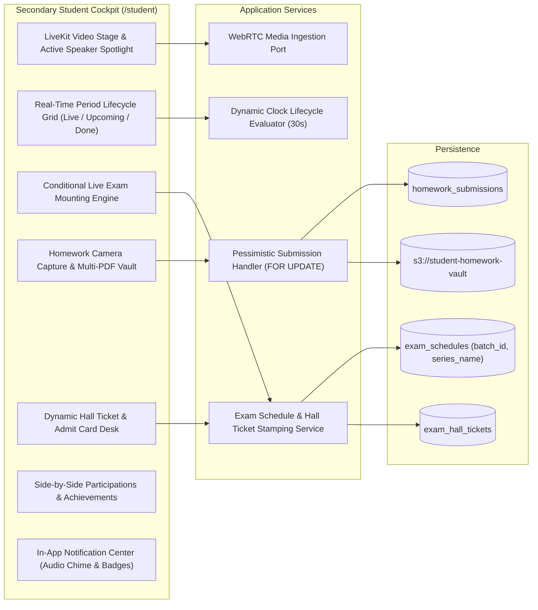

#### 3. Database Schema Mapping
* **Primary Tables:**
  * `students` (`id` PK, `admission_no` UNIQUE, `roll_no`, `class_id` FK, `status`, `health_flags`)
  * `homework_submissions` (`id` PK, `homework_id` FK, `student_id` FK, `submitted_at`, `status`, `sha256_hash`)
  * `exam_schedules` (`id` PK, `exam_id` FK, `series_name`, `batch_id`, `schedule_type`, `class_name`, `section`, `exam_date`, `start_time`, `end_time`, `hall_name`, `chief_invigilator_name`)
  * `exam_hall_tickets` (`id` PK, `student_id` FK, `exam_id` FK, `qr_code_hash`, `issued_at`, `is_unlocked`)

#### 4. End-to-End Workflow: Dynamic Exam Schedule $\to$ Admit Card & Live Mounting

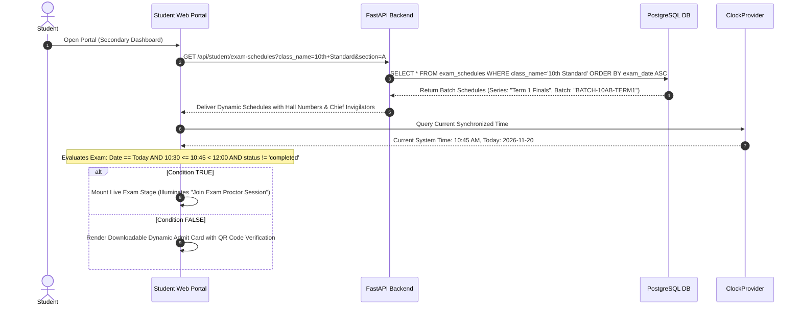

---

### Role 3: Parent Portal (`/parent`)

#### 1. Architectural Responsibility & Bounded Context
* **Bounded Context:** *Guardian Oversight, Family Engagement & Financial Settlement Context*
* **Core Invariants:**
  1. Anti-spam delivery: Push alerts are restricted to urgent items; routine announcements are displayed exclusively on the **Moving Slider Banners**.
  2. **Concurrency-Safe Dynamic PTM Booking**: PTM slot reservations use pessimistic row locking on `PTMSlot` with a 5-minute temporary `HELD` lease before transition to `BOOKED`.
  3. **Authentic UPI QR Matrix**: Generates a mathematically genuine 29x29 module QR matrix with authentic position finders for merchant UPI payloads (`upi://pay?pa=...`).
  4. **Immediate Real-Time Fee Sync**: When a parent pays an invoice online or makes a physical counter payment, the milestone immediately flips to `Paid`, clears the student from defaulter status, and triggers instant update broadcasts to the Accounts and Admin dashboards.

#### 2. Architecture Diagram

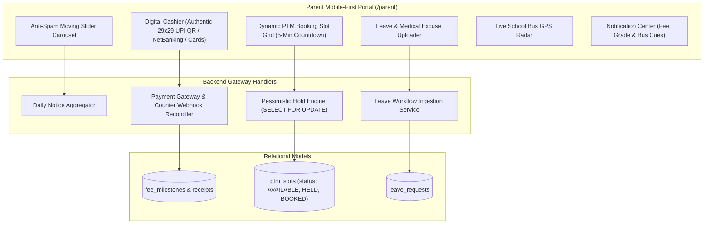

#### 3. Database Schema Mapping
* **Primary Tables:**
  * `parents` (`id` PK, `user_id` FK, `full_name`, `phone_number`, `email`, `upi_vpa`)
  * `parent_student_map` (`id` PK, `parent_id` FK, `student_id` FK, `relationship_type`)
  * `ptm_slots` (`id` PK, `slot_code`, `teacher_id` FK, `slot_date`, `slot_time`, `status`, `held_by_parent_id` FK, `hold_expires_at`, `booked_student_name`, `meeting_url`)
  * `fee_milestones` (`id` PK, `student_id` FK, `term_name`, `due_amount`, `paid_amount`, `status`, `utr_number`, `receipt_pdf_url`)

#### 4. End-to-End Workflow: Concurrency-Safe PTM Booking & Fee Settlement

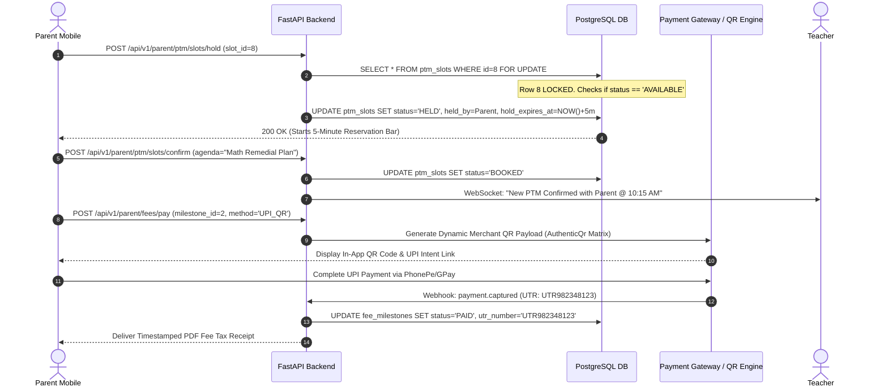

---

### Role 4: Super Admin / Principal Console (`/admin`)

#### 1. Architectural Responsibility & Bounded Context
* **Bounded Context:** *Institutional Supervision, Executive Governance & Financial Authorization Context*
* **Core Invariants:**
  1. Priority Triage Cockpit (🔴 Red / 🟠 Orange / 🟢 Green) auto-updates every 60 seconds; students with approved leaves are excluded from unexcused absence red flags.
  2. Administrative Overrides are cryptographically stamped with SHA-256 seals.
  3. Student Exit Certificates (TC) require a dual-signature handshake (Library + Accounts clearance) followed by Principal digital seal verification.
  4. **Executive Staff Leave Pop-Up**: Pending faculty leave applications (`staff_permissions`) display prominently on the executive dashboard with urgent action badges and an approval pop-up.
  5. **Four-Eye Maker-Checker Payroll Authorization**: Large-scale financial outflows (monthly staff salary wire) require mandatory executive sign-off from the Principal (`POST /api/finance/payroll/batches/{id}/authorize`) before the Accounts Coordinator can execute disbursements.
  6. **Real-Time Collections Synchronization**: Top executive collection tiles and fee realization gauges update reactively through the shared `fee-ledger.ts` bus whenever a payment occurs anywhere in the institution.

#### 2. Architecture Diagram

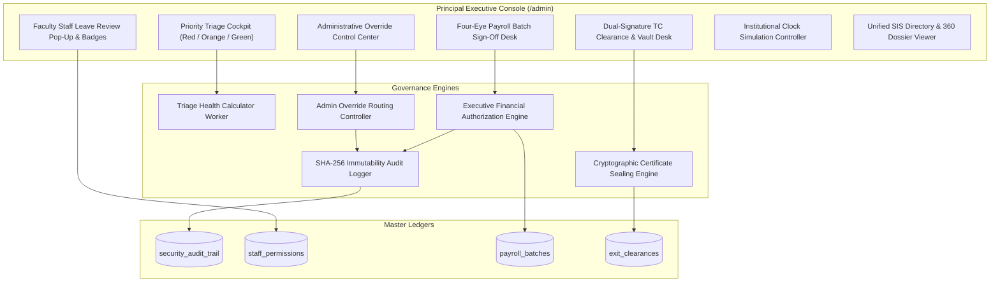

#### 3. Database Schema Mapping
* **Primary Tables:**
  * `admin_tasks` (`id` PK, `domain`, `title`, `status`, `assigned_to` FK, `escalated_to_principal`, `is_admin_override`, `admin_override_reason`)
  * `security_audit_trail` (`id` PK, `action_type`, `actor_id` FK, `actor_role`, `target_entity`, `target_id`, `sha256_seal`, `timestamp`)
  * `payroll_batches` (`id` PK, `payroll_month`, `total_staff_count`, `net_payable`, `status`, `authorized_by`, `authorized_at`)
  * `exit_clearances` (`id` PK, `student_id` FK, `library_cleared`, `finance_cleared`, `parent_otp_verified`, `principal_digital_seal`, `tc_serial_no`)

#### 4. End-to-End Workflow: Executive Admin Override on Disciplinary Leave & Attendance

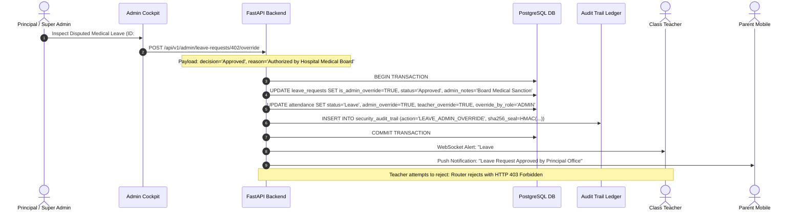

---

### Role 5: Exam Coordinator (`/exam_coordinator`)

#### 1. Architectural Responsibility & Bounded Context
* **Bounded Context:** *Assessment Operations, Secrecy Vault & Examination Logistics Context*
* **Core Invariants:**
  1. Once the Exam Coordinator clicks **Verify & Lock Marks**, grade entries are frozen and teachers cannot edit scores.
  2. Report card batch compilation generates official CBSE-compliant marks memos with institutional headers and digital signatures.
  3. Exportable official CSV adheres directly to the CBSE Pariksha Sangam specification.
  4. **Atomic Batch Class Scheduling**: The Exam Coordinator schedules comprehensive exam timetables via `POST /api/exams/schedules/batch-class`. The engine tags slots with a unique `batch_id` (e.g. `BATCH-10AB-TERM1FINAL`), series name, and sets `schedule_type = 'BATCH'`.
  5. **Dynamic Hall & Invigilator Deployment**: Replaces all legacy static tables. Room allocation calculates seating density, room capacity limits, and assigns verified Chief Invigilators.
  6. **Inter-Coordinator Syllabus & Exam Synchronization Protocol**: The Exam Coordinator collaborates with the Academic Coordinator through `ExamSyncRequest` in `academic.py` to reconcile curriculum delivery lag against published board exam dates.

#### 2. Architecture Diagram

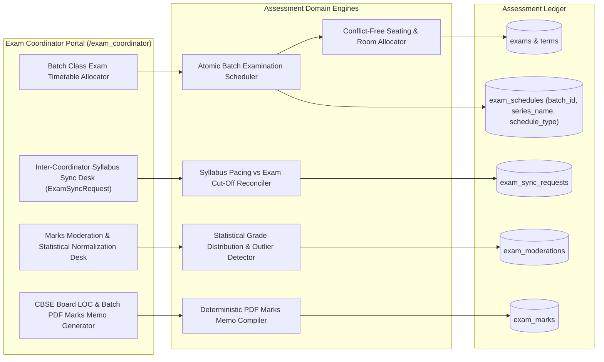

#### 3. Database Schema Mapping
* **Primary Tables:**
  * `exams` (`id` PK, `name`, `academic_year`, `term`, `start_date`, `end_date`, `is_published`)
  * `exam_schedules` (`id` PK, `exam_id` FK, `title`, `series_name`, `batch_id`, `schedule_type`, `subject`, `class_name`, `section`, `exam_date`, `start_time`, `end_time`, `hall_name`, `capacity`, `chief_invigilator_name`)
  * `exam_sync_requests` (`id` PK, `title`, `class_name`, `subject`, `curriculum_lag_units`, `current_completion_pct`, `proposed_resolution`, `status`)
  * `exam_marks` (`id` PK, `exam_id` FK, `student_id` FK, `subject_id` FK, `marks_obtained`, `max_marks`, `grade`, `is_locked`)
  * `exam_moderations` (`id` PK, `exam_id` FK, `subject_id` FK, `class_id` FK, `average_score`, `std_deviation`, `is_locked`, `locked_by` FK)

#### 4. End-to-End Workflow: Marks Moderation, Cryptographic Lock & LOC Export

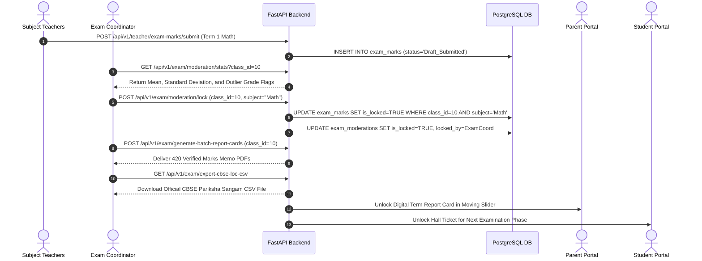

---

### Role 6: Admissions Coordinator (`/admissions_coordinator`)

#### 1. Architectural Responsibility & Bounded Context
* **Bounded Context:** *Student Outreach, Enrollment CRM & Atomic Identity Inception Context*
* **Core Invariants:**
  1. No online diagnostic test module required (handled through in-person campus evaluation).
  2. **Multi-Step Enrollment Handshake**: Enrolling an applicant utilizes `ConfirmEnrollmentModal`, validating guardian KYC documents, emergency contacts, roll number assignment, and fee category.
  3. **Atomic Multi-Aggregate Provisioning**: Converting an applicant to an enrolled student executes an atomic, single-pass database transaction initializing:
     * `Student` with unique official `admission_no` (`ADM-2026-XXXX`) and sequential roll number.
     * `User` authentication credentials for student and parent.
     * `FeeStructure` with all 5 statutory term milestones.
     * `AttendanceRecord` day-1 presence baseline.
     * `HallTicket` auto-released for scheduled class exams.
  4. **4-Role Notification Broadcast**: Dispatches concurrent welcome and roster notifications to the enrolled student, guardian, class teacher, and accounts coordinator.

#### 2. Architecture Diagram

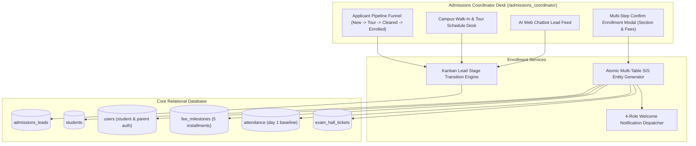

#### 3. Database Schema Mapping
* **Primary Tables:**
  * `admissions_leads` (`id` PK, `student_name`, `guardian_name`, `phone`, `email`, `stage`, `notes`, `campus_tour_date`)
  * `students` (`id` PK, `admission_no` UNIQUE, `roll_no`, `class_id` FK, `status='Active'`)
  * `users` (`id` PK, `username` UNIQUE, `email` UNIQUE, `role`, `password`, `school_code`)
  * `fee_milestones` (`id` PK, `student_id` FK, `term_name`, `due_amount`, `status='PENDING'`)
  * `attendance` (`id` PK, `student_id` FK, `date`, `status='Present'`, `method='baseline'`)
  * `exam_hall_tickets` (`id` PK, `student_id` FK, `ticket_number`, `is_released=True`)

#### 4. End-to-End Workflow: Lead Funnel Triage to Atomic SIS Conversion

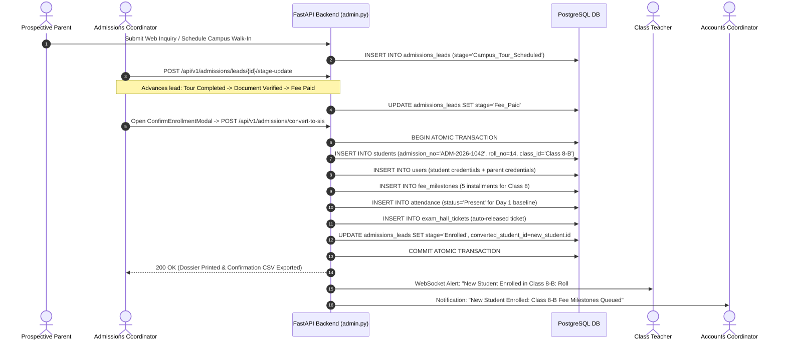

---

### Role 7: Accounts Coordinator (`/accounts_coordinator`)

#### 1. Architectural Responsibility & Bounded Context
* **Bounded Context:** *Bursar Operations, Fee Realization & Staff Payroll Engine*
* **Core Invariants:**
  1. Defaulter aging calculations run continuously across three risk tiers (Tier 1: 0–15d, Tier 2: 16–30d, Tier 3: 30+d).
  2. **Hardened Counter Fee Collection**: `POST /api/finance/defaulters/{id}/pay` executes pessimistic row locking (`with_for_update()`). The payment amount must be greater than zero and **cannot exceed the current overdue balance** (cannot collect on a ₹0 balance). Automatically inserts an auto-reconciled transaction and marks linked student fee milestones as `Paid`.
  3. **Staff Payroll & Automated LOP Deductions**: When generating monthly staff payroll batches (`POST /api/finance/payroll/batches/generate`), the engine queries all approved `StaffPermission` records for the month. Any leave declared under `"Loss of Pay"` or `"Unpaid"` triggers automatic pro-rated deduction:
     $$\text{LOP Deduction} = \left(\frac{\text{Basic Salary}}{30}\right) \times \text{LOP Days}$$
  4. **Four-Eye Maker-Checker Workflow**: The Accounts Coordinator can only generate a draft payroll batch. The batch enters `Draft` status until executive authorization is signed by the Principal/Super Admin (`POST /api/finance/payroll/batches/{id}/authorize`). Only then can Accounts execute corporate bank disbursement wire (`Disbursed`).
  5. **Today Payments Real-Time Sync**: Shared reactive state via `fee-ledger.ts` synchronizes online parent payments and counter collections directly into the Accounts Coordinator's "Today Receipts" desk and "Online Bank Verification" tables without page reloads.

#### 2. Architecture Diagram

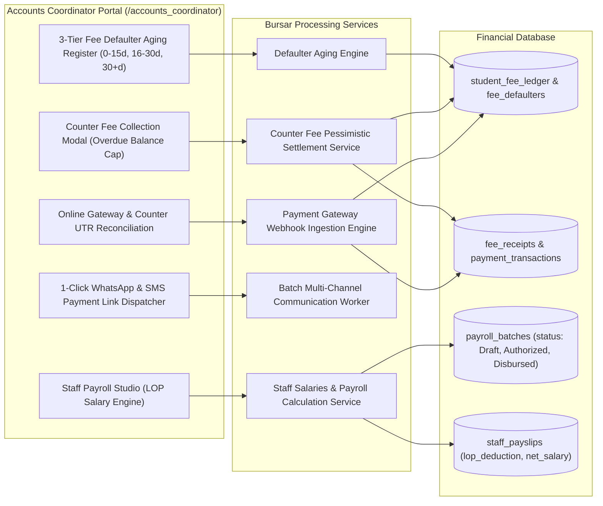

#### 3. Database Schema Mapping
* **Primary Tables:**
  * `fee_structures` (`id` PK, `class_id` FK, `academic_year`, `total_tuition`, `lab_fee`, `sports_fee`)
  * `fee_defaulters` (`id` PK, `student_id` FK, `student_name`, `amount_due`, `status`, `payment_history_json`)
  * `payment_transactions` (`id` PK, `utr_number` UNIQUE, `amount`, `payment_method`, `reconciled`, `reconciled_by`)
  * `payroll_batches` (`id` PK, `payroll_month`, `total_staff_count`, `gross_salaries`, `total_deductions`, `net_payable`, `status`, `authorized_by`, `authorized_at`)
  * `staff_payslips` (`id` PK, `batch_id` FK, `staff_id` FK, `staff_name`, `basic_salary`, `hra_allowance`, `lop_deduction`, `provident_fund`, `professional_tax`, `tds_tax`, `total_deductions`, `net_salary`, `bank_account_no`, `bank_ifsc`)

#### 4. End-to-End Workflow: Staff Payroll Generation, LOP Deductions & Four-Eye Authorization

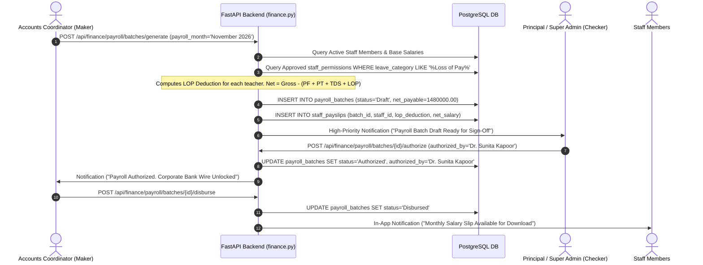

---

### Role 8: Academic Coordinator (`/academic_coordinator`)

#### 1. Architectural Responsibility & Bounded Context
* **Bounded Context:** *Curriculum Surveillance, Pedagogical Auditing, PTM Logistics & Inter-Coordinator Alignment Context*
* **Core Invariants:**
  1. Period substitutions automatically filter faculty based on three mandatory conditions: teacher is present on campus (verified via `staff_attendance_daily`), has zero teaching periods assigned in that slot, and has not exceeded their daily proxy load cap.
  2. Curriculum pacing compares completed syllabus units against the statutory academic calendar; pacing deviations $>2$ chapters trigger automated remedial alerts to the Principal.
  3. **Faculty Leave Interlock**: Whenever a teacher's leave request (`staff_permissions`) is submitted or approved, the affected teaching periods automatically generate open `SubstitutionSlot` records in the Academic Coordinator's coverage dashboard.
  4. **Inter-Coordinator Syllabus & Exam Synchronization**: Coordinates curriculum completion cut-offs with the Exam Coordinator via `ExamSyncRequest` in `academic.py`.

#### 2. Architecture Diagram

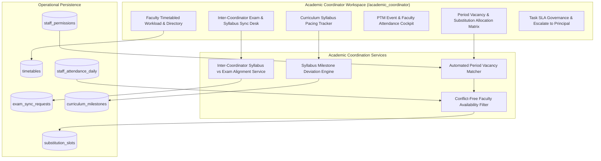

#### 3. Database Schema Mapping
* **Primary Tables:**
  * `timetables` (`id` PK, `class_id` FK, `day_of_week`, `period_number`, `subject_id` FK, `teacher_id` FK, `room_number`)
  * `substitution_slots` (`id` PK, `date`, `period_number`, `class_id` FK, `absent_teacher_id` FK, `substitute_teacher_id` FK, `status`, `is_admin_override`)
  * `staff_permissions` (`id` PK, `staff_id` FK, `leave_category`, `affected_periods`, `status`)
  * `staff_attendance_daily` (`id` PK, `staff_id` FK, `attendance_date`, `status`)
  * `exam_sync_requests` (`id` PK, `title`, `class_name`, `subject`, `curriculum_lag_units`, `current_completion_pct`, `proposed_resolution`, `status`)
  * `curriculum_milestones` (`id` PK, `subject_id` FK, `class_id` FK, `expected_units_completed`, `actual_units_completed`, `variance_status`)

#### 4. End-to-End Workflow: Period Vacancy Detection & 1-Click Conflict-Free Substitution

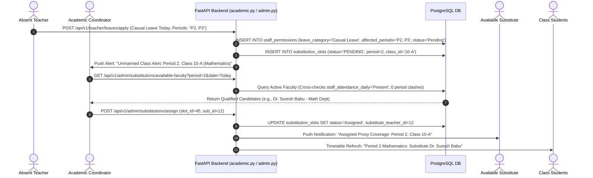

---

## 4. Master Cross-Role Orchestration & Handshake Machine

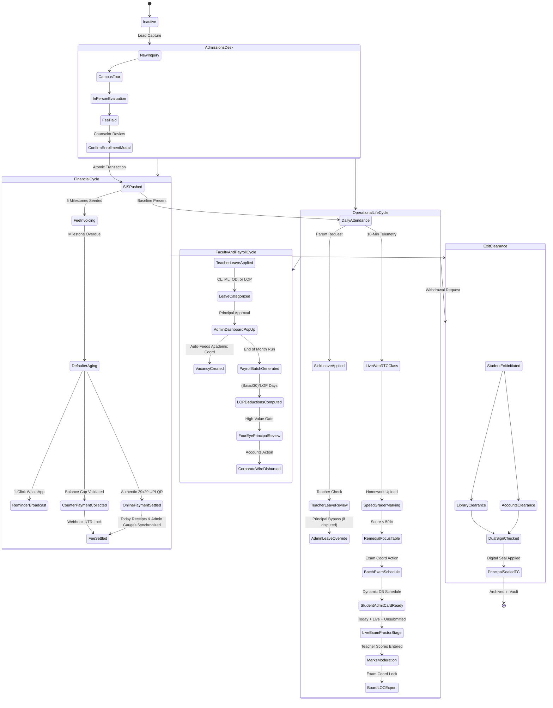

---

## 5. Architectural Decision Records (ADRs 001 – 010)

### ADR-001: Hierarchical Administrative Override Engine
* **Status:** Accepted
* **Context:** Fragmented operations in school environments lead to deadlocks when frontline staff reject legitimate emergency leaves or fail to resolve departmental tasks past statutory board deadlines.
* **Decision:** Introduce a cross-cutting administrative override model (`is_admin_override`, `admin_override_reason`, `override_by_role`) across tasks, leaves, attendance registers, and marksheets. Setting this flag locks the record against downstream reversal by teachers or coordinators (returning `HTTP 403 Forbidden`) and writes a SHA-256 sealed audit entry to `security_audit_trail`.
* **Consequences:** Eliminates operational gridlock and guarantees statutory authority; requires validation interceptors in all mutation routers.

### ADR-002: Pessimistic Row Locking (`SELECT ... FOR UPDATE`) for Contended School Resources
* **Status:** Accepted
* **Context:** Parent-Teacher Meeting (PTM) booking releases and fee installment balance payments create high concurrency windows where optimistic locking results in unacceptable retry cascades and double-bookings.
* **Decision:** Enforce pessimistic database row locking using `SELECT ... FOR UPDATE` in SQLAlchemy Async for PTM slot allocation (with a 5-minute temporary `HELD` lease) and student fee balance deductions.
* **Consequences:** Guarantees zero double-booking and payment ledger duplicate writes; requires query timeouts ($< 5000\text{ms}$) to prevent database pool exhaustion.

### ADR-003: Two-Phase Dual-Signature Exit Authorization (Digital OTP + Physical Seal)
* **Status:** Accepted
* **Context:** Student transfers (Transfer Certificate issuance) expose schools to legal disputes if certificates are released while library books, laboratory apparatus, or tuition fees remain outstanding.
* **Decision:** Exit clearance enforces an asynchronous two-phase gate: Phase 1 requires verified boolean sign-offs from both Library and Accounts departments; Phase 2 requires digital OTP acceptance from the parent before the Principal applies the school's digital seal.
* **Consequences:** Eliminates institutional liability; slightly increases transfer completion time from 1 hour to 24 hours.

### ADR-004: Decoupled WebRTC Telemetry Webhook Processing for Attendance
* **Status:** Accepted
* **Context:** Synchronous database insertion for hundreds of concurrent live class attendees joining simultaneously during morning peak hours caused database write-lock spikes.
* **Decision:** LiveKit participant connection telemetry webhooks are ingested asynchronously by a dedicated background telemetry worker. The worker buffers presence heartbeats, applies the 10-minute active attendance rule, and flushes updates to PostgreSQL in batched windows.
* **Consequences:** Decouples video conferencing performance from database persistence; introduces a minor 30- to 60-second eventual consistency window for parent attendance push notifications.

### ADR-005: Four-Eye Principle (Separation of Duties) for Institutional Payroll & Capital Outflows
* **Status:** Accepted
* **Context:** Unilateral payroll generation and disbursement by accounting personnel creates severe financial fraud, miscalculation risk, and audit exposure.
* **Decision:** Enforce a strict Maker-Checker architectural boundary. The Accounts Coordinator functions as the **Maker** (`status='Draft'`), computing pro-rated Loss of Pay (LOP) deductions from approved `StaffPermission` leaves, PF, PT, and TDS. The Super Admin / Principal functions as the **Checker** (`status='Authorized'`), inspecting financial totals and issuing cryptographic sign-off. Only after Principal authorization can the Accounts Officer trigger the bank disbursement wire (`status='Disbursed'`).
* **Consequences:** Fully satisfies corporate governance and statutory financial compliance standards; prevents unauthorized salary disbursements while maintaining complete audit traceability.

### ADR-006: Atomic Batch Examination Scheduling & Dynamic Admit Card Delivery
* **Status:** Accepted
* **Context:** Scheduling individual subject exams manually led to fragmented timetable tables, missing room capacity validations, and hardcoded mock student admit cards that failed to reflect changes in hall allocations or chief invigilators.
* **Decision:** Implement atomic batch scheduling (`POST /api/exams/schedules/batch-class`) tagging slots with unique `batch_id`, series metadata, and `schedule_type = 'BATCH'`. Student admit cards query live database schedules chronologically (`GET /api/student/exam-schedules`), dynamically rendering seat codes, hall invigilator seals, and timetable matrices.
* **Consequences:** Eliminates hardcoded client artifacts; guarantees that schedule adjustments made by the Exam Coordinator propagate instantly to Student and Parent portals.

### ADR-007: Real-Time Dynamic Timetable Lifecycle Driven by ClockProvider
* **Status:** Accepted
* **Context:** Disconnect between client device wall-clock time and school instructional periods caused premature class terminations, incorrect attendance tardiness marks, and out-of-sync proctored examinations.
* **Decision:** Bind all period lifecycles and exam mountings to a centralized `ClockProvider` service synchronized via client hooks running on 30-second heartbeats. Timetable periods transition autonomously through `upcoming`, `live`, and `completed`, illuminating active WebRTC broadcaster and viewer stages only during valid period intervals.
* **Consequences:** Creates a deterministic, testable simulation environment where academic schedules operate reliably across global timezones and daylight savings shifts.

### ADR-008: Reactive Client-Side Fee Ledger Sync with PostgreSQL Consistency
* **Status:** Accepted
* **Context:** Operating across three separate client portals (Parent payment $\to$ Accounts cashier $\to$ Admin vital gauges) caused temporal display discrepancies when relying solely on periodic polling.
* **Decision:** Implement a dual-layer synchronization model: FastAPI persists transactions to PostgreSQL using pessimistic row locks (`with_for_update()`), while client portals utilize a synchronized shared bus (`fee-ledger.ts`) that broadcasts immediate optimistic state updates upon receipt confirmation.
* **Consequences:** Guarantees zero lag across the Admin, Parent, and Accounts interfaces while maintaining ACID transaction guarantees on the database.

### ADR-009: Atomic Multi-Aggregate SIS Provisioning on Lead Conversion
* **Context:** Separate creation of student profiles, user credentials, fee invoices, and attendance records led to orphan records and incomplete student setups when network or validation errors occurred mid-process.
* **Decision:** All enrollment artifacts (`Student`, `Parent`, `User` credentials, `FeeMilestones`, `AttendanceRecord`, `HallTicket`) are generated within a single, atomic database transaction in `convert_enquiry_to_student`. Any validation failure triggers an automatic rollback of all entities.
* **Consequences:** Guarantees that every student in the system possesses a complete, functional profile with working login credentials, active class rosters, and fee schedules from Day 1.

### ADR-010: Inter-Coordinator Alignment Protocol for Curriculum & Exam Feasibility
* **Context:** Disconnect between the Academic Coordinator's syllabus delivery pace and the Exam Coordinator's scheduled examination dates resulted in students being tested on untaught topics.
* **Decision:** Introduce a dedicated inter-coordinator contract (`ExamSyncRequest`) in `academic.py`. When curriculum delivery lags behind schedule by $>1$ unit, the Academic Coordinator dispatches a formal adjustment request, requiring the Exam Coordinator to either adjust the question blueprint or reschedule the assessment date, with escalation to the Principal if unaligned within 48 hours.
* **Consequences:** Enforces pedagogical integrity and fair student assessments through an auditable inter-departmental negotiation protocol.

---

## 6. Verification & Port Access Matrix

| Role | Portal Route | Primary Test Procedure | Expected System Outcome |
| :--- | :--- | :--- | :--- |
| **Super Admin** | `http://localhost:3000/admin` | Inspect staff leave pop-up; authorize pending monthly payroll batch; verify fee gauge sync. | Approves teacher LOP leave; signs off payroll batch; admin collection tiles update reactively upon parent payment. |
| **Academic Coord** | `http://localhost:3000/academic_coordinator` | Open **Period Substitutions** after teacher leave submission; dispatch `ExamSyncRequest`. | Vacant period appears automatically; available faculty query cross-checks `staff_attendance_daily`; exam sync alert reaches Exam Coordinator. |
| **Exam Coord** | `http://localhost:3000/exam_coordinator` | Create batch exam schedule for Class 10 ("Term 1 Finals", 5 slots); review syllabus sync. | Atomic creation assigns `batch_id`; dynamic admit cards become immediately queryable by students in Class 10. |
| **Accounts Coord** | `http://localhost:3000/accounts_coordinator` | Generate payroll batch; test counter fee payment on defaulter. | Computes LOP salary deductions automatically; counter fee payment caps payment at balance due and updates student fee milestone. |
| **Admissions Coord**| `http://localhost:3000/admissions_coordinator` | Advance lead to `Fee Paid`; open `ConfirmEnrollmentModal`. | Atomic single-pass transaction seeds student profile, roll number, parent account, Day 1 attendance, hall ticket, and 5 fee milestones. |
| **Teacher** | `http://localhost:3000/teacher` | Apply for 3-day Unpaid Leave (LOP); inspect class roster for new admissions; check daily attendance. | `staff_permissions` records `leave_category='Unpaid LOP'`; newly enrolled student appears on class register; daily check-in logs timestamp. |
| **Secondary Student**| `http://localhost:3000/student` | Verify dynamic admit card and period status ticker; test live exam mount. | Hall ticket renders Chief Invigilator and seat code; periods evaluate dynamically (`completed`/`live`/`upcoming`); live exam mounts only when scheduled today and live. |
| **Parent** | `http://localhost:3000/parent` | Pay fee milestone with Authentic 29x29 UPI QR; reserve dynamic PTM slot. | Milestone reflects immediate transition to `Paid`; fee defaulter cleared; PTM slot locks with 5-minute timer; Admin and Accounts update in real-time. |
