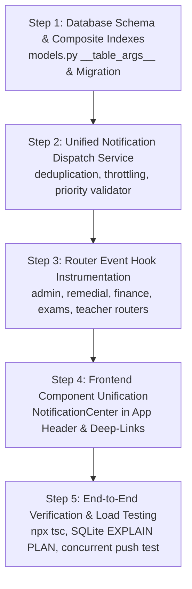

# 🔔 EDU360: In-App Notifications System — Implementation Plan

> **System**: Real-Time, Event-Driven In-App Notification & SLA Alerting Engine  
> **Target Scope**: 100% Pure Online Schooling (8 Canonical Roles)  
> **Status**: Ready for Execution  
> **Target Release**: Sprint 4 / v2.4  

---

## 📋 Table of Contents
1. [Executive Summary & Architectural Goals](#1-executive-summary--architectural-goals)
2. [Role Architecture & Scoping (The 8 Canonical Online Roles)](#2-role-architecture--scoping)
3. [Database Layer & High-Throughput Optimization](#3-database-layer--high-throughput-optimization)
4. [Backend Dispatch & Event-Bus Pipeline](#4-backend-dispatch--event-bus-pipeline)
5. [Frontend UI/UX & Deep-Linking Routing](#5-frontend-uiux--deep-linking-routing)
6. [Exhaustive 8-Role Notification Catalog & Payloads](#6-exhaustive-8-role-notification-catalog--payloads)
7. [Step-by-Step Implementation Roadmap](#7-step-by-step-implementation-roadmap)
8. [Testing, QA & Benchmarking Protocols](#8-testing-qa--benchmarking-protocols)

---

## 1. Executive Summary & Architectural Goals

In a pure online K-12 environment, users are physically separated across disparate screens. The **In-App Notification Engine** serves as the central nervous system connecting students, parents, faculty, and administrators. 

### Core Architectural Mandates:
1. **Zero Dead Notifications**: Every notification must carry a contextual `action_url` with deep-link query parameters, navigating users directly to the actionable modal, row, or SpeedGrader canvas.
2. **Sub-2ms Unread Query Latency**: Database reads for the header badge must execute in $< 2\text{ms}$ under 100,000+ stored notifications using composite B-Tree indexing.
3. **Cross-Role Interlock**: Operational events (e.g., Teacher leaves $\to$ Substitution alert $\to$ Schedule injection) must dispatch reliably without manual intervention.
4. **Compassionate SLA Governance**: Faculty alerts must link directly to workload relief and extension workflows, preventing punitive burnout.

---

## 2. Role Architecture & Scoping

EDU360 strictly serves an online schooling model. Physical school departments (yellow bus fleets, physical chemical stock) are excluded. The system exclusively serves the **8 Canonical Institutional Roles**:

```
                       ┌───────────────────────────────┐
                       │   EDU360 Central Event Bus    │
                       └──────────────┬────────────────┘
                                      │
         ┌────────────────────────────┼────────────────────────────┐
         │ Core Academic Roles        │ Governance & Operations    │
         ▼                            ▼                            ▼
  ┌─────────────┐             ┌─────────────────┐           ┌─────────────────┐
  │   Student   │             │      Admin      │           │   Admissions    │
  └─────────────┘             │   (Principal)   │           │   Coordinator   │
  ┌─────────────┐             └─────────────────┘           └─────────────────┘
  │   Parent    │             ┌─────────────────┐           ┌─────────────────┐
  └─────────────┘             │    Academic     │           │    Accounts     │
  ┌─────────────┐             │   Coordinator   │           │   Coordinator   │
  │   Teacher   │             └─────────────────┘           └─────────────────┘
  └─────────────┘                                           ┌─────────────────┐
                                                            │      Exam       │
                                                            │   Coordinator   │
                                                            └─────────────────┘
```

---

## 3. Database Layer & High-Throughput Optimization

### 3.1 Existing Data Model (`backend/app/models/models.py`)
```python
class Notification(Base):
    __tablename__ = "notifications"
    id = Column(Integer, primary_key=True, index=True)
    recipient_user_id = Column(Integer, nullable=True, index=True)
    recipient_role = Column(String(50), nullable=True, index=True)
    sender_name = Column(String(100), nullable=False)
    sender_role = Column(String(50), nullable=False)
    title = Column(String(200), nullable=False)
    message = Column(Text, nullable=False)
    notification_type = Column(String(50), nullable=False)
    priority = Column(String(20), default="NORMAL")  # CRITICAL | URGENT | NORMAL | INFO
    action_url = Column(String(255), nullable=True)
    metadata_json = Column(Text, nullable=True)
    is_read = Column(Boolean, default=False, index=True)
    created_at = Column(DateTime, default=datetime.datetime.utcnow)
    read_at = Column(DateTime, nullable=True)
```

### 3.2 High-Throughput Composite Index Enhancements
Add explicit composite indexes in `backend/app/models/models.py` (`__table_args__`) to optimize unread lookups:

```python
__table_args__ = (
    # Optimizes: GET /api/notifications?user_id=2&unread_only=true
    Index("ix_notifications_user_unread_sort", "recipient_user_id", "is_read", "id"),
    # Optimizes: Role-wide broadcasts (e.g. all finance staff or academic coordinators)
    Index("ix_notifications_role_unread_sort", "recipient_role", "is_read", "id"),
    # Optimizes: Nightly retention cleanup queries
    Index("ix_notifications_cleanup", "is_read", "created_at"),
)
```

### 3.3 Data Retention & Pruning Cron (PostgreSQL / SQLite)
```python
# Nightly Batch Cleanup (Scheduled in background cron)
async def prune_stale_notifications(db: AsyncSession, retention_days: int = 30):
    cutoff_date = datetime.datetime.utcnow() - datetime.timedelta(days=retention_days)
    stmt = delete(Notification).where(
        Notification.is_read == True,
        Notification.created_at < cutoff_date
    )
    result = await db.execute(stmt)
    await db.commit()
    logger.info(f"Pruned {result.rowcount} read notifications older than {retention_days} days.")
```

---

## 4. Backend Dispatch & Event-Bus Pipeline

### 4.1 Dispatcher Core Specification (`app.services.notifications`)
Create a centralized notification service that guarantees:
- **Priority Validation**: `CRITICAL` (P0), `URGENT` (P1), `NORMAL` (P2), `INFO` (P3).
- **Target Addressing**: Direct to `recipient_user_id` or broadcast via `recipient_role`.
- **Deduplication Key**: If an unread notification with identical `(recipient_user_id, notification_type, action_url)` exists within 5 minutes, update the timestamp and message rather than creating duplicate spam.

```python
async def dispatch_notification(
    db: AsyncSession,
    title: str,
    message: str,
    notification_type: str,
    priority: str = "NORMAL",
    recipient_user_id: Optional[int] = None,
    recipient_role: Optional[str] = None,
    action_url: Optional[str] = None,
    metadata_dict: Optional[dict] = None,
    sender_name: str = "EDU360 System",
    sender_role: str = "system"
) -> Notification:
    # 1. Throttling & Deduplication Check (5-min window)
    five_mins_ago = datetime.datetime.utcnow() - datetime.timedelta(minutes=5)
    existing_q = select(Notification).where(
        Notification.recipient_user_id == recipient_user_id,
        Notification.recipient_role == recipient_role,
        Notification.notification_type == notification_type,
        Notification.action_url == action_url,
        Notification.is_read == False,
        Notification.created_at >= five_mins_ago
    )
    existing = (await db.execute(existing_q)).scalars().first()
    if existing:
        existing.created_at = datetime.datetime.utcnow()
        existing.message = message
        await db.commit()
        return existing

    # 2. Insert New Notification
    notif = Notification(
        recipient_user_id=recipient_user_id,
        recipient_role=recipient_role,
        sender_name=sender_name,
        sender_role=sender_role,
        title=title,
        message=message,
        notification_type=notification_type,
        priority=priority,
        action_url=action_url,
        metadata_json=json.dumps(metadata_dict or {}),
        is_read=False,
        created_at=datetime.datetime.utcnow()
    )
    db.add(notif)
    await db.commit()
    await db.refresh(notif)
    return notif
```

### 4.2 Event Hooks Matrix
Hook `dispatch_notification` directly into existing router endpoints:

| Trigger Point | Source File | Event Trigger Call |
|---|---|---|
| **Timetable Auto-Resolve** | `backend/app/routers/admin.py` | Dispatch `PROXY_ASSIGNED` to substitute teacher user ID. |
| **Remedial Rough Work Submitted** | `backend/app/routers/remedial.py` | Dispatch `REMEDIAL_SUBMITTED` to class teacher. |
| **Fee Payment Cleared** | `backend/app/routers/finance.py` | Dispatch `FEE_CLEARED` to parent (`user_id=4`) & Accounts coordinator (`role='accounts_coordinator'`). |
| **Exam Cycle Concluded** | `backend/app/routers/exams.py` | Dispatch `MODERATION_START` to all subject teachers. |
| **Lead Converted to Enrolment** | `backend/app/routers/admin.py` | Dispatch `NEW_ENROLMENT` to Accounts and Admissions desks. |
| **Live Class Late Join (>10 min)** | `backend/app/routers/teacher.py` | Dispatch `LATE_APPROVAL_REQUEST` to live teacher console. |

---

## 5. Frontend UI/UX & Deep-Linking Routing

### 5.1 Global Layout Integration (`frontend/src/app/layout.tsx` / Header)
Embed the existing `NotificationCenter` into the primary header component across all portals:
- **Dynamic Badge Count**: Displays `unread_count` with pulsating red dot for `CRITICAL`/`URGENT` items.
- **Smart Adaptive Polling**: Polls every 20s when active; pauses on window blur.
- **Direct Deep-Link Handling**:
  ```typescript
  const handleItemClick = (notif: NotificationItem) => {
    markNotificationAsRead(notif.id);
    if (notif.action_url) {
      router.push(notif.action_url);
    }
  };
  ```

### 5.2 Priority-Based Visual Tokens

| Priority | Visual Badge | Icon | Audio / Toast Behavior |
|---|---|---|---|
| **CRITICAL** | Red (`bg-red-500/10 text-red-500 border-red-500/30`) | `AlertOctagon` | Persistent banner + Audio chime |
| **URGENT** | Amber (`bg-amber-500/10 text-amber-500 border-amber-500/30`) | `AlertTriangle` | 8-second toast alert |
| **NORMAL** | Blue (`bg-blue-500/10 text-blue-500 border-blue-500/30`) | `Clock` / `FileText` | Subtle dropdown update |
| **INFO** | Slate (`bg-slate-500/10 text-slate-400 border-slate-500/30`) | `Sparkles` / `Award` | Standard list item |

---

## 6. Exhaustive 8-Role Notification Catalog & Payloads

### Role 1: Student
```json
[
  {
    "title": "Live Math Session Starting",
    "message": "Class 8-B Mathematics live virtual room is open. Class begins in 10 minutes.",
    "notification_type": "LIVE_CLASS_COUNTDOWN",
    "priority": "CRITICAL",
    "action_url": "/student/live-class/1"
  },
  {
    "title": "Homework Returned for Revision",
    "message": "Mrs. Ananya Verma requested corrections on Q3 of Chapter 4 factoring.",
    "notification_type": "HOMEWORK_RETURNED",
    "priority": "URGENT",
    "action_url": "/student?tab=homework&id=4"
  },
  {
    "title": "Remedial Sprint Day 2 Unlocked",
    "message": "Step-by-step guided worksheet for quadratic formulas is ready.",
    "notification_type": "REMEDIAL_DAY_READY",
    "priority": "NORMAL",
    "action_url": "/student?tab=remedial&day=2"
  }
]
```

### Role 2: Parent / Guardian
```json
[
  {
    "title": "Absence Alert: Live Class Missed",
    "message": "Aarav Sharma was marked absent for 10:00 AM Live Mathematics.",
    "notification_type": "STUDENT_ABSENT",
    "priority": "CRITICAL",
    "action_url": "/parent?tab=attendance"
  },
  {
    "title": "Focus Table Action Plan Sign-off",
    "message": "7-Day Remedial Sprint assigned for Term 1 Math (Score: 58%). Guardian review required.",
    "notification_type": "FOCUS_PLAN_REVIEW",
    "priority": "URGENT",
    "action_url": "/parent?tab=academics&view=focus-plan"
  },
  {
    "title": "Tuition Fee Milestone Overdue",
    "message": "Quarter 3 Tuition Fee ₹45,000 is past due. Settle online to prevent exam hold.",
    "notification_type": "FEE_OVERDUE",
    "priority": "CRITICAL",
    "action_url": "/parent?tab=finance&action=pay"
  }
]
```

### Role 3: Teacher (Class & Subject Faculty)
```json
[
  {
    "title": "Proxy Substitution Injected: Period 3",
    "message": "Assigned as proxy cover for Class 8-B (Mathematics) replacing absent colleague.",
    "notification_type": "PROXY_ASSIGNED",
    "priority": "CRITICAL",
    "action_url": "/teacher?tab=schedule&highlightPeriod=3"
  },
  {
    "title": "Remedial Practice Solution Submitted",
    "message": "Aarav Sharma uploaded rough notebook for Day 2 Quadratic Factoring.",
    "notification_type": "REMEDIAL_SUBMISSION",
    "priority": "URGENT",
    "action_url": "/teacher/focus/1?tab=remedial&day=2"
  },
  {
    "title": "Live Class Late Join Approval Needed",
    "message": "Rohan Iyer joined +14.5m into class. Teacher attendance approval required.",
    "notification_type": "LATE_JOIN_APPROVAL",
    "priority": "NORMAL",
    "action_url": "/teacher/live-class/1?tab=attendance"
  }
]
```

### Role 4: Admin (Principal / Executive Leadership)
```json
[
  {
    "title": "Critical Welfare: 3-Day Chronic Absence",
    "message": "Student Kabir Mehta (Class 8-B) has missed 3 consecutive online days.",
    "notification_type": "CHRONIC_ABSENCE_ESCALATION",
    "priority": "CRITICAL",
    "action_url": "/admin?tab=attendance&filter=chronic"
  },
  {
    "title": "Syllabus Lag Alert (>2 Units Behind)",
    "message": "Class 8-B Science (Dr. Suresh Babu) is 2 units behind CBSE calendar target.",
    "notification_type": "PACING_LAG_CRITICAL",
    "priority": "URGENT",
    "action_url": "/admin?tab=curriculum&view=pacing"
  },
  {
    "title": "VIP Admission Referral Logged",
    "message": "Admissions enquiry from Board Trustee referral awaiting priority review.",
    "notification_type": "VIP_REFERRAL",
    "priority": "URGENT",
    "action_url": "/admin?tab=crm&filter=vip"
  }
]
```

### Role 5: Admissions Coordinator
```json
[
  {
    "title": "New Online Admission Enquiry",
    "message": "Parent Rajesh Sharma submitted enquiry for Grade 8.",
    "notification_type": "NEW_ENQUIRY",
    "priority": "NORMAL",
    "action_url": "/admin?tab=crm&id=8"
  },
  {
    "title": "Virtual Campus Tour Scheduled",
    "message": "Live 1-on-1 curriculum tour scheduled via Zoom for tomorrow 4:00 PM.",
    "notification_type": "TOUR_SCHEDULED",
    "priority": "URGENT",
    "action_url": "/admin?tab=crm&view=tours"
  },
  {
    "title": "Admission Fee Received (Enrolment Ready)",
    "message": "Candidate Aarav Kumar completed ₹25,000 admission payment. Assign roll number.",
    "notification_type": "NEW_ENROLMENT",
    "priority": "CRITICAL",
    "action_url": "/admin?tab=crm&action=enrol"
  }
]
```

### Role 6: Academic Coordinator
```json
[
  {
    "title": "Unmanned Class Period: Immediate Action",
    "message": "Mrs. Verma approved medical leave. Period 3 Class 8-B needs proxy faculty.",
    "notification_type": "UNMANNED_PERIOD",
    "priority": "CRITICAL",
    "action_url": "/admin?tab=substitutions"
  },
  {
    "title": "Faculty Workload Relief Requested",
    "message": "Dr. Suresh Babu requested SLA extension on Term 1 practical evaluation.",
    "notification_type": "TASK_RELIEF_REQUESTED",
    "priority": "URGENT",
    "action_url": "/admin?tab=tasks&filter=relief-requested"
  },
  {
    "title": "PTM Booking Deficit Warning",
    "message": "Class 8-B has 42% unbooked conference slots 48 hours prior to PTM.",
    "notification_type": "PTM_SLOT_DEFICIT",
    "priority": "NORMAL",
    "action_url": "/admin?tab=governance&view=ptm"
  }
]
```

### Role 7: Accounts Coordinator (Finance / Bursar)
```json
[
  {
    "title": "Online Fee Payment Cleared",
    "message": "Payment of ₹45,000 recorded for Aarav Sharma (Txn: TXN-8921). Receipt sealed.",
    "notification_type": "PAYMENT_RECEIVED",
    "priority": "NORMAL",
    "action_url": "/finance?tab=receipts&id=1"
  },
  {
    "title": "Exam Hall Ticket Hold Triggered",
    "message": "Term 1 exam cell opened. 14 fee defaulters placed on automated hall ticket lock.",
    "notification_type": "EXAM_HOLD_TRIGGERED",
    "priority": "CRITICAL",
    "action_url": "/finance?tab=defaulters"
  },
  {
    "title": "Emergency Exam Clearance Requested",
    "message": "Coordinator requested hardship exam clearance for Kabir Mehta.",
    "notification_type": "CLEARANCE_REQUESTED",
    "priority": "URGENT",
    "action_url": "/finance?tab=defaulters&action=clearance"
  }
]
```

### Role 8: Exam Coordinator (Examination Cell)
```json
[
  {
    "title": "Exam Cycle Concluded: 5-Day SLA Active",
    "message": "Term 1 exams concluded. Countdown timer active for subject marks submission.",
    "notification_type": "MODERATION_START",
    "priority": "CRITICAL",
    "action_url": "/exams?tab=moderation"
  },
  {
    "title": "Marks Upload SLA Breach Imminent",
    "message": "Class 9-A Science marks upload past 72h mark. 6 hours remaining before breach.",
    "notification_type": "MARKS_OVERDUE",
    "priority": "URGENT",
    "action_url": "/exams?tab=moderation&subject=science"
  },
  {
    "title": "Marks Validation Anomaly Detected",
    "message": "Teacher entered 85 marks on an 80-mark scale for Roll #12. Rejected by validator.",
    "notification_type": "VALIDATION_ANOMALY",
    "priority": "URGENT",
    "action_url": "/exams?tab=validation-errors"
  }
]
```

---

## 7. Step-by-Step Implementation Roadmap



### Phase 1: Database Optimization & Indexing (Day 1)
- [ ] Add composite indexes in `backend/app/models/models.py` (`ix_notifications_user_unread_sort`, `ix_notifications_role_unread_sort`, `ix_notifications_cleanup`).
- [ ] Verify query execution plan using `EXPLAIN QUERY PLAN SELECT ...` confirming index scan.

### Phase 2: Dispatcher & Throttling Service (Day 2)
- [ ] Implement `dispatch_notification()` in `backend/app/services/notifications.py` with 5-minute deduplication window.
- [ ] Expose `POST /api/notifications/dispatch` for administrative/system triggers.

### Phase 3: Router Instrumentation (Day 3)
- [ ] Wire triggers in `backend/app/routers/admin.py` (leave approvals, substitution auto-resolve, CRM leads).
- [ ] Wire triggers in `backend/app/routers/remedial.py` (Focus Table plan releases, rough sheet uploads).
- [ ] Wire triggers in `backend/app/routers/finance.py` (payment confirmations, defaulter warnings).
- [ ] Wire triggers in `backend/app/routers/exams.py` (exam conclusion, moderation countdown).

### Phase 4: Frontend Deep-Link Verification (Day 4)
- [ ] Ensure `NotificationCenter` is mounted in the top navigation bar for all 8 roles.
- [ ] Verify every `action_url` matches an existing active route and tab.

---

## 8. Testing, QA & Benchmarking Protocols

### 8.1 Performance Benchmark Goals
- **Unread Badge Query**: $\le 2\text{ms}$ at 50,000 notifications in DB.
- **Insert Dispatch Latency**: $\le 10\text{ms}$ per notification creation.
- **Zero Frontend Errors**: Clean build verified with `npx tsc --noEmit`.

### 8.2 Automated Test Cases
1. **Deduplication Test**: Trigger identical notification 5 times within 30 seconds; verify only 1 DB row is created with updated timestamp.
2. **Role Broadcast Test**: Send notification to `recipient_role="accounts_coordinator"`; verify all accounts staff see unread badge update.
3. **Deep-Link Integrity Test**: Click notification with `/teacher/focus/1?tab=remedial`; verify URL navigation and correct tab activation.
4. **Mark As Read Test**: Mark single item and mark-all; verify `is_read = true` and `read_at` timestamp persistence.

---
*Authored by: Antigravity Architectures for EDU360 Platform*
