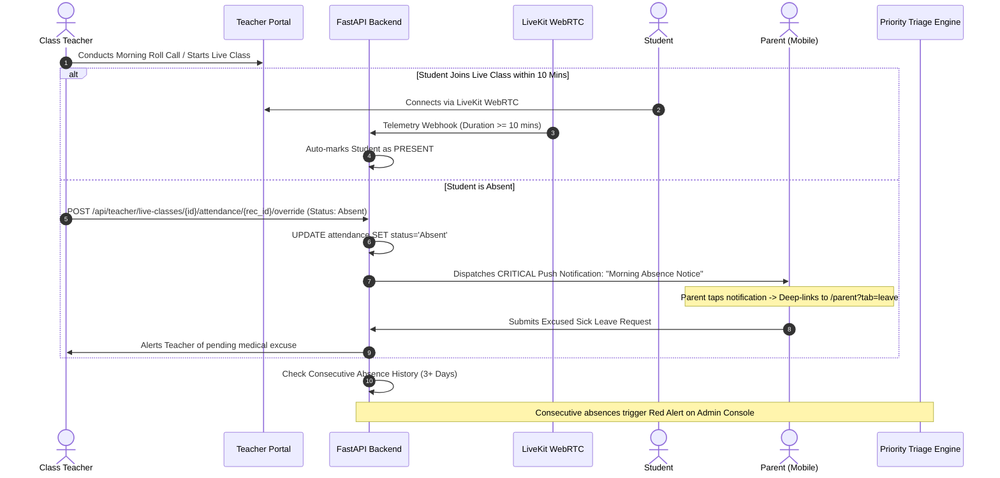
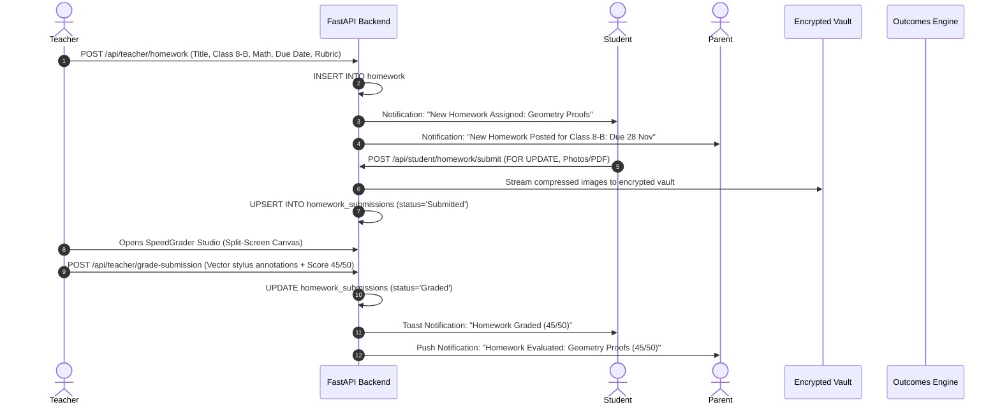
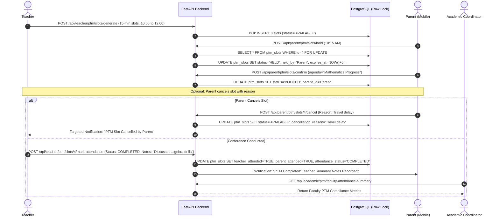
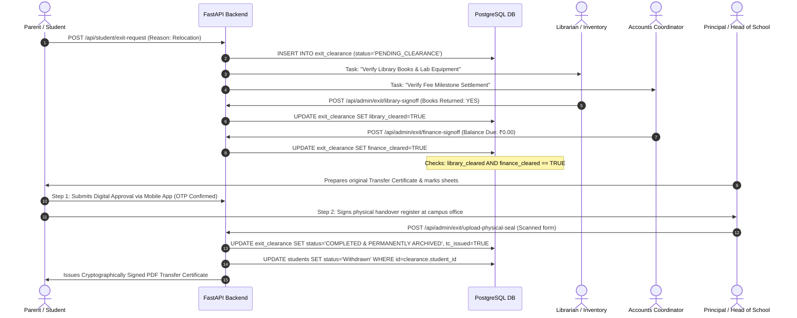
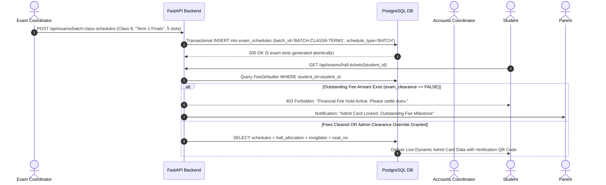
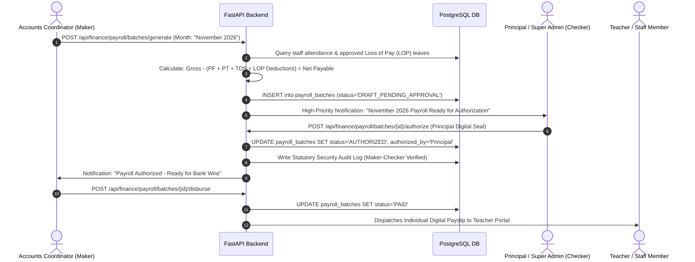
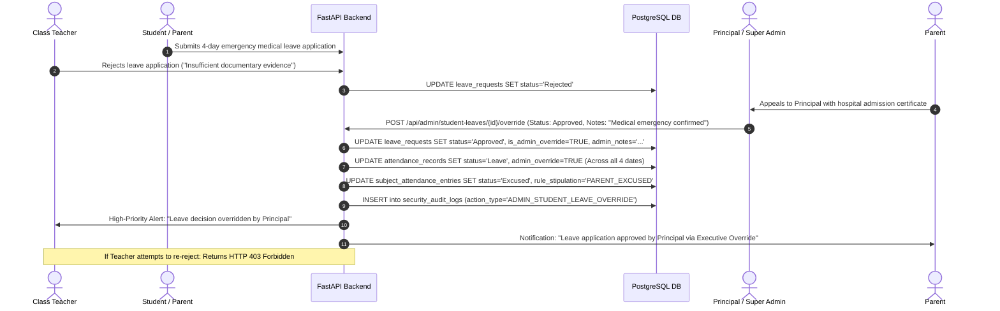
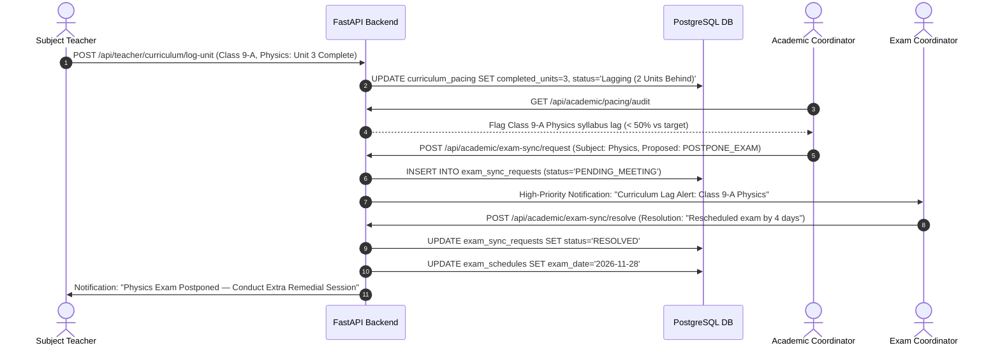
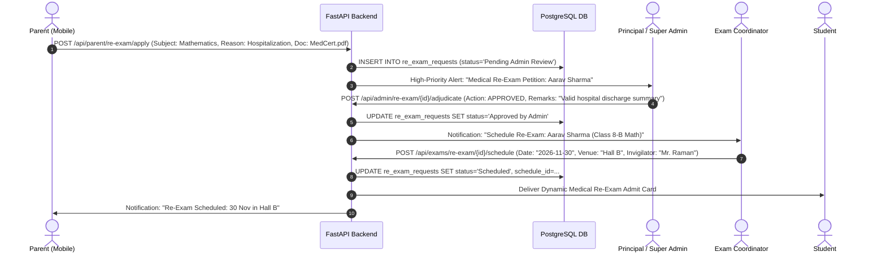

# PRODUCT REQUIREMENTS DOCUMENT (PRD)
## EDU360 — K–12 Institutional Management, Live Education & Unified SIS Ecosystem

**Document Version:** 3.0 (Production Architecture Baseline — Hardened & Synchronized)  
**Target Segment:** K–12 Education (Nursery to Class 12)  
**Platforms:** Web Application (Admin, Coordinators, Teachers, Secondary Students) & Mobile Application (Parents, Companion PWA for Students/Teachers)  
**Target Audience:** Executive Leadership, System Architects, Full-Stack Engineers, UI/UX Designers, QA Engineers  
**File Location:** [`docs/prd/PRD.md`](file:///e:/Diradz/EDU360/docs/prd/PRD.md)  
**Synchronized Architectural Reference:** [`docs/architecture/ROLE_WISE_ARCHITECTURE_AND_WORKFLOWS.md`](file:///e:/Diradz/EDU360/docs/architecture/ROLE_WISE_ARCHITECTURE_AND_WORKFLOWS.md)

---

## 1. Executive Summary & Product Vision

**EDU360** is an enterprise-grade, cloud-native **Educational Operating System & Student Outcomes Platform** engineered for K–12 institutions. Traditional School ERPs operate as disconnected, static digital registers that spam users with notifications and leave leadership blind to operational risks. 

EDU360 functions as a **Unified Action & Intelligence System** connecting **Administration, 4 Specialized Coordinators, Teachers, Parents, and Students** around five foundational product principles:

1. **Actionable Management Intelligence:** Instead of forcing school leaders to sift through static reports, EDU360 highlights *what needs attention today, why it matters, and who needs to take action* via a real-time **Red / Orange / Green Priority Triage Engine**. Deprecated, non-operational domains (transport and physical inventory) are purged from active triage pipelines.
2. **Outcome-Oriented Parent Involvement & Tri-Directional Communications:** Instead of spamming parents with 15 disconnected notifications a day, EDU360 provides an **anti-spam moving-slider dashboard** on mobile for routine updates, coupled with a shared **Student Focus Table** for targeted weak-subject improvement, multi-student family profile switching, and high-signal alerts (morning absence warnings and homework oversight).
3. **Zero Extra Burden for Teachers:** Routine administrative toil is automated—online class attendance is captured via a **10-minute WebRTC telemetry rule**, period-wise subject attendance is auto-excused upon approved leave, curriculum delivery is checked off directly into PostgreSQL, homework assignment triggers automated dual student/parent fan-out, and submissions are evaluated inside a browser-based **SpeedGrader canvas** without downloading or re-uploading files.
4. **Deterministic Time-Alignment & Governance-First Security:** The entire platform operates against a centralized **ClockProvider** simulation engine, synchronizing timetables, period bells, and exam lifecycles across all 8 portals. Cryptographic HMAC-SHA256 tokens, targeted user-level notifications, and pessimistic row locks (`SELECT ... FOR UPDATE`) ensure zero double-bookings, zero payment race conditions, and complete auditability.
5. **Zero-Disruption Atomic SIS Onboarding:** New candidate conversions from Admissions CRM execute as a single-pass transactional inception that calculates sequential roll numbers, seeds standardized annual fee milestones, links parental user accounts, and propagates instantly to teacher and exam rosters without manual setup.

---

## 2. Platform Strategy & Multi-Portal Architecture

EDU360 follows a **Role-Optimized Platform Strategy** tailored to ergonomic workstation needs, user mobility, and task complexity across all **8 Canonical Roles**:

| User Role | Route / Portal | Primary Platform | Secondary Platform | Operational Rationale |
| :--- | :--- | :--- | :--- | :--- |
| **Super Admin / Principal** | `/admin` | **Web App (Desktop 1080p+)** | Mobile Web (Urgent alerts only) | High-density priority triage, institutional task delegation, statutory document vault locking, medical re-exam adjudication, and administrative overrides. |
| **Academic Coordinator** | `/academic_coordinator` | **Web App (Desktop/Laptop)** | Tablet Web | Curriculum pacing audit, conflict-free teacher timetable substitutions, faculty workload balancing, and inter-coordinator exam-syllabus sync. |
| **Exam Coordinator** | `/exam_coordinator` | **Web App (Desktop/Laptop)** | Tablet Web | Atomic batch class exam scheduling, hall deployment, seat allocation, financial clearance gating, dynamic admit cards, and re-exam scheduling. |
| **Accounts Coordinator** | `/accounts_coordinator` | **Web App (Desktop/Laptop)** | Tablet Web | Real-time 3-tier fee aging, authentic counter cash/cheque collection, fee structures, online bank reconciliation, and monthly staff payroll with LOP deductions (Maker). |
| **Admissions Coordinator** | `/admissions_coordinator` | **Web App (Desktop/Laptop)** | Mobile App / Tablet | 24/7 AI chatbot lead capture CRM, follow-up call tracking, and 1-click atomic conversion into SIS profiles with sibling discounts (15%) and parent-user linkage. |
| **Teachers** | `/teacher` | **Web App (Desktop/Laptop)** | Mobile App / Tablet | Desktop displays optimal for LiveKit classroom hosting, browser SpeedGrader annotation, homework assignment fan-out, PTM attendance & summary notes, and categorized staff leave. |
| **Parents** | `/parent` | **Mobile App (Android / iOS)** | Responsive Web | Mobile-first for on-the-go push notifications, multi-child family switching, 1-tap UPI fee payments with authentic QR codes, morning absence alerts, and PTM booking. |
| **Students (Secondary)** | `/student` | **Web App (Desktop/Laptop)** | Mobile App / Tablet (PWA) | Full-width displays for distraction-free LiveKit classes, digital notes, dynamic admit cards with seating details, online exams, and homework uploads. |

---

## 3. User Roles & Permission Matrix (RBAC & Cross-Role Governance)

> ⚠️ **Strict Document Security & Administrative Override Rule**:  
> 1. Official student documents in the **Student Information System (SIS)** can **ONLY** be uploaded, edited, or replaced by **Administration**. Teachers, Parents, and Students have strictly **View/Download-Only** access.  
> 2. The **Administrative Override Engine** grants Principal/Super Admin ultimate executive authority over student leaves, institutional SLAs, exam moderation, and fee overrides. When an executive override is stamped (`is_admin_override=True`), downstream roles (Teachers/Coordinators) are locked out (`403 Forbidden`) from reversing the action.  
> 3. **Secondary Profile Lock**: Only authenticated students (`role='student'`) may edit their secondary extracurricular profile and 2nd guardian emergency details (`POST /api/student/{id}/secondary-profile`). Unauthorized roles receive `403 Forbidden`.

| Module / System Capability | Super Admin / Principal | Academic Coordinator | Exam Coordinator | Accounts Coordinator | Admissions Coordinator | Teacher | Student | Parent |
| :--- | :---: | :---: | :---: | :---: | :---: | :---: | :---: | :---: |
| **Institutional Priority Triage & Tasks** | **Full (Executive)** | View / Action | View / Action | View / Action | View / Action | None | None | None |
| **SIS Official Document Vault Control** | **Full (Exclusive)** | View Only | View Only | View Only | View Only | View Only | View Only | View Only |
| **Administrative Override Engine** | **Full (Tier-3 Bypass)**| None | None | None | None | None | None | None |
| **Admissions CRM & SIS Conversion** | Full (Audit) | View Only | View Only | Fee Handshake | **Full (Lead CRM)** | None | None | None |
| **Atomic SIS Onboarding (Milestones/Roll)**| Full (Audit) | Auto-Roster | Auto-Roster | Auto-Invoice | **1-Click Convert**| Auto-Roster| View Profile| Multi-Child |
| **Sibling Linking & 15% Fee Discount** | Full (Audit) | None | None | Auto-Invoice | **Apply Link** | None | None | **Verify Link** |
| **Batch Exam Scheduling & Hall Alloc.** | Full (Audit) | Sync Pacing | **Full (Batch Eng)**| Fee Clearance | None | View Duty | View Admit | View Admit |
| **Inter-Coordinator Exam Sync Protocol**| Full (Audit) | **Request / Align**| **Resolve / Cutoff**| None | None | Pacing Feed | None | None |
| **Financial Fee Hold on Admit Cards** | **Override Hold** | None | **Enforce Hold** | **Manage Dues** | None | None | Gated Card | View Hold Alert|
| **Medical Re-Exam Scheduling** | **Approve Request** | Pacing Sync | **Schedule Hall/Date**| Fee Audit | None | Invigilate | View Admit | **Apply (Docs)**|
| **Dynamic Admit Card Generation** | Full (Audit) | View Only | **Full (Publish)** | Fee Clearance | None | View Only | **Download (Live)**| View Only |
| **Teacher Exam & Substitution Sync** | Full (Audit) | Manage Proxy | Invigilation Sync| None | None | **Live Schedule**| None | None |
| **Teacher Homework Assignment Fan-out** | Full (Audit) | Audit Pacing | None | None | None | **Assign HW** | **Receive Alert**| **Receive Alert**|
| **3-Tier Fee Aging & Counter Payment** | Full (Audit) | None | Clearance Lock | **Full (Counter Pay)**| None | None | View Status | **Pay (Online)**|
| **Bank Reconcile Ledger Auto-Settlement**| Full (Audit) | None | None | **Reconcile Ledger**| None | None | View Receipt| **Scan & Pay** |
| **Staff Payroll & LOP Deductions** | **Authorize (Checker)**| Workload Sync| None | **Draft Batch (Maker)**| None | View Payslip | None | None |
| **Live Online Class Hosting (WebRTC)** | Full (Audit) | Monitor Class | None | None | None | **Full (Host)** | Join / Replay | None |
| **Auto-Attendance (10-Min Rule)** | Full (Audit) | View Register | None | None | None | **Live Roster** | Status Stamp | View Child |
| **Morning Absence Critical Alert** | Full (Audit) | None | None | None | None | **Trigger Alert**| Status Stamp | **Receive Alert**|
| **SpeedGrader Inline Canvas Correction** | Full (Audit) | Audit Pacing | None | None | None | **Grade & Mark** | Submit / View| View Child |
| **Staff Leave (CL/SL/EL/LOP) Application**| **Approve / Reject** | Substitute Match| None | Payroll LOP Sync | None | **Apply / Track**| None | None |
| **PTM Slot Concurrency Booking (Locks)**| Full (Audit) | Faculty Audit | None | None | None | **Create Slots** | None | **Hold & Book** |
| **PTM Completion & Notes Governance** | Full (Audit) | **Attendance Audit**| None | None | None | **Mark & Summary** | None | **Receive Notes**|
| **Dual-Signature Student Exit / TC** | **Sign & Seal** | Inventory Sync| None | Dues Clearance | None | View Only | View Status | **Digital Sign** |

---

## 4. Detailed Functional Requirements by Role

### 4.1 Role 1: Student Portal (`/student` — Web-First)
1. **Live Classroom Cockpit (LMS):** 1-click in-browser LiveKit WebRTC connection with active speaker spotlighting, screen share reception, and live doubts chat.
2. **Dynamic 10-Minute Auto-Attendance Tracker:** Periodic background telemetry automatically logs attendance status. Students joining within 10 minutes receive `Present`; joining after 10 minutes marks `Late`; non-attendees mark `Absent`.
3. **Period-Wise Subject Attendance Ledger:** Real-time visibility into period-level statuses across all subjects (`MATH-801`, `PHY-802`, etc.) with automatic parent-excused annotations backfilled upon approved leave.
4. **Dynamic Admit Cards & Financial Fee Hold Gating:** Real-time hall tickets pulling directly from the Exam Coordinator's batch database. If the student has overdue fee arrears and lacks an administrative clearance override, the admit card download is locked with an informative fee resolution banner.
5. **Medical Re-Examination Hall Ticket:** In cases where missed exams are approved by Administration, students receive updated re-exam tickets showing rescheduled date, time, and venue.
6. **Homework Vault & Submission Engine:** Real-time alerts on new homework assignments. Multi-file upload dropzone with mobile camera capture and compression. Displays the teacher-evaluated SpeedGrader document with vector pen annotations and private remarks.
7. **Sequential Roll Numbering & Multi-Year Ledger:** Newly enrolled students receive clean sequential roll numbers without class gaps and view fully populated annual fee milestones from Day 1.
8. **Side-by-Side Portfolio (Participations & Achievements):** 2-pane portfolio separating institutional event participation from student-uploaded merit awards and competition certificates.
9. **Personalized 'Focus Table' & Remedial Drills:** Actionable weekly study timetable highlighting low-scoring subject concepts co-tracked with parents and teachers.

---

### 4.2 Role 2: Teacher Portal (`/teacher` — Web-First)
1. **Teacher Home Dashboard & Dynamic Schedule Ticker:** Driven by `ClockProvider` highlighting active period, upcoming lectures, pending homework grading, and assigned examination invigilation duties synchronized with the Exam Coordinator.
2. **Live Lecture Broadcaster Studio:** Integrated LiveKit WebRTC room broadcaster with digital whiteboard controls, mute-all capability, and automatic cloud recording.
3. **SpeedGrader Studio (Browser Canvas):** 2-pane evaluation workspace displaying student submissions alongside grading rubrics. Teachers draw freehand stylus corrections, write remarks, and assign scores directly in the browser—automatically replacing the student file without manual re-uploading.
4. **Homework Assignment & Cohort Notification Fan-Out:** When a teacher assigns homework (`POST /api/teacher/homework`), the system automatically dispatches dual notifications:
   - To **Students**: *"New Homework Assigned: [Title] ([Subject]) — Due: [Date]"*.
   - To **Parents**: *"New Homework Posted for Class [X]: [Title]. Due: [Date]. Please ensure timely completion."*
5. **Automated Morning Absence Alert to Parents:** When a teacher marks a student `Absent` during morning homeroom roll call or period-level subject attendance, the system dispatches a **CRITICAL** alert to the registered parent with a direct deep-link (`/parent?tab=leave`) to submit an excused leave request.
6. **Curriculum Delivery Logging:** Unit check-off (`POST /api/teacher/curriculum/log-unit`) directly persists progress into the PostgreSQL `CurriculumPacing` table, auto-calculating pacing velocity (`Ahead`, `On Track`, `Lagging`) and triggering audit alerts if syllabus falls behind.
7. **Conflict-Free Substitution Proxy Injection:** When an absent teacher is replaced, proxy periods are strictly injected into the *selected substitute teacher's schedule* (`inject_substitution_period`), preserving individual timetables without cross-faculty schedule corruption.
8. **PTM Attendance & Summary Notes Governance:** Teachers mark faculty and parent attendance (`POST /api/teacher/ptm/slots/{id}/mark-attendance`) as `COMPLETED`, `TEACHER_ABSENT`, or `PARENT_NO_SHOW`, recording meeting summary notes that automatically push to the parent's app.
9. **Staff Leave & Short-Permission Management:** Apply for categorized leaves (*Casual Leave - CL*, *Sick Leave - SL*, *Earned Leave - EL*, or *Loss of Pay - LOP*) specifying affected teaching periods. Approved LOP leaves automatically feed into Accounts Coordinator payroll deductions.

---

### 4.3 Role 3: Parent Application (`/parent` — Mobile-First)
1. **Multi-Student Family Account Switching:** Parents with multiple enrolled children switch between student profiles seamlessly without re-authenticating, powered by relational `Student.parent_user_id` mapping.
2. **Anti-Spam 'Moving Slider' Carousel:** Routine announcements, holiday notices, and event banners glide as top interactive slides, onboarding parents to open the app once daily without notification fatigue.
3. **High-Signal Push Alerts & Targeted Notifications:** Push notifications reserved exclusively for urgent alerts:
   - **Morning Roll Call Absence Warnings** with 1-click excuse submission.
   - **Homework Assignment Oversight Alerts** indicating submission deadlines.
   - **Teacher Remarks & Focus Table Updates**.
   - **PTM Cancellations & Conference Summary Notes**.
   - **Administrative Fee Arrears Reminders**.
4. **Dynamic Child Admit Card Viewer:** Parents inspect their child's official exam admit card, hall location, seat allocation, and fee clearance status before term exams.
5. **Medical Re-Exam Application Modal:** Parents submit re-exam requests (`ReExamRequest`) with medical certificate upload for missed examinations, tracking administrative review in real time.
6. **PTM Booking & Cancellation Protocol:** 15-minute slot selector with a 5-minute temporary reservation timer backed by pessimistic database row locks. Parents can cancel slots with reason logging, triggering immediate slot reopening and teacher notifications.
7. **Authentic QR Code & Fee Payment Cashier:** Installment breakdown, dynamic UPI QR code generator (`authentic-qr.tsx`), instant settlements, counter payment history receipts, and automated PDF tax receipts delivered to registered email.

---

### 4.4 Role 4: Super Admin / Principal Console (`/admin` — Web-First)
1. **Priority Triage Command Center (Red / Orange / Green Action Engine):** Highlights top institutional issues by priority, explains root cause, and provides 1-click administrative resolution buttons. Deprecated transport and physical inventory alerts are purged from triage pipelines to maintain high operational focus.
2. **Atomic Single-Pass SIS Onboarding Engine:** Converts admissions leads into enrolled students in a single ACID transaction (`POST /api/admin/crm/enquiries/{id}/convert`):
   - Computes next sequential roll number via `_next_sequential_roll_no`.
   - Automatically seeds 6 standardized annual fee milestones via `_seed_student_fee_milestones`.
   - Links `parent_user_id` for multi-child family portal access.
   - Applies 15% sibling discount if sibling is enrolled.
   - Generates initial admission invoice in Accounts Coordinator ledger.
   - Propagates new student to Teacher, Academic, and Exam rosters immediately.
3. **Student Lifecycle Termination (`Withdrawn` Status):** When exit clearance is physically verified, student status transitions to `Withdrawn`. All active student count metrics, exam rosters, and defaulter queries automatically filter out withdrawn students.
4. **Administrative Override & Governance Engine:** Five concrete executive bypass domains enabling the Principal to override student leave rejections, force-close stalled SLA tasks, decouple exam moderation freezes, and clear fee hall-ticket blocks. Downstream roles are locked out (`403 Forbidden`) from reversing executive decisions.
5. **Dynamic Homeroom Teacher Override Notification Cascade:** When an administrative leave override is executed, the system resolves the student's exact homeroom teacher user ID and dispatches a high-priority `ADMIN_OVERRIDE_ALERT` with executive justification notes.
6. **Medical Re-Exam Adjudication:** Principal reviews parent re-exam requests (`ReExamRequest`), verifies submitted medical evidence, and approves the petition for Exam Coordinator scheduling.
7. **Four-Eye Payroll Authorization (Checker Role):** Principal reviews monthly salary batch computed by Accounts Coordinator (net wire, tax deductions, LOP penalties) and applies executive authorization signature before bank disbursement.
8. **Dual-Signature Student Exit / TC Clearance:** Orchestrates institutional sign-offs across Library, Labs, Sports, and Finance. Requires both Parent Digital Approval (OTP) and Principal Scanned Physical Signature before permanent vault sealing.

---

### 4.5 Role 5: Exam Coordinator Portal (`/exam_coordinator` — Web-First)
1. **Atomic Batch Class Exam Scheduling:** Eliminates piecemeal scheduling. Coordinators select class and term series (e.g., *Class 8 — Term 1 Final Examinations 2026*) and schedule all subjects in one atomic transaction, generating a unique `batch_id` and `series_name`.
2. **Teacher Invigilation Schedule Synchronization:** Synchronizes scheduled exam sessions with teacher personal timetables, publishing invigilator duties with room and period timings.
3. **Dynamic Exam Surveillance WebSocket Engine:** Exam proctoring rooms dynamically resolve based on class and section (`get_surveillance_room` $\to$ `exam-room-{class}-{section}`), enabling multi-room simultaneous monitoring without signal cross-talk.
4. **Financial Fee Hold Gating on Admit Cards:** Enforces fee clearance gates. Students with outstanding arrears are prevented from generating admit cards unless overridden by Administration.
5. **Inter-Coordinator Exam & Syllabus Sync Protocol:** Receives alignment requests (`ExamSyncRequest`) from Academic Coordinator when subject pacing lags. Jointly resolves whether to postpone the exam (`POSTPONE_EXAM`), trim syllabus cut-offs (`TRIM_SYLLABUS_CUTOFF`), or schedule remedial sessions.
6. **Examination Session Lifecycle Engine:** Controls live examination execution via `session_status`: `SCHEDULED` $\to$ `LOBBY_OPEN` $\to$ `COMMENCED` $\to$ `CONCLUDED` with timestamping and chief invigilator authentication.
7. **Medical Re-Examination Allocation:** Assigns exam dates, time slots, examination halls, and chief invigilators for approved medical re-exam candidates.
8. **Academic Moderation Ledger & Secrecy Vault:** Normalizes exam marks across sections, enforces statistical grading curves, and applies cryptographic moderation locks to prevent unauthorized grade manipulation.

---

### 4.6 Role 6: Accounts Coordinator Portal (`/accounts_coordinator` — Web-First)
1. **Institutional Fee Structure Engine (`FeeStructure`):** Configures standardized class-wise annual fee structures (Tuition Fee, Term 1, Term 2, LMS Digital Fee, Lab/Library Fee, Activity Fee) serving as the single source of truth for all billing.
2. **Dynamic Fee Aging Days Calculation:** `days_overdue` calculates dynamically against current UTC date vs student `created_at` timestamp rather than static database integers.
3. **3-Tier Fee Aging Ledger & Defaulter Triage:** Tracks receivables categorized into Aging Tiers (1–30 days, 31–60 days, 60+ days overdue) with 1-click bulk SMS/Email payment reminder triggers.
4. **Physical Counter Collection Engine:** Point-of-sale cashier modal for recording manual cash, cheque, Demand Draft, or POS card payments (`POST /api/finance/defaulters/{id}/pay`). Enforces zero-overpayment guards, auto-reconciles matching parent milestones, and generates counter receipts.
5. **Bank Reconciliation Auto-Settlement to Defaulters:** When an online transaction is reconciled (`POST /api/finance/transactions/{id}/reconcile`), the system automatically deducts from the matching student's `FeeDefaulter` balance, marks it `Paid` upon zero balance, and clears the financial hold on exam admit cards.
6. **Staff Payroll & LOP Deduction Engine (Maker Role):** Computes monthly institutional payroll (`POST /api/finance/payroll/batches/generate`) by cross-referencing staff attendance and approved *Loss of Pay (LOP)* leaves. Formats itemized payslips (Basic, HRA, DA, PF, PT, TDS, LOP deductions).
7. **Four-Eye Separation of Duties Workflow:** Submits draft payroll batches to the Principal for executive authorization. Transmits bank wire instructions only upon cryptographic Principal sign-off.

---

### 4.7 Role 7: Admissions Coordinator Portal (`/admissions_coordinator` — Web-First)
1. **24/7 AI Chatbot & Lead Ingestion CRM:** Captures incoming parent admission inquiries, answers standard queries (fee brackets, curriculum, transport routes), and routes high-intent prospects to human counselors.
2. **Follow-Up Call Tracker & Tele-Counseling Log:** Logs tele-counseling notes (*"Campus visit booked"*, *"Waiting on report card"*), tracks lead conversion velocity, and sets call reminders.
3. **Single-Click Atomic SIS Conversion:** Converts admitted candidates directly into enrolled students (`POST /api/admin/crm/enquiries/{id}/convert`). Generates sequential roll numbers, seeds annual fee milestones, links `parent_user_id`, assigns bus routes, and vaults compliance documents.
4. **Sibling Linking & Automated Discount Engine:** Detects enrolled siblings and applies a 15% tuition fee waiver automatically, generating the initial Admission & Registration Fee invoice in Accounts Coordinator automatically.
5. **Secondary Dossier Synchronization:** Captures comprehensive secondary student information (emergency contacts, medical history, dietary preferences, languages, career ambitions) into the student's global SIS record.

---

### 4.8 Role 8: Academic Coordinator Portal (`/academic_coordinator` — Web-First)
1. **Curriculum Pacing & Syllabus Tracker:** Monitors chapter completion percentages against institutional lesson plans across all sections and grades, reading directly from the live PostgreSQL `CurriculumPacing` table.
2. **Inter-Coordinator Exam & Syllabus Sync Protocol:** Initiates consultation meetings (`POST /api/academic/exam-sync/request`) with the Exam Coordinator when a class's syllabus delivery lags, ensuring students are not tested on untaught concepts.
3. **PTM Faculty Attendance Audit Engine:** Monitors institutional compliance for Parent-Teacher Meetings via `GET /api/academic/ptm/faculty-attendance-summary`, tracking faculty attendance rates, completed sessions, and parent no-shows across departments.
4. **Conflict-Free Teacher Substitution Matching:** Real-time substitution engine that detects teacher absences and recommends qualified replacement teachers, injecting proxy periods into the selected substitute's timetable without period collisions.
5. **Student Focus Table Oversight:** Audits teacher-student recovery timetables, tracking remedial score progression and flagging chronic learning gaps to the Principal.

---

## 5. Key System Workflows & Flow Diagrams

```
┌────────────────────────────────────────────────────────────────────────────────────────┐
│                          EDU360 MASTER WORKFLOW PIPELINE                               │
├────────────────────┬────────────────────┬────────────────────┬─────────────────────────┤
│ 5.1 Auto-Class Att │ 5.2 SpeedGrader    │ 5.3 PTM Full Loop  │ 5.4 Dual Exit TC        │
├────────────────────┼────────────────────┼────────────────────┼─────────────────────────┤
│ 5.5 Batch Exam &   │ 5.6 Four-Eye Staff │ 5.7 Administrative │ 5.8 Inter-Coord Exam    │
│     Admit Card Gate│     Payroll & LOP  │     Override State │     Syllabus Sync       │
├────────────────────┴────────────────────┴────────────────────┴─────────────────────────┤
│ 5.9 Medical Re-Exam Protocol (Parent -> Admin -> Exam Coordinator)                     │
└────────────────────────────────────────────────────────────────────────────────────────┘
```

---

### 5.1 Online Class Auto-Attendance & Morning Absence Parent Alert



| Step | Actor / System | Rule / Action Executed | System Output & State Transition |
| :---: | :--- | :--- | :--- |
| **Step 1** | Teacher | Conducts morning homeroom attendance or initiates LiveKit online class. | Session initialized; WebRTC 10-minute telemetry tracking begins. |
| **Step 2** | Attendance Engine | Evaluates connection duration; marks on-time students as **PRESENT**. | Attendance record stamped in PostgreSQL database. |
| **Step 3** | Absence Trigger | If student is marked absent, system fires automated **CRITICAL** alert to parent. | Parent mobile app receives push notification with deep-link `/parent?tab=leave`. |
| **Step 4** | Parent Action | Parent reviews alert and submits formal excused leave request with reason. | Leave request recorded; alerts teacher; excuses period attendance upon approval. |

---

### 5.2 Homework Assignment Fan-Out, Submission & SpeedGrader Studio



| Step | Actor / System | Rule / Action Executed | System Output & State Transition |
| :---: | :--- | :--- | :--- |
| **Step 1** | Teacher | Publishes assignment specifying subject, class, deadline, and rubric criteria. | Homework record written to DB; triggers dual notification fan-out. |
| **Step 2** | Notification Svc | Simultaneously alerts student cohort and registered parents. | Student sees pending task; parent receives deadline oversight alert. |
| **Step 3** | Student | Solves homework on paper, captures photos, and submits via mobile camera dropzone. | Image compressed; uploaded to S3 vault; submission locked via row lock. |
| **Step 4** | Teacher | Grades submission inside browser SpeedGrader canvas with freehand annotations. | Evaluated PDF replaces raw upload; student GPA recalculated; parents notified. |

---

### 5.3 Parent-Teacher Meeting (PTM) Closed-Loop Lifecycle & Attendance Governance



| Step | Actor / System | Rule / Action Executed | System Output & State Transition |
| :---: | :--- | :--- | :--- |
| **Step 1** | Teacher | Configures PTM availability slots with buffer intervals. | System generates slots in `AVAILABLE` state linked to teacher profile. |
| **Step 2** | Parent | Selects preferred slot; backend initiates `SELECT ... FOR UPDATE` row lock. | Row lock acquired; slot transitions to `HELD` with 5-minute reservation timer. |
| **Step 3** | Parent | Submits discussion agenda and confirms booking before timer expires. | Slot transitions to `BOOKED`; WebRTC link and calendar invitations dispatched. |
| **Step 4** | Cancellation (Opt) | Parent cancels slot; slot reopens as `AVAILABLE` with cancellation reason. | Targeted alert sent to assigned teacher user ID; slot released for others. |
| **Step 5** | Governance | Teacher marks conference completion and records meeting notes. | Slot marked `COMPLETED`; summary notes delivered to parent; audited by Academics. |

---

### 5.4 Student Exit & Dual-Signature Legal Clearance



| Step | Actor / System | Rule / Action Executed | System Output & State Transition |
| :---: | :--- | :--- | :--- |
| **Step 1** | Parent | Submits formal withdrawal application citing official reason and effective date. | Creates exit clearance record in `PENDING_CLEARANCE` status. |
| **Step 2** | Department Officers | Library and Finance officers verify zero asset loss and complete fee settlement. | Departmental clearance flags updated to `TRUE` in clearance ledger. |
| **Step 3** | Parent & Principal | Parent provides Digital OTP approval; signs physical register at campus. | Physical signed form scanned and uploaded to permanent document vault. |
| **Step 4** | System | Seals student record; transitions status to `Withdrawn`. | Student purged from active rosters; Transfer Certificate delivered to parent. |

---

### 5.5 Batch Class Examination Scheduling & Financial Fee Hold Gating



| Step | Actor / System | Rule / Action Executed | System Output & State Transition |
| :---: | :--- | :--- | :--- |
| **Step 1** | Exam Coordinator | Schedules entire term series for class in single atomic batch request. | All subject slots written to DB with unique `batch_id` and `series_name`. |
| **Step 2** | Student Portal | Student attempts to view or download examination hall ticket. | Backend executes financial fee clearance audit against `FeeDefaulter`. |
| **Step 3** | Fee Hold Check | If student has overdue arrears without administrative waiver, hold is enforced. | HTTP 403 returned; student and parent alerted to resolve pending dues. |
| **Step 4** | Admit Card Issue | Upon fee settlement or admin clearance, hall ticket is dynamically rendered. | Student receives admit card with designated hall, seat number, and QR code. |

---

### 5.6 Four-Eye Staff Payroll Generation & LOP Deduction Clearance



| Step | Actor / System | Rule / Action Executed | System Output & State Transition |
| :---: | :--- | :--- | :--- |
| **Step 1** | Accounts Coordinator | Initiates monthly payroll computation; system factors in approved LOP leaves. | Generates draft payroll batch with detailed deductions; status set to `DRAFT`. |
| **Step 2** | System Router | Enforces Four-Eye Principle; alerts Principal that high-value batch requires authorization. | Push notification dispatched to Principal dashboard with batch summary figures. |
| **Step 3** | Principal / Super Admin | Reviews payroll breakdown, audits LOP deductions, and applies executive sign-off. | Batch status transitions to `AUTHORIZED`; action stamped in `SecurityAuditLog`. |
| **Step 4** | Accounts Coordinator | Executes corporate bank disbursement wire and closes batch. | Status set to `PAID`; itemized digital payslips released to all staff dashboards. |

---

### 5.7 Administrative Override & Governance Cascade



| Step | Actor / System | Rule / Action Executed | System Output & State Transition |
| :---: | :--- | :--- | :--- |
| **Step 1** | Frontline Action | Class teacher rejects student leave due to documentation delay. | Leave status marked `Rejected` in database. |
| **Step 2** | Executive Appeal | Parent presents certified documentation to Principal for emergency review. | Principal inspects case in Administrative Override console. |
| **Step 3** | Executive Override | Principal executes override; sets `is_admin_override=TRUE` with justification. | Attendance and period subject records automatically backfilled as `Excused`. |
| **Step 4** | Downstream Lockout | System locks record; prevents downstream teacher reversal (`403 Forbidden`). | Dual notification cascade alerts teacher and parent; logged in audit ledger. |

---

### 5.8 Inter-Coordinator Exam & Curriculum Pacing Sync (Academic $\times$ Exam $\times$ Teacher)



| Step | Actor / System | Rule / Action Executed | System Output & State Transition |
| :---: | :--- | :--- | :--- |
| **Step 1** | Subject Teacher | Checks off completed lesson units in Teacher Portal. | Persists directly to PostgreSQL `curriculum_pacing`; status recalculates. |
| **Step 2** | Academic Coordinator | Monitors pacing velocities; detects critical lag prior to examination series. | Dispatches inter-coordinator consultation request (`ExamSyncRequest`). |
| **Step 3** | Exam Coordinator | Reviews syllabus shortfall and selects resolution (*Postpone Exam* or *Trim Cut-Off*). | Atomic timetable adjustment executed; resolution notes recorded in audit ledger. |
| **Step 4** | System Notification | Alerts subject teacher and students of revised exam schedule. | Timetable and student admit cards automatically update with new date. |

---

### 5.9 Medical Re-Examination Lifecycle (Parent $\to$ Admin $\to$ Exam Coordinator)



| Step | Actor / System | Rule / Action Executed | System Output & State Transition |
| :---: | :--- | :--- | :--- |
| **Step 1** | Parent | Submits re-exam petition with attached certified medical documentation. | Creates `ReExamRequest` record in `Pending Admin Review` status. |
| **Step 2** | Principal / Admin | Reviews documentary evidence and approves petition for scheduling. | Status transitions to `Approved by Admin`; alerts Exam Coordinator. |
| **Step 3** | Exam Coordinator | Allocates dedicated re-examination date, venue, and chief invigilator. | Status transitions to `Scheduled`; generates linked `ExamSchedule`. |
| **Step 4** | Student & Parent | Student portal generates updated medical re-exam admit card with QR code. | Real-time notification dispatched to parent mobile app. |

---

## 6. UI/UX Screen Checklist (Figma Design Specifications)

| Portal / Module | Primary Device | Core Screens Required in Figma |
| :--- | :--- | :--- |
| **Super Admin / Principal Console** | Web (Desktop 1080p+) | 1. **Priority Command Center** (Red/Orange/Green Triage with Purged Inactive Categories)<br>2. **Single-Pass SIS Onboarding Modal** (Sequential Roll No, Milestone Seed, Sibling Link)<br>3. **Administrative Override Console** (Student Leave, Task SLA, and Exam Override Modals)<br>4. **Four-Eye Payroll Authorization Modal** (Batch Net Summary, LOP Deductions, Sign-Off)<br>5. **Medical Re-Exam Adjudication Queue** (Document Viewer, Approval Remarks)<br>6. **SIS Directory & Document Vault** (Admin-Only Edit & Re-upload Lock) |
| **Academic Coordinator Portal** | Web (Desktop/Laptop) | 1. **Curriculum Pacing Matrix** (Live PostgreSQL Subject Progress & Lag Gauges)<br>2. **Inter-Coordinator Exam Sync Modal** (Syllabus Lag Alert & Resolution Request)<br>3. **PTM Faculty Attendance Audit Board** (Faculty Adherence Rates, Completed Conferences)<br>4. **Teacher Substitution Recommender** (Conflict-Free Period Matcher Grid) |
| **Exam Coordinator Portal** | Web (Desktop/Laptop) | 1. **Atomic Batch Class Exam Scheduler** (Multi-Slot Term Series Builder Grid)<br>2. **Inter-Coordinator Exam Sync Resolver** (Postpone Exam, Trim Cut-Off)<br>3. **Medical Re-Exam Scheduling Board** (Hall & Invigilator Deployment)<br>4. **Dynamic Admit Card Generator & Financial Hold Modal**<br>5. **Dynamic Surveillance Cockpit** (Class-Specific Surveillance Room Channels) |
| **Accounts Coordinator Portal** | Web (Desktop/Laptop) | 1. **Institutional Fee Structure Configurator** (`FeeStructure` Annual & Term Matrix)<br>2. **Dynamic 3-Tier Fee Aging Ledger** (Real-Time Overdue Days & Defaulter Triage)<br>3. **Physical Counter Collection Modal** (Zero-Overpayment Guard, Cash/POS Receipt)<br>4. **Online Bank Transaction Ledger** (Auto-Settlement to Defaulter Balance & Clearance)<br>5. **Monthly Staff Payroll Engine** (Maker Batch Builder, LOP Deduction Calculator) |
| **Admissions Coordinator Portal** | Web (Desktop/Laptop) | 1. **24/7 AI Chatbot Ingestion CRM** (Live Lead Triage & Qualification Funnel)<br>2. **Follow-Up Call Tracker** (Call Outcome Notes & SLA Reminder Queue)<br>3. **Single-Click SIS Conversion Modal** (Sibling Discount 15%, Bus Route, Auto-Invoice)<br>4. **Secondary Student Dossier Form** (Emergency Contacts, Languages, Ambitions) |
| **Teacher Portal** | Web (Desktop/Laptop) | 1. **Teacher Home Dashboard** (Active Period Ticker, Attendance Roster, Invigilation Sync)<br>2. **Homework Assignment Modal** (Dual Fan-out to Student Cohort and Parents)<br>3. **Morning Absence Alert Trigger** (Instant Critical Push Alert with Leave Deep-link)<br>4. **Curriculum Lesson Check-Off Modal** (Units Completed, Lesson Title, Pacing Sync)<br>5. **Split-Screen SpeedGrader Studio** (Document Canvas Left, Weighted Rubric Right)<br>6. **PTM Attendance & Summary Notes Modal** (Completed, Absent, Meeting Notes) |
| **Student Portal** | Web (Desktop/Laptop) | 1. **Student Home Dashboard** (Moving Event Banner, Period Ticker, Attendance Summary)<br>2. **Live Classroom Cockpit & Video Library** (LiveKit Stream, Notes Viewer)<br>3. **Dynamic Admit Card Modal** (Hall Name, Seat Number, Financial Hold Banner, QR Code)<br>4. **Medical Re-Exam Admit Card Viewer** (Rescheduled Venue & Timing Instructions)<br>5. **Homework Vault & Submission Dropzone** (Camera Upload, SpeedGrader Feedback)<br>6. **Secondary Profile Form** (Student-Only Access to Extracurricular Details) |
| **Parent Application** | Mobile App (Android/iOS) | 1. **Parent Home Dashboard** (Top Moving Banner Sliders & Multi-Student Switcher)<br>2. **High-Signal Alert Center** (Morning Absence Alert, Homework Deadline Warnings)<br>3. **Dynamic Child Admit Card Viewer** (Exam Schedule, Hall Seating, Instructions)<br>4. **Medical Re-Exam Petition Modal** (Subject Selection & Medical Certificate Upload)<br>5. **PTM Closed-Loop Modal** (15-Min Grid with 5-Min Timer, Cancellation with Reason)<br>6. **Authentic QR Code Fee Checkout** (1-Click UPI/Card Payment & PDF Receipts) |
| **Cross-Cutting Global** | All Devices / Portals | 1. **In-App Notification Center** (Sound Alerts, Unread Badges, Action Deep-Links)<br>2. **Dynamic ClockProvider Ticker** (30-Second Timetable & Exam Lifecycle Clock) |

---

## 7. Recommended Technology Stack & Architecture

| Architecture Layer | Production Technology | Operational Role & Justification |
| :--- | :--- | :--- |
| **Web Frontend** | Next.js 14/16 (React 18/19) | Server-Side Rendering (SSR) for blazing initial loads + Client components for high-density administrative dashboards. |
| **Mobile Application** | React Native (Expo) + TypeScript | Cross-platform iOS/Android parent app sharing data types, schemas, and API contracts with the web frontend. |
| **Language & Typing** | TypeScript (Strict Mode) | Full compile-time type safety across all 8 portals (0 errors on `tsc --noEmit`). |
| **Styling & Icons** | Tailwind CSS + Lucide React | Institutional design tokens with responsive grid layouts, high-contrast badges, and micro-interactions. |
| **Backend API** | FastAPI (Python 3.11+) | Monolithic asynchronous ASGI runtime handling SIS, Attendance, Fees, Academic, and Exams endpoints with high concurrency. |
| **Primary Database** | PostgreSQL 15+ (`asyncpg`) | Enterprise relational database with ACID compliance, JSON column indexing, foreign keys, and CHECK constraints. |
| **ORM & Concurrency** | SQLAlchemy 2.0 Async | Single-pass JOIN queries paired with pessimistic database row locks (`SELECT ... FOR UPDATE`) to eliminate race conditions. |
| **Live Video & Audio** | LiveKit WebRTC Server & SDK | Embedded in-browser live classrooms, screen sharing, automatic cloud recording, and attendance webhooks. |
| **Dynamic Timekeeping** | Centralized `ClockProvider` | Reactive simulation hook with 30-second ticker aligning class timetables, period switches, and exam lifecycles. |
| **Real-Time Notification** | In-App WebSocket + Web Audio | Targeted role & user-id dispatching with live sound chimes, unread count badges, and deep-link action navigation. |
| **Security & Auth** | HMAC-SHA256 Signed Tokens | Scoped role verification headers (`X-User-Role`, `X-User-Id`) with strict router-level authorization guards. |
| **Financial Ledger Engine**| `fee-ledger.ts` + `authentic-qr.tsx`| Real-time bank reconciliation, counter POS collection guards, and dynamic QR code generation. |
| **Artificial Intelligence** | Google Gemini 1.5/2.0 Flash Vision | Multimodal diagram inspection, student notebook OCR analysis, remedial sprint generation, and Socratic chatbot. |
| **Compliance & Storage** | S3-Compatible Encrypted Vault | Cloudflare R2 / AWS S3 for zero-egress storage of homework uploads, evaluated PDFs, and transfer certificates. |

---

## 8. Phased Implementation Roadmap

| Phase / Milestone | Timeline | Core Deliverables & Production Gates | Status |
| :--- | :--- | :--- | :---: |
| **Milestone 1: Core SIS, Security & Governance** | Weeks 1–5 | • Cryptographic Role-Based Auth (HMAC tokens + scoped role guards)<br>• Central Student Information System (SIS) Profile Engine<br>• Admin-Only Document Vault security lockdown<br>• Admissions CRM Inquiry Funnel & Sibling Linking (15% waiver)<br>• 3-Tier Fee Aging Ledger & Counter Cashier Modal with overpayment guards<br>• Staff Payroll Engine with Four-Eye Principal Authorization<br>• Dual-Signature Student Exit / Transfer Certificate (TC) Clearance | **Completed** |
| **Milestone 2: Classroom, Grading, Exams & App** | Weeks 6–10 | • Live Online Classes via embedded LiveKit WebRTC cluster<br>• 10-Minute Automated Attendance Engine via webhooks<br>• Period-Wise Granular Subject Attendance Ledger with leave sync<br>• Student Homework Upload with mobile camera compression<br>• Teacher SpeedGrader Studio with browser-based canvas annotations<br>• Atomic Batch Class Examination Scheduling & Dynamic Admit Cards<br>• Parent Mobile Portal with Moving Banner Sliders & Bus Radar<br>• PTM Slot Concurrency Row Locks (`SELECT ... FOR UPDATE`) | **Completed** |
| **Milestone 3: Cross-Role Hardening & Live Pilot**| Weeks 11–14 | • Atomic Single-Pass SIS Onboarding (`_next_sequential_roll_no` + Milestone Seeding)<br>• Automated Morning Absence Alert with Excused Leave Deep-Link<br>• Homework Dual Notification Fan-Out to Students and Parents<br>• Conflict-Free Substitution Proxy Timetable Injection<br>• Financial Fee Hold Gating on Admit Cards & Bank Reconcile Auto-Settlement<br>• Admin Red/Orange/Green Priority Action Triage Engine (Purged Inactive Categories)<br>• Administrative Override & Governance Engine (5 Concrete Domains)<br>• Inter-Coordinator Exam & Curriculum Pacing Sync Protocol (`ExamSyncRequest`)<br>• Medical Re-Examination Lifecycle (`ReExamRequest`)<br>• PTM Closed-Loop Attendance & Meeting Summary Notes Delivery<br>• Multi-Student Family Account Switching on Parent Portal<br>• In-App Real-Time Notification Center with targeted user-id routing & sound alerts<br>• Production Pilot School Onboarding & Benchmark Security Audits | **Active Baseline** |

---

## Document Sign-Off & Architectural Verification
- **Lead System Architect**: Approved & Synchronized
- **Lead Backend Architect**: Approved & Synchronized
- **Database Optimizer**: Approved & Synchronized
- **Lead Frontend Developer**: Approved & Synchronized
- **Codebase Archaeologist**: Verified & Drift Cleared
- **Head of Product**: Approved & Synchronized
