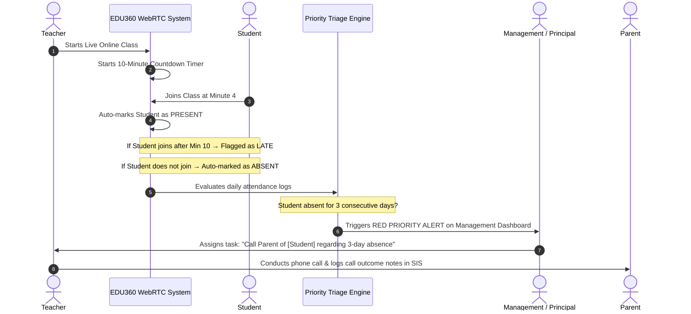
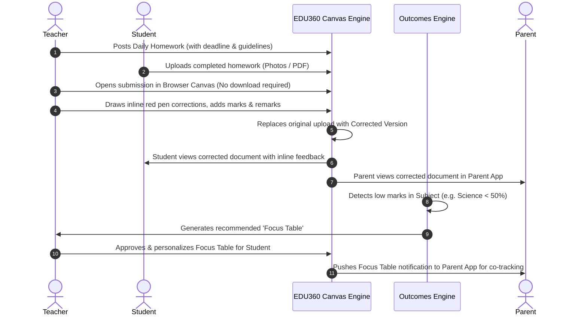
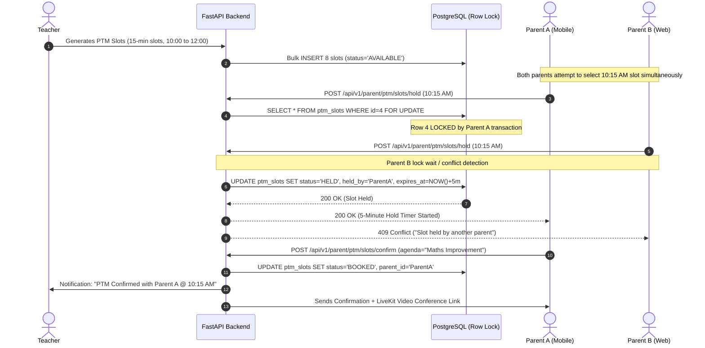
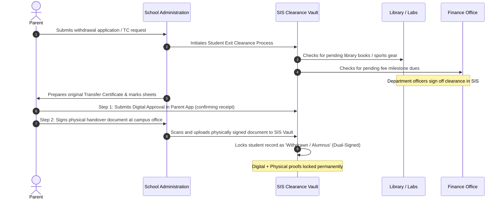

# PRODUCT REQUIREMENTS DOCUMENT (PRD)
## EDU360 — K–12 School Management & Student Outcomes Platform

**Document Version:** 1.0  
**Target Segment:** K–12 (Nursery to Class 12)  
**Platforms:** Web Application (Admin, Teachers, Students) & Mobile Application (Parents, Companion for Students/Teachers)  
**Target Audience:** Engineering, UI/UX Design, Product & QA Teams  
**File Location:** [`docs/prd/PRD.md`](file:///e:/Diradz/EDU360/docs/prd/PRD.md)

---

## 1. Executive Summary & Product Vision

**EDU360** is a next-generation **School Management and Student Outcomes Platform** designed for K–12 schools. While traditional School ERPs act only as digital registers that store records and send repetitive notifications, EDU360 acts as an **Action & Intelligence System** that connects **Administration, Teachers, Parents, and Students** around three core principles:

1. **Actionable Management Intelligence:** Instead of forcing school management to search through dozens of static reports, EDU360 highlights *what needs attention today, why it matters, and who needs to take action* using a **Red / Orange / Green Priority Engine**.
2. **Outcome-Oriented Parent Involvement:** Instead of spamming parents with 15 notifications a day, EDU360 uses a **moving-slider banner** on the home screen for routine updates and a shared **Student Focus Table** so teachers and parents work together to improve a child's weak subjects.
3. **Zero Extra Burden for Teachers:** Automates routine work like online class attendance (via a **10-minute join rule**) and allows teachers to correct and remark on uploaded homework directly inside the browser without downloading or re-uploading files.

---

## 2. Platform Strategy (Web vs. Mobile Usage)

Based on how school stakeholders work every day, EDU360 follows a **Role-Optimized Platform Strategy**:

| User Role | Primary Platform | Secondary Platform | Why This Fits Daily Workflow |
| :--- | :--- | :--- | :--- |
| **Super Administration / Principal** | **Web App (Desktop/Laptop)** | Mobile Web (Urgent alerts only) | Complex tasks like timetable scheduling, fee tracking, staff payroll, and document verification require full-width desktop monitors. |
| **Teachers** | **Web App (Desktop/Laptop)** | Mobile App / Tablet | Teachers need desktop keyboards and large canvases for conducting live classes, inline homework correction, and entering exam marks. |
| **Parents** | **Mobile App (Android / iOS)** | Web App (Alternative) | Parents are busy and mobile-first. They need instant push notifications, 1-tap fee payments, moving slider updates, and live bus GPS tracking on their phones. |
| **Students** | **Web App (Desktop/Laptop)** | Mobile App / Tablet (PWA) | Desktop web provides comfortable screen size for attending online classes, reading digital notes, and writing online exams without distractions. |

---

## 3. User Roles & Permission Matrix

> ⚠️ **IMPORTANT — Strict Document Security Rule**:  
> Official student documents in the **Student Information System (SIS)** can **ONLY** be uploaded, edited, or replaced by **Administration**. Teachers, Parents, and Students have strictly **View/Download-Only** access.

| Module / Capability | Administration | Teacher | Parent | Student |
| :--- | :---: | :---: | :---: | :---: |
| **SIS Official Document Upload / Edit** | **Full (Exclusive)** | View Only | View Only | View Only |
| **Live Online Class — Start / Host** | Full | **Full (Host)** | None | Join / View |
| **Attendance — Mark / Auto-Attendance** | Full (Audit) | **Full (10-Min Rule)** | View Child Only | View Own Only |
| **Homework — Create & Inline Correct** | Full (Audit) | **Full (Inline Canvas)** | View Child Only | Submit / View |
| **Shared Student 'Focus Table'** | Full (Audit) | **Create / Update** | **Co-Track & View** | View & Execute |
| **Fee Milestones & Online Payment** | **Full (Config & Defaulters)** | None | **Pay & View Receipts** | View Status |
| **Staff & Payroll Management** | **Full** | View Own Salary | None | None |
| **Inventory & Asset Tracking** | **Full** | Request Item | None | None |
| **Event & Vendor Command Center** | **Full (Assign Duty)** | View Assigned Task | View Event Info | View Event Info |
| **Dual-Signature Student Exit / TC** | **Full (Sign & Issue)** | View Status | **Digital Sign-Off** | View Status |
| **Live School Bus GPS Tracking** | Full (Manage Routes) | None | **Live Map Tracking** | Live Map Tracking |
| **Priority Triage Command Center** | **Full (Red/Orange/Green)**| None | None | None |

---

## 4. Detailed Functional Requirements by Role

### 4.1 Role 1: Student Portal (Web-First)
1. **Class Dashboard & Recordings (LMS Layer):** Students see their daily live class schedule and join online classes with 1 click (like a video meeting). Past recorded classes are organized by Subject, Chapter, and Date so students can re-watch any lesson anytime alongside digital syllabus notes.
2. **Student Information System (SIS — Global Profile):** Connected across all modules. Displays complete exam results, attendance trends, applied leaves, performance analytics charts, and View-Only official documents.
3. **Attendance & Leave History:** Displays daily and subject-wise attendance status (Present, Absent, Late, Approved Leave) and monthly percentage.
4. **Homework Module (Upload & Teacher Corrected View):** Students view daily homework, upload their completed homework (PDF/images) online, and view the teacher-corrected document with inline remarks.
5. **Exams & Assignments (Online & Offline):** Attend online timed quizzes/exams directly in the portal and view offline exam schedules, seating plans, and published marks.
6. **Participations & Achievements (Side-by-Side Portfolio):** Displayed as two side-by-side sections:
   - **Left Section (Participations):** Lists all school events, sports, and competitions the student joined.
   - **Right Section (Achievements):** Lets the student upload certificates and awards earned.
7. **Timetable, Holidays & Transport Route:** Weekly class timetable, annual holiday calendar, and assigned school bus route showing stop timings and live status.

---

### 4.2 Role 2: Teacher Portal (Web-First)

> 💡 **Zero-Burden Design Rule for Teachers**:  
> Every teacher workflow must minimize manual data entry. Attendance in online classes is captured automatically, homework is corrected inline without downloading files, and marks can be bulk-uploaded or auto-graded.

1. **Teacher Profile & Personal Dashboard:** Displays today's classes, pending homework submissions to grade, student leave requests, personal attendance/salary details, and assigned event duties.
2. **Class Dashboard & 10-Minute Auto-Attendance Rule:** Teachers initiate live online classes from their dashboard. Students who join within the first 10 minutes of class start time are automatically marked **PRESENT**. Students joining after 10 minutes are flagged as **LATE** (for 1-click teacher approval), and non-attendees are marked **ABSENT**.
3. **Inline Homework Correction & Remarks Module:** Teachers open student-uploaded homework directly inside the browser canvas, draw corrections, write remarks, and save. The corrected file automatically updates/replaces the uploaded homework document for the student and parent to view.
4. **Per-Student 'Focus Table' (Shared with Teacher & Parent):** Based on each student's exam performance and analytics, a personalized Focus Timetable highlights which subjects or concepts the student must focus on. Both the Teacher and the Parent have shared access to track progress.
5. **My Students List & 360° Drill-Down:** View all students in assigned classes and open any student's complete SIS dashboard and performance analytics.
6. **Parental Connection Hub:** Direct communication with parents when a student's performance drops, online Parent-Teacher Meeting (PTM) scheduling, student leave approval, and visibility into student marks and fee status context.
7. **Leave & Short-Permission Section:** Apply for full-day leaves or short permissions (e.g., late arrival, early exit) routed directly to Management for approval.

---

### 4.3 Role 3: Parent Application (Mobile-First)
1. **Anti-Spam 'Moving Slider' Dashboard:** To prevent notification fatigue, routine school updates (*'Results Are Out'*, *'Annual Day in 1 Week'*, *'Holiday Notice'*) appear as interactive moving slides/banners at the top of the Parent App. Tapping a slide takes the parent directly to that section. Parents are onboarded to open the app once daily.
2. **High-Signal Push Notifications Only:** Phone push notifications are strictly reserved for urgent items: Teacher Remarks, updates to the child's Focus Table, consecutive absence alerts, and fee reminders raised by Admin.
3. **Automated Email Delivery for Marks & Receipts:** Exam report cards/marks and fee payment receipts are automatically sent as formatted PDFs to the parent's registered email.
4. **5-Level Parent Involvement Workflow:** Supports Level 1 (Visibility of SIS/Attendance/Fees), Level 2 (Leave requests & Teacher chat/PTM), and Levels 3–5 (Active participation and intervention using the shared Student Focus Table).
5. **Live Bus GPS Tracking:** Parents track their child's assigned school bus route and live GPS location on the map during pickup and drop-off hours.

---

### 4.4 Role 4: Administration / Management Portal (Web-First — Super Admin)
1. **Priority Triage Command Center (Red / Orange / Green Action Engine):** Instead of forcing management to check records manually, the dashboard highlights top issues by priority, explains why attention is needed, and recommends the next action:

| Priority Level | Category | Example Alert Shown on Management Dashboard | Recommended Next Action |
| :---: | :--- | :--- | :--- |
| 🔴 **Red (Urgent)** | Attendance | "20 students absent today; **5 students absent for 3+ consecutive days**." | *[Action Button: Assign Class Teacher to Call Parents]* |
| 🔴 **Red (Urgent)** | Academics | "**Class 8 Maths average marks dropped by 18%** in Unit Test 2." | *[Action Button: Schedule Review with Maths Teacher]* |
| 🟠 **Orange (Operational)** | Fees | "**30 students have overdue Fee Milestone 2**." | *[Action Button: Send Fee Reminder Notification & Assign Tele-caller]* |
| 🟠 **Orange (Operational)** | Transport | "**2 School Buses (Route 4 & Route 7) not reporting GPS** for 15+ mins." | *[Action Button: Contact Transport Supervisor]* |
| 🟢 **Green (Scheduled)** | Operations | Displays scheduled administrative tasks and upcoming deadlines. | *[Action Button: Review Task Completion]* |

2. **Urgent & Upcoming Tasks Manager:** Dedicated widgets where Admin can create tasks, assign deadlines to specific staff members, and track completion status.
3. **Admissions & Enquiry CRM (Chatbot + Human + Follow-Up Calls):** Combines an AI Chatbot + human handover for admission enquiries, logs interested leads, schedules follow-up calls for the admissions team, and converts confirmed admissions into SIS profiles in 1 click.
4. **Fee Milestone Tracking & Automated Email Receipts:** Tracks installment milestones per student, allows Admin to raise fee alerts, and automatically emails digital PDF receipts to parents upon payment.
5. **SIS & Exclusive Document Control:** Admin has full access to all student details and is the **ONLY** role allowed to upload or edit official SIS documents.
6. **Entry/Exit Management & Dual-Signature TC Clearance:** Logs gate entry/exit and manages departing students. When a student leaves the school, the system records both the **Parent's Digital Approval** (confirming all original certificates were received) **AND a scanned copy of the Physical Signature** to prevent future disputes.
7. **Complete Staff & Vendor Management:** Full profiles and dashboards for teaching staff, non-teaching staff, drivers, and vendors—covering salaries/payroll, attendance, leave approvals, and assigned classes/tasks.
8. **Inventory & Resource Management:** Tracks books, lab equipment, sports gear, and school resources (stock counts, issued items, condition).
9. **Transparent Event & Vendor Command Center (e.g., Annual Day):** Displays upcoming events across all 4 role dashboards. Maps staff tasks, student participants, equipment, vendor contact details, and handover timestamps.

---

## 5. Key System Workflows & Flow Diagrams

```
┌────────────────────────────────────────────────────────────────────────┐
│                   EDU360 SYSTEM WORKFLOW PIPELINE                      │
├───────────────────┬────────────────────┬───────────────────┬───────────┤
│ 5.1 Auto-Class    │ 5.2 SpeedGrader &  │ 5.3 Concurrency   │ 5.4 Dual  │
│     Attendance    │     Focus Table    │     PTM Booking   │     Exit  │
└───────────────────┴────────────────────┴───────────────────┴───────────┘
```

---

### 5.1 Online Class Auto-Attendance & Consecutive Absence Triage



#### Step-by-Step Execution Matrix:

| Step | Actor / System | Rule / Action | System Output |
| :---: | :--- | :--- | :--- |
| **Step 1** | Teacher | Starts live class from Teacher Dashboard. | Live class room opens; 10-minute auto-attendance window activates. |
| **Step 2** | Student | Joins class within 10 minutes of start time. | System auto-marks student as **PRESENT** (no manual teacher roll-call required). |
| **Step 3** | System | Identifies students absent for 3 consecutive school days. | Triggers **RED PRIORITY ALERT** on Management Dashboard with reason & student list. |
| **Step 4** | Admin | Clicks action button on Red Alert card. | Assigns follow-up task to Class Teacher to call parents and log reason in SIS. |

---

### 5.2 Homework Submission, Inline Correction & Focus Table Workflow



#### Step-by-Step Execution Matrix:

| Step | Actor / System | Rule / Action | System Output |
| :---: | :--- | :--- | :--- |
| **Step 1** | Student | Solves homework on paper and uploads photos/PDF via student portal. | Submission uploaded; notification sent to teacher's pending grading list. |
| **Step 2** | Teacher | Opens uploaded homework directly inside browser canvas. | Canvas displays document; teacher draws corrections and writes inline remarks. |
| **Step 3** | System | Saves corrected document. | Corrected file automatically replaces raw upload for Student & Parent to view. |
| **Step 4** | Teacher & Parent | Low performance in subject triggers 'Focus Table' recommendation. | Personalized Focus Table shared between Teacher and Parent for targeted improvement. |

---

### 5.3 Parent-Teacher Meeting (PTM) Concurrency-Safe Booking



#### Step-by-Step Execution Matrix:

| Step | Actor / System | Rule / Action | System Output |
| :---: | :--- | :--- | :--- |
| **Step 1** | Teacher | Configures PTM availability (e.g., 15-minute slots with 5-minute intervals). | System generates open slots in `AVAILABLE` status for parents to view. |
| **Step 2** | Parent A | Selects desired time slot on interactive mobile calendar. | Backend executes `SELECT ... FOR UPDATE` row lock, placing slot on 5-minute hold. |
| **Step 3** | Parent B | Simultaneously attempts to click the same slot. | Backend rejects collision with **409 Conflict** toast; slot grays out as `HELD`. |
| **Step 4** | Parent A | Confirms agenda topic and completes booking before 5-minute timer expires. | Slot transitions to `BOOKED`; calendar invite and WebRTC meeting link sent to both parties. |

---

### 5.4 Student Exit & Dual-Signature Legal Clearance Workflow



#### Step-by-Step Execution Matrix:

| Step | Actor / System | Rule / Action | System Output |
| :---: | :--- | :--- | :--- |
| **Step 1** | Admin | Initiates student exit and verifies zero pending fee/library dues. | Clearance checklist unlocked; original TC & certificates prepared. |
| **Step 2** | Parent | Reviews original certificates and provides Digital Approval (App/OTP). | Timestamped digital acknowledgment recorded in SIS. |
| **Step 3** | Admin | Uploads scanned copy of physically signed handover form. | Digital + Physical proofs permanently locked to prevent future disputes. |

---

## 6. UI/UX Screen Checklist (For Design & Frontend Teams)

| Role / Portal | Primary Device | Core Screens Required in Figma |
| :--- | :--- | :--- |
| **Administration Portal** | Web (Desktop) | 1. **Priority Command Center** (Red/Orange/Green Triage + Urgent/Upcoming Tasks)<br>2. **Admissions CRM** (Chatbot Logs, Lead Table, Follow-Up Call Tracker)<br>3. **SIS Directory & Document Vault** (Admin-Only Edit Lock)<br>4. **Fee Milestone Manager** & Defaulter Notification Trigger<br>5. **Staff, Payroll & Vendor Directory** + Leave/Permission Approval Queue<br>6. **Inventory Manager** (Books, Lab Equipment, Resources)<br>7. **Event Command Center** (Staff-Student Tree + Vendor Equipment Handover Tracker)<br>8. **Entry/Exit Gate Log & Dual-Signature TC Clearance Modal** |
| **Teacher Portal** | Web (Desktop/Tablet) | 1. **Teacher Home Dashboard** (Today's Classes, Pending Homework, Leave/Permission Form)<br>2. **Live Class Host Studio** + 10-Min Auto-Attendance Roster<br>3. **Split-Screen Inline Homework Grader** & Remark Canvas<br>4. **My Students List** & 360° Student Analytics Drill-Down<br>5. **Shared Student 'Focus Table' Builder**<br>6. **Parental Connection Hub** (1-on-1 Chat, Online PTM, Student Leave Approval) |
| **Student Portal** | Web (Desktop/Tablet) | 1. **Student Home Dashboard** (Moving Event Banner, Today's Classes, Attendance Summary)<br>2. **Live Class Join Screen & Recorded Classes Video Library** (LMS)<br>3. **Homework Upload & Teacher-Corrected Document Viewer**<br>4. **Online Exam / Assignment Interface** & Results Analytics<br>5. **Side-by-Side Participations & Achievements Portfolio Upload**<br>6. **View-Only Document Vault, Timetable, Holidays & Bus Route Viewer** |
| **Parent Application** | Mobile App (Android & iOS) | 1. **Parent Home with Top Moving Banner Carousel (Sliders)** & Child Summary<br>2. **Shared Student 'Focus Table' & Teacher Remarks Viewer**<br>3. **Live School Bus GPS Map Tracker**<br>4. **Fee Milestones Online Payment (UPI/Cards)** & Receipt History<br>5. **Leave Request Form, Online PTM Booking & Digital TC Receipt Sign-Off** |

---

## 7. Recommended Technology Stack & Architecture

| Architecture Layer | Recommended Technology | Why It Fits EDU360 |
| :--- | :--- | :--- |
| **Web Frontend** | Next.js (React) + TypeScript + Tailwind CSS | Fast, responsive desktop dashboards for Admin, Teachers, and Students with strict compile-time type safety. |
| **Mobile Application** | React Native (Expo) + TypeScript | Single codebase for Android & iOS; shares API schemas and business logic with the web app. |
| **Unified Single Backend** | Python (FastAPI) | Unified Core + AI Engine. High-performance async Python backend handling all SIS, Attendance, and Fees endpoints while executing AI/analytics in-process without microservice overhead. |
| **Primary Database** | PostgreSQL (Async SQLAlchemy 2.0) | ACID-compliant relational storage for linked student, fee, staff, and permission records with strict role security and pessimistic row locking (`FOR UPDATE`). |
| **Real-Time & Background Jobs** | Redis + ARQ (or Celery) | Handles live Bus GPS coordinates and scheduled background jobs (consecutive absence checks, Focus Table generation, auto-emails). |
| **File & Video Storage** | Cloudflare R2 (or AWS S3) | Stores homework uploads, corrected PDFs, certificates, and class recordings with zero egress fees. |
| **Inline Doc Annotation** | PDF.js + Fabric.js (HTML5 Canvas) | Enables teachers to draw corrections and remarks directly on uploaded homework in the browser without downloading. |
| **Live Video & Attendance** | LiveKit (or 100ms SDK) | Embedded live classes, auto-recording, and join/leave webhooks for the 10-minute attendance rule. |
| **Notifications & Email** | Firebase (FCM) + Resend / AWS SES | Free high-signal push alerts to Parent App; automated PDF fee receipts & marks via email. |
| **Maps & Bus Tracking** | Google Maps SDK / Leaflet OSM | Displays live school bus routes and stops for Parents and Admin. |

---

## 8. Phased Implementation Roadmap

| Phase / Milestone | Timeline | Core Deliverables |
| :--- | :--- | :--- |
| **Milestone 1: Core SIS & Admin Control** | Weeks 1–5 *(Completed)* | Role-Based Auth (Admin, Teacher, Parent, Student), Central SIS Profile, Admin-Only Document Vault lock, Admissions Enquiry CRM + Follow-Up Call Tracker, Fee Milestones with Automated Email Receipts, Staff/Salary/Inventory, and Dual-Signature Exit/TC Clearance. |
| **Milestone 2: Classroom, Grading & Parent App** | Weeks 6–10 *(Completed)* | Live Online Classes + Recordings Library, 10-Minute Auto-Attendance Engine, Student Homework Upload + Teacher Inline Homework Correction Canvas, Side-by-Side Participations & Achievements, Parent App with Moving Banner Sliders, and Event + Vendor Handover Command Center. |
| **Milestone 3: Intelligence Layer & Live GPS** | Weeks 11–14 *(Active)* | Admin Red/Orange/Green Priority Triage Engine, Urgent/Upcoming Tasks Manager, Shared Student 'Focus Table' Generator, Admissions AI Chatbot, Live Bus GPS Tracking, QA & Pilot Deployment. |

---

*Verified & Synchronized for EDU360 Engineering, Design, and Product Operations.*
