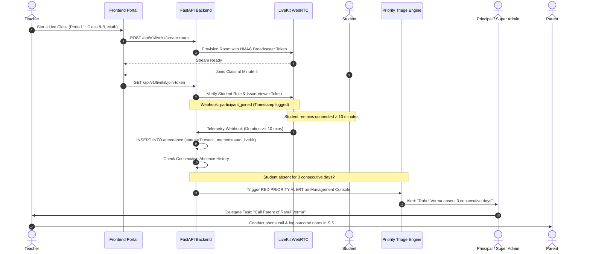
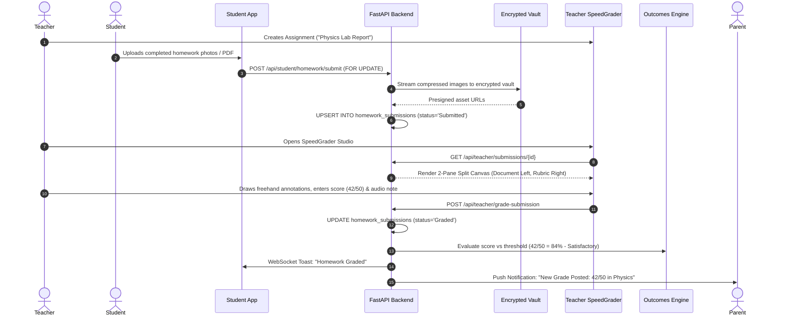
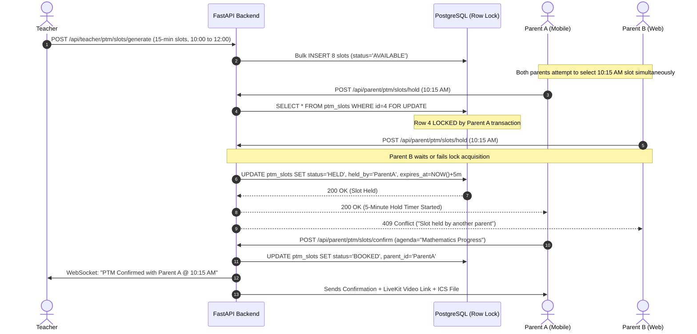
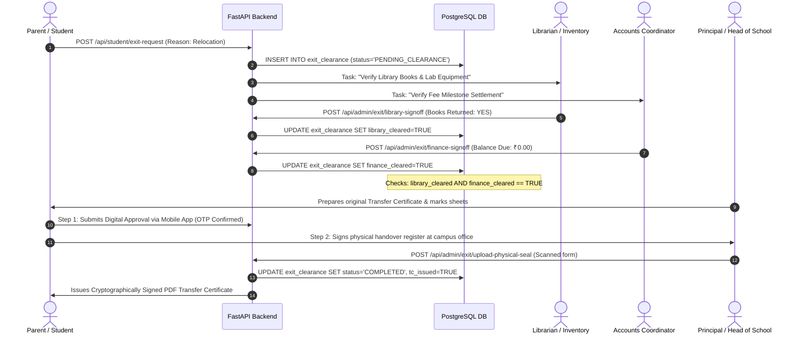
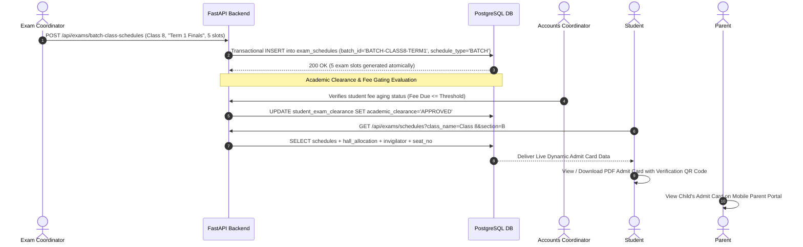
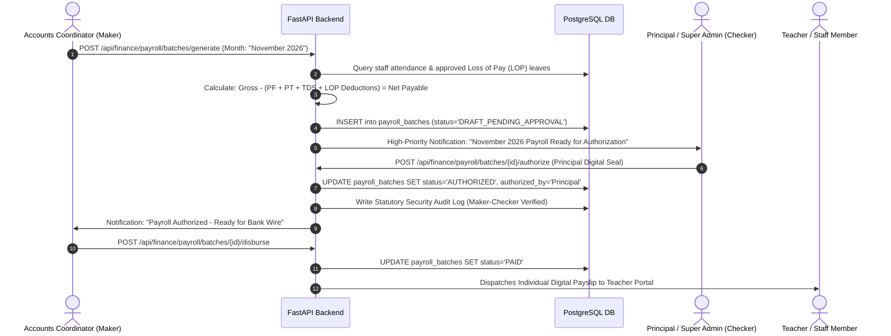
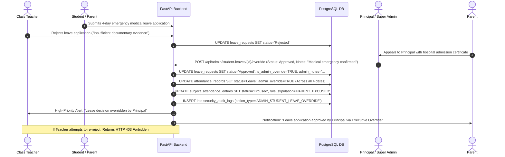

# PRODUCT REQUIREMENTS DOCUMENT (PRD)
## EDU360 — K–12 Institutional Management, Live Education & Unified SIS Ecosystem

**Document Version:** 2.0 (Production Architecture Baseline)  
**Target Segment:** K–12 Education (Nursery to Class 12)  
**Platforms:** Web Application (Admin, Coordinators, Teachers, Secondary Students) & Mobile Application (Parents, Companion PWA for Students/Teachers)  
**Target Audience:** Executive Leadership, System Architects, Full-Stack Engineers, UI/UX Designers, QA Engineers  
**File Location:** [`docs/prd/PRD.md`](file:///e:/Diradz/EDU360/docs/prd/PRD.md)  
**Synchronized Architectural Reference:** [`docs/architecture/ROLE_WISE_ARCHITECTURE_AND_WORKFLOWS.md`](file:///e:/Diradz/EDU360/docs/architecture/ROLE_WISE_ARCHITECTURE_AND_WORKFLOWS.md)

---

## 1. Executive Summary & Product Vision

**EDU360** is an enterprise-grade, cloud-native **Educational Operating System & Student Outcomes Platform** engineered for K–12 institutions. Traditional School ERPs operate as disconnected, static digital registers that spam users with notifications and leave leadership blind to operational risks. 

EDU360 functions as a **Unified Action & Intelligence System** connecting **Administration, 4 Specialized Coordinators, Teachers, Parents, and Students** around four foundational product principles:

1. **Actionable Management Intelligence:** Instead of forcing school leaders to sift through static reports, EDU360 highlights *what needs attention today, why it matters, and who needs to take action* via a real-time **Red / Orange / Green Priority Triage Engine**.
2. **Outcome-Oriented Parent Involvement:** Instead of spamming parents with 15 disconnected notifications a day, EDU360 provides an **anti-spam moving-slider dashboard** on mobile for routine updates, coupled with a shared **Student Focus Table** for targeted weak-subject improvement.
3. **Zero Extra Burden for Teachers:** Routine administrative toil is automated—online class attendance is captured via a **10-minute WebRTC telemetry rule**, period-wise subject attendance is auto-excused upon approved leave, and homework is evaluated directly inside a browser-based **SpeedGrader canvas** without downloading or re-uploading files.
4. **Deterministic Time-Alignment & Governance-First Security:** The entire platform operates against a centralized **ClockProvider** simulation engine, synchronizing timetables, period bells, and exam lifecycles across all 8 portals. Cryptographic HMAC-SHA256 tokens and pessimistic row locks (`SELECT ... FOR UPDATE`) ensure zero double-bookings, zero payment race conditions, and complete auditability.

---

## 2. Platform Strategy & Multi-Portal Architecture

EDU360 follows a **Role-Optimized Platform Strategy** tailored to ergonomic workstation needs, user mobility, and task complexity across all **8 Canonical Roles**:

| User Role | Route / Portal | Primary Platform | Secondary Platform | Operational Rationale |
| :--- | :--- | :--- | :--- | :--- |
| **Super Admin / Principal** | `/admin` | **Web App (Desktop 1080p+)** | Mobile Web (Urgent alerts only) | High-density priority triage, institutional task delegation, statutory document vault locking, and administrative override governance. |
| **Academic Coordinator** | `/academic_coordinator` | **Web App (Desktop/Laptop)** | Tablet Web | Curriculum pacing audit, conflict-free teacher timetable substitutions, and faculty workload balancing. |
| **Exam Coordinator** | `/exam_coordinator` | **Web App (Desktop/Laptop)** | Tablet Web | Atomic batch class exam scheduling, hall deployment, seat allocation, academic clearance gating, and dynamic admit card generation. |
| **Accounts Coordinator** | `/accounts_coordinator` | **Web App (Desktop/Laptop)** | Tablet Web | Real-time 3-tier fee aging, physical counter cash/cheque collection, fee waivers, and monthly staff payroll with LOP deductions (Maker role). |
| **Admissions Coordinator** | `/admissions_coordinator` | **Web App (Desktop/Laptop)** | Mobile App / Tablet | 24/7 AI chatbot lead capture CRM, follow-up call tracking, and 1-click atomic conversion into SIS profiles with sibling discounts. |
| **Teachers** | `/teacher` | **Web App (Desktop/Laptop)** | Mobile App / Tablet | Desktop displays optimal for LiveKit classroom hosting, browser-based SpeedGrader annotation, and staff leave/permission applications. |
| **Parents** | `/parent` | **Mobile App (Android / iOS)** | Responsive Web | Mobile-first for on-the-go push notifications, 1-tap UPI fee payments, moving slider notices, live bus GPS tracking, and PTM booking. |
| **Students (Secondary)** | `/student` | **Web App (Desktop/Laptop)** | Mobile App / Tablet (PWA) | Full-width displays for distraction-free LiveKit classes, digital notes, dynamic admit cards, online exams, and homework uploads. |

---

## 3. User Roles & Permission Matrix (RBAC & Governance)

> ⚠️ **Strict Document Security & Administrative Override Rule**:  
> 1. Official student documents in the **Student Information System (SIS)** can **ONLY** be uploaded, edited, or replaced by **Administration**. Teachers, Parents, and Students have strictly **View/Download-Only** access.  
> 2. The **Administrative Override Engine** grants Principal/Super Admin ultimate executive authority over student leaves, institutional SLAs, exam moderation, and fee overrides. When an executive override is stamped (`is_admin_override=True`), downstream roles (Teachers/Coordinators) are locked out (`403 Forbidden`) from reversing the action.

| Module / System Capability | Super Admin / Principal | Academic Coordinator | Exam Coordinator | Accounts Coordinator | Admissions Coordinator | Teacher | Student | Parent |
| :--- | :---: | :---: | :---: | :---: | :---: | :---: | :---: | :---: |
| **Institutional Priority Triage & Tasks** | **Full (Executive)** | View / Action | View / Action | View / Action | View / Action | None | None | None |
| **SIS Official Document Vault Control** | **Full (Exclusive)** | View Only | View Only | View Only | View Only | View Only | View Only | View Only |
| **Administrative Override Engine** | **Full (Tier-3 Bypass)**| None | None | None | None | None | None | None |
| **Admissions CRM & SIS Conversion** | Full (Audit) | View Only | View Only | Fee Handshake | **Full (Lead CRM)** | None | None | None |
| **Batch Exam Scheduling & Hall Alloc.** | Full (Audit) | Sync Pacing | **Full (Batch Eng)**| Fee Clearance | None | View Duty | View Admit | View Admit |
| **Dynamic Admit Card Generation** | Full (Audit) | View Only | **Full (Publish)** | Fee Clearance | None | View Only | **Download (Live)**| View Only |
| **3-Tier Fee Aging & Counter Payment** | Full (Audit) | None | Clearance Lock | **Full (Counter Pay)**| None | None | View Status | **Pay (Online)**|
| **Staff Payroll & LOP Deductions** | **Authorize (Checker)**| Workload Sync| None | **Draft Batch (Maker)**| None | View Payslip | None | None |
| **Live Online Class Hosting (WebRTC)** | Full (Audit) | Monitor Class | None | None | None | **Full (Host)** | Join / Replay | None |
| **Auto-Attendance (10-Min Rule)** | Full (Audit) | View Register | None | None | None | **Live Roster** | Status Stamp | View Child |
| **SpeedGrader Inline Canvas Correction** | Full (Audit) | Audit Pacing | None | None | None | **Grade & Mark** | Submit / View| View Child |
| **Shared Student 'Focus Table'** | Full (Audit) | Audit Focus | Sync Blueprint | None | None | **Create / Edit** | View & Execute| **Co-Track** |
| **Staff Leave (CL/SL/EL/LOP) Application**| **Approve / Reject** | Substitute Match| None | Payroll LOP Sync | None | **Apply / Track**| None | None |
| **Student Leave Approval & Override** | **Executive Override**| View Only | Attendance Sync| None | None | **First Approver**| Apply / Track| Apply for Child|
| **PTM Slot Concurrency Booking (Locks)**| Full (Audit) | Monitor Slots | None | None | None | **Create Slots** | None | **Hold & Book** |
| **Dual-Signature Student Exit / TC** | **Sign & Seal** | Inventory Sync| None | Dues Clearance | None | View Only | View Status | **Digital Sign** |
| **Live School Bus GPS Tracking** | Full (Routes) | None | None | Transport Fees | None | None | Live Tracking| **Live Tracking**|

---

## 4. Detailed Functional Requirements by Role

### 4.1 Role 1: Student Portal (`/student` — Web-First)
1. **Live Classroom Cockpit (LMS):** 1-click in-browser LiveKit WebRTC connection with active speaker spotlighting, screen share reception, and live doubts chat.
2. **Dynamic 10-Minute Auto-Attendance Tracker:** Periodic background telemetry automatically logs attendance status. Students joining within 10 minutes receive `Present`; joining after 10 minutes marks `Late`; non-attendees mark `Absent`.
3. **Period-Wise Subject Attendance Ledger:** Real-time visibility into period-level statuses across all subjects (`MATH-801`, `PHY-802`, etc.) with automatic parent-excused annotations.
4. **Dynamic Admit Cards & Exam Seating Roster:** Students receive live, dynamic examination hall tickets pulling directly from the Exam Coordinator's batch database. Displays exam series name, designated examination hall, assigned seat number, chief invigilator name, QR verification code, and academic/fee clearance verification.
5. **Homework Vault & Submission Engine:** Multi-file upload dropzone with mobile camera capture and compression. Displays the teacher-evaluated SpeedGrader document with vector pen annotations and private remarks.
6. **Side-by-Side Portfolio (Participations & Achievements):** 2-pane portfolio separating institutional event participation from student-uploaded merit awards and competition certificates.
7. **Personalized 'Focus Table' & Remedial Drills:** Actionable weekly study timetable highlighting low-scoring subject concepts co-tracked with parents and teachers.

---

### 4.2 Role 2: Teacher Portal (`/teacher` — Web-First)
1. **Teacher Home Dashboard & Class Timetable:** Dynamic schedule ticker driven by `ClockProvider` highlighting active period, upcoming lectures, pending homework submissions, and duty assignments.
2. **Live Lecture Broadcaster Studio:** Integrated LiveKit WebRTC room broadcaster with digital whiteboard controls, mute-all capability, and automatic cloud recording.
3. **SpeedGrader Studio (Browser Canvas):** 2-pane evaluation workspace displaying student submissions alongside grading rubrics. Teachers draw freehand stylus corrections, write remarks, and assign scores directly in the browser—automatically replacing the student file without manual re-uploading.
4. **Staff Leave & Short-Permission Management:** Apply for categorized leaves (*Casual Leave - CL*, *Sick Leave - SL*, *Earned Leave - EL*, or *Loss of Pay - LOP*) specifying affected teaching periods. Approved LOP leaves automatically feed into Accounts Coordinator payroll deductions.
5. **Period-Wise Attendance Register:** Fast-key bulk attendance marker (`P`, `A`, `L`, `E`) with instant sync to parent notifications. Approved student leaves automatically backfill and excuse period sessions.
6. **Student Focus Table Builder:** Generate personalized concept recovery plans for students scoring below benchmark thresholds in unit exams.
7. **Parental Connection Hub:** 1-on-1 parent messaging, online PTM slot generation with buffer intervals, and student leave recommendation reviews.

---

### 4.3 Role 3: Parent Application (`/parent` — Mobile-First)
1. **Anti-Spam 'Moving Slider' Carousel:** Routine announcements, holiday notices, and event banners glide as top interactive slides, onboarding parents to open the app once daily without notification fatigue.
2. **High-Signal Push Alerts & Notification Center:** Push notifications reserved exclusively for urgent alerts: Teacher Remarks, updates to Child's Focus Table, 3-day consecutive absence warnings, and administrative fee alerts.
3. **Dynamic Child Admit Card Viewer:** Parents inspect their child's official exam admit card, hall location, seat allocation, and academic clearance status before term exams.
4. **Concurrency-Safe PTM Booking:** Interactive 15-minute slot selector with a 5-minute temporary reservation timer backed by pessimistic database row locks (`SELECT ... FOR UPDATE`).
5. **3-Tier Fee Milestones & Digital Cashier:** Installment breakdown, instant UPI/Card settlements, counter payment history receipts, and automated PDF tax receipts delivered to registered email.
6. **Live Transport Radar:** Real-time school bus GPS tracking showing live map route, current stop, morning pickup ETA, and evening drop countdown.

---

### 4.4 Role 4: Super Admin / Principal Console (`/admin` — Web-First)
1. **Priority Triage Command Center (Red / Orange / Green Action Engine):** Highlights top institutional issues by priority, explains root cause, and provides 1-click administrative resolution buttons:
   - 🔴 **Red (Urgent):** 3+ consecutive student absences, Class average drop > 15%, teacher unauthorized absenteeism.
   - 🟠 **Orange (Operational):** Fee Milestone defaulters > 30 days, GPS tracking offline for > 15 mins.
   - 🟢 **Green (Scheduled):** Upcoming compliance filings, term exam schedules, board circulars.
2. **Administrative Override & Governance Engine:** Five concrete executive bypass domains enabling the Principal to override student leave rejections, force-close stalled SLA tasks, decouple exam moderation freezes, and clear fee hall-ticket blocks. Downstream roles are locked out (`403 Forbidden`) from reversing executive decisions.
3. **Four-Eye Payroll Authorization (Checker Role):** Principal reviews monthly salary batch computed by Accounts Coordinator (net wire, tax deductions, LOP penalties) and applies executive authorization signature before bank disbursement.
4. **Dual-Signature Student Exit / TC Clearance:** Orchestrates institutional sign-offs across Library, Labs, Sports, and Finance. Requires both Parent Digital Approval (OTP) and Principal Scanned Physical Signature before permanent vault sealing.
5. **Conflict-Free Timetable & Substitution Engine:** Algorithmic schedule builder with automatic emergency substitution matching based on teacher subject qualifications and free periods.

---

### 4.5 Role 5: Exam Coordinator Portal (`/exam_coordinator` — Web-First)
1. **Atomic Batch Class Exam Scheduling:** Eliminates piecemeal scheduling. Coordinators select class and term series (e.g., *Class 8 — Term 1 Final Examinations 2026*) and schedule all subjects in one atomic transaction, generating a unique `batch_id` and `series_name`.
2. **Hall Deployment & Seating Allocation:** Manages examination halls (Auditorium, Hall A, Room 204), maximum seating capacity, and assigns Chief Invigilators per session.
3. **Dynamic Admit Card Generation Engine:** Automates hall ticket publishing. Integrates fee clearance gates and academic eligibility thresholds to generate tamper-evident student admit cards with verification QR codes.
4. **Academic Moderation Ledger & Secrecy Vault:** Normalizes exam marks across sections, enforces statistical grading curves, and applies cryptographic moderation locks to prevent unauthorized grade manipulation.
5. **AI-Assisted Hybrid Answer Script Scanning:** Integrates Google Gemini Flash Vision API to process scanned paper answer scripts, extract student roll numbers, and auto-populate marks rubrics.

---

### 4.6 Role 6: Accounts Coordinator Portal (`/accounts_coordinator` — Web-First)
1. **3-Tier Fee Aging Ledger & Defaulter Triage:** Tracks receivables categorized into Aging Tiers (1–30 days, 31–60 days, 60+ days overdue) with 1-click bulk SMS/Email payment reminder triggers.
2. **Physical Counter Collection Engine:** Point-of-sale cashier modal for recording manual cash, cheque, Demand Draft, or POS card payments (`POST /api/finance/defaulters/{id}/pay`). Enforces zero-overpayment guards, auto-reconciles matching parent milestones, and generates counter receipts.
3. **Staff Payroll & LOP Deduction Engine (Maker Role):** Computes monthly institutional payroll (`POST /api/finance/payroll/batches/generate`) by cross-referencing staff attendance and approved *Loss of Pay (LOP)* leaves. Formats itemized payslips (Basic, HRA, DA, PF, PT, TDS, LOP deductions).
4. **Four-Eye Separation of Duties Workflow:** Submits draft payroll batches to the Principal for executive authorization. Transmits bank wire instructions only upon cryptographic Principal sign-off.
5. **Fee Waiver & Concession Approvals:** Evaluates economic hardship and merit scholarship fee waivers within predefined administrative delegation limits.

---

### 4.7 Role 7: Admissions Coordinator Portal (`/admissions_coordinator` — Web-First)
1. **24/7 AI Chatbot & Lead Ingestion CRM:** Captures incoming parent admission inquiries, answers standard queries (fee brackets, curriculum, transport routes), and routes high-intent prospects to human counselors.
2. **Follow-Up Call Tracker & Tele-Counseling Log:** Logs tele-counseling notes (*"Campus visit booked"*, *"Waiting on report card"*), tracks lead conversion velocity, and sets call reminders.
3. **Single-Click Atomic SIS Conversion:** Converts admitted candidates directly into enrolled students (`POST /api/admin/crm/enquiries/{id}/convert`). Generates admission numbers (`EDU-2026-XXX`), configures default credentials, assigns bus routes, and vaults compliance documents.
4. **Sibling Linking & Automated Discount Engine:** Detects enrolled siblings and applies a 15% tuition fee waiver, generating the initial Admission & Registration Fee invoice in Accounts Coordinator automatically.

---

### 4.8 Role 8: Academic Coordinator Portal (`/academic_coordinator` — Web-First)
1. **Curriculum Pacing & Syllabus Tracker:** Monitors chapter completion percentages against institutional lesson plans across all sections and grades.
2. **Teacher Substitution & Workload Balancing:** Real-time substitution engine that detects teacher absences and recommends qualified replacement teachers without period collisions or excessive weekly workload.
3. **Student Focus Table Oversight:** Audits teacher-student recovery timetables, tracking remedial score progression and flagging chronic learning gaps to the Principal.
4. **Classroom Quality & Observation Log:** Conducts structured teacher pedagogical reviews, logs lesson feedback, and tracks teacher professional development milestones.

---

## 5. Key System Workflows & Flow Diagrams

---

### 5.1 Online Class Auto-Attendance & Consecutive Absence Triage

| Step | Actor / System | Rule / Action Executed | System Output & State Transition |
| :---: | :--- | :--- | :--- |
| **Step 1** | Teacher | Initiates live class from Teacher Dashboard during scheduled timetable slot. | LiveKit room provisioned with teacher broadcaster token. |
| **Step 2** | Student | Enters live class within first 10 minutes of scheduled start time. | System logs WebRTC join timestamp; marks student **PRESENT**. |
| **Step 3** | System | Monitors attendance registers across all periods for consecutive absences. | Triggers **RED PRIORITY ALERT** on Admin Dashboard if student is absent 3+ days. |
| **Step 4** | Principal / Admin | Reviews Red Alert card and assigns priority tele-call task to class teacher. | Task created with SLA; class teacher notified; outcome notes recorded in SIS. |

---

### 5.2 Homework Submission, SpeedGrader Inline Canvas & Focus Table

| Step | Actor / System | Rule / Action Executed | System Output & State Transition |
| :---: | :--- | :--- | :--- |
| **Step 1** | Student | Captures homework pages via mobile camera and submits PDF/images. | Acquires row lock via `SELECT ... FOR UPDATE`; stores assets in encrypted vault. |
| **Step 2** | Teacher | Opens pending submission in browser-based SpeedGrader Studio. | Renders 2-pane split canvas: document viewer alongside weighted scoring rubric. |
| **Step 3** | Teacher | Annotates drawings, writes inline feedback, and commits numerical marks. | Corrected document replaces original upload; notification dispatched. |
| **Step 4** | Outcomes Engine | Low marks (< 50%) automatically trigger Student Focus Table recommendation. | Personalized concept recovery table generated and shared with Teacher and Parent. |

---

### 5.3 Parent-Teacher Meeting (PTM) Concurrency-Safe Booking

| Step | Actor / System | Rule / Action Executed | System Output & State Transition |
| :---: | :--- | :--- | :--- |
| **Step 1** | Teacher | Configures PTM availability slots with buffer intervals. | System generates slots in `AVAILABLE` state linked to teacher profile. |
| **Step 2** | Parent A | Selects preferred slot; backend initiates `SELECT ... FOR UPDATE` row lock. | Row lock acquired; slot transitions to `HELD` with 5-minute reservation timer. |
| **Step 3** | Parent B | Simultaneously clicks the same slot. | Backend detects active lock; immediately rejects with **409 Conflict** error toast. |
| **Step 4** | Parent A | Submits discussion agenda and confirms booking before timer expires. | Slot transitions to `BOOKED`; WebRTC link and calendar invitations dispatched. |

---

### 5.4 Student Exit & Dual-Signature Legal Clearance

| Step | Actor / System | Rule / Action Executed | System Output & State Transition |
| :---: | :--- | :--- | :--- |
| **Step 1** | Parent | Submits formal withdrawal application citing official reason and effective date. | Creates exit clearance record in `PENDING_CLEARANCE` status. |
| **Step 2** | Department Officers | Library and Finance officers verify zero asset loss and complete fee settlement. | Departmental clearance flags updated to `TRUE` in clearance ledger. |
| **Step 3** | Parent & Principal | Parent provides Digital OTP approval; signs physical register at campus. | Physical signed form scanned and uploaded to permanent document vault. |
| **Step 4** | System | Seals student record; transitions status to `Alumni / Withdrawn`. | Cryptographically verified PDF Transfer Certificate delivered to parent. |

---

### 5.5 Batch Class Examination Scheduling & Dynamic Admit Card Delivery

| Step | Actor / System | Rule / Action Executed | System Output & State Transition |
| :---: | :--- | :--- | :--- |
| **Step 1** | Exam Coordinator | Configures full exam timetable series for class in single atomic batch request. | All subject slots written to DB with unique `batch_id` and `series_name`. |
| **Step 2** | Accounts / Academics | System evaluates fee clearance status and academic attendance eligibility. | Eligible students receive `APPROVED` academic examination clearance. |
| **Step 3** | Student Portal | Student accesses Exam tab; system dynamically queries live batch schedule. | Generates personalized admit card with hall name, seat number, and QR code. |
| **Step 4** | Parent Portal | Parent inspects child's admit card details on mobile app. | Instant visibility into scheduled examination dates, timings, and instructions. |

---

### 5.6 Four-Eye Staff Payroll Generation & LOP Deduction Clearance

| Step | Actor / System | Rule / Action Executed | System Output & State Transition |
| :---: | :--- | :--- | :--- |
| **Step 1** | Accounts Coordinator | Initiates monthly payroll computation; system factors in approved LOP leaves. | Generates draft payroll batch with detailed deductions; status set to `DRAFT`. |
| **Step 2** | System Router | Enforces Four-Eye Principle; alerts Principal that high-value batch requires authorization. | Push notification dispatched to Principal dashboard with batch summary figures. |
| **Step 3** | Principal / Super Admin | Reviews payroll breakdown, audits LOP deductions, and applies executive sign-off. | Batch status transitions to `AUTHORIZED`; action stamped in `SecurityAuditLog`. |
| **Step 4** | Accounts Coordinator | Executes corporate bank disbursement wire and closes batch. | Status set to `PAID`; itemized digital payslips released to all staff dashboards. |

---

### 5.7 Administrative Override & Governance Cascade

| Step | Actor / System | Rule / Action Executed | System Output & State Transition |
| :---: | :--- | :--- | :--- |
| **Step 1** | Frontline Action | Class teacher rejects student leave due to documentation delay. | Leave status marked `Rejected` in database. |
| **Step 2** | Executive Appeal | Parent presents certified documentation to Principal for emergency review. | Principal inspects case in Administrative Override console. |
| **Step 3** | Executive Override | Principal executes override; sets `is_admin_override=TRUE` with justification. | Attendance and period subject records automatically backfilled as `Excused`. |
| **Step 4** | Downstream Lockout | System locks record; prevents downstream teacher reversal (`403 Forbidden`). | Dual notification cascade alerts teacher and parent; logged in audit ledger. |

---

## 6. UI/UX Screen Checklist (Figma Design Specifications)

| Portal / Module | Primary Device | Core Screens Required in Figma |
| :--- | :--- | :--- |
| **Super Admin / Principal Console** | Web (Desktop 1080p+) | 1. **Priority Command Center** (Red/Orange/Green Triage + Urgent/Upcoming Task Manager) 2. **Administrative Override Console** (Student Leave, Task SLA, and Exam Override Modals) 3. **Four-Eye Payroll Authorization Modal** (Batch Net Summary, LOP Deductions, Sign-Off) 4. **SIS Directory & Document Vault** (Admin-Only Edit & Re-upload Lock) 5. **Entry/Exit Gate Log & Dual-Signature TC Clearance Modal** 6. **Event Command Center** (Staff-Student Assignment Tree + Vendor Equipment Tracker) |
| **Academic Coordinator Portal** | Web (Desktop/Laptop) | 1. **Curriculum Pacing Matrix** (Subject Completion Gauges & Target Variance) 2. **Teacher Substitution Recommender** (Conflict-Free Period Matcher Grid) 3. **Student Focus Table Oversight Board** (Weak Concept Recovery Tracker) |
| **Exam Coordinator Portal** | Web (Desktop/Laptop) | 1. **Atomic Batch Class Exam Scheduler** (Multi-Slot Term Series Builder Grid) 2. **Examination Hall Deployment & Seat Allocation Matrix** 3. **Dynamic Admit Card Generator & Clearance Gate Modal** 4. **Academic Moderation Ledger** (Grade Normalization & Secrecy Freeze) |
| **Accounts Coordinator Portal** | Web (Desktop/Laptop) | 1. **3-Tier Fee Aging Ledger** (1–30d, 31–60d, 60+d Overdue Defaulter Table) 2. **Physical Counter Collection Modal** (Zero-Overpayment Guard, Cash/POS Receipt) 3. **Monthly Staff Payroll Engine** (Maker Batch Builder, LOP Deduction Calculator) 4. **Fee Waiver & Concession Approvals Queue** |
| **Admissions Coordinator Portal** | Web (Desktop/Laptop) | 1. **24/7 AI Chatbot Ingestion CRM** (Live Lead Triage & Qualification Funnel) 2. **Follow-Up Call Tracker** (Call Outcome Notes & SLA Reminder Queue) 3. **Single-Click SIS Conversion Modal** (Sibling Discount 15%, Bus Route, Auto-Invoice) |
| **Teacher Portal** | Web (Desktop/Laptop) | 1. **Teacher Home Dashboard** (Active Period Ticker, Attendance Roster, Duty List) 2. **Live Class Host Studio** (WebRTC Video Stage, Whiteboard, 10-Min Auto-Roster) 3. **Split-Screen SpeedGrader Studio** (Document Canvas Left, Weighted Rubric Right) 4. **Staff Leave & Short-Permission Form** (CL/SL/EL/LOP & Affected Period Selector) 5. **Shared Student Focus Table Builder** & Parental Connection Chat |
| **Student Portal** | Web (Desktop/Laptop) | 1. **Student Home Dashboard** (Moving Event Banner, Period Ticker, Attendance Summary) 2. **Live Classroom Cockpit & Video Library** (LiveKit Stream, Notes Viewer) 3. **Dynamic Admit Card Modal** (Hall Name, Seat Number, Invigilator, Verification QR) 4. **Homework Vault & Submission Dropzone** (Camera Upload, SpeedGrader Feedback) 5. **Side-by-Side Participations & Achievements Portfolio Upload** |
| **Parent Application** | Mobile App (Android/iOS) | 1. **Parent Home Dashboard** (Top Moving Banner Sliders & Child Daily Summary) 2. **Dynamic Child Admit Card Viewer** (Exam Schedule, Hall Seating, Instructions) 3. **Concurrency-Safe PTM Booking Modal** (Interactive 15-Min Grid with 5-Min Timer) 4. **Fee Milestones Online Payment** (1-Click UPI/Card Checkout & PDF Receipts) 5. **Live School Bus GPS Map Radar** & Digital TC Handover Sign-Off |
| **Cross-Cutting Global** | All Devices / Portals | 1. **In-App Notification Center** (Sound Alerts, Unread Badges, Action Deep-Links) 2. **Dynamic ClockProvider Ticker** (30-Second Timetable & Exam Lifecycle Clock) |

---

## 7. Recommended Technology Stack & Architecture

| Architecture Layer | Production Technology | Operational Role & Justification |
| :--- | :--- | :--- |
| **Web Frontend** | Next.js 14/16 (React 18/19) | Server-Side Rendering (SSR) for blazing initial loads + Client components for high-density administrative dashboards. |
| **Mobile Application** | React Native (Expo) + TypeScript | Cross-platform iOS/Android parent app sharing data types, schemas, and API contracts with the web frontend. |
| **Language & Typing** | TypeScript (Strict Mode) | Full compile-time type safety across all 8 portals (0 errors on `tsc --noEmit`). |
| **Styling & Icons** | Tailwind CSS + Lucide React | Institutional design tokens with responsive grid layouts, high-contrast badges, and micro-interactions. |
| **Backend API** | FastAPI (Python 3.11+) | Monolithic asynchronous ASGI runtime handling SIS, Attendance, Fees, and Exams endpoints with high concurrency. |
| **Primary Database** | PostgreSQL 15+ (`asyncpg`) | Enterprise relational database with ACID compliance, JSON column indexing, foreign keys, and CHECK constraints. |
| **ORM & Concurrency** | SQLAlchemy 2.0 Async | Single-pass JOIN queries paired with pessimistic database row locks (`SELECT ... FOR UPDATE`) to eliminate race conditions. |
| **Live Video & Audio** | LiveKit WebRTC Server & SDK | Embedded in-browser live classrooms, screen sharing, automatic cloud recording, and attendance webhooks. |
| **Dynamic Timekeeping** | Centralized `ClockProvider` | Reactive simulation hook with 30-second ticker aligning class timetables, period switches, and exam lifecycles. |
| **Real-Time Notification** | In-App WebSocket + Web Audio | Multi-target role dispatching with live sound chimes, unread count badges, and deep-link action navigation. |
| **Security & Auth** | HMAC-SHA256 Signed Tokens | Scoped role verification headers (`X-User-Role`, `X-User-Id`) with strict router-level authorization guards. |
| **Artificial Intelligence** | Google Gemini 1.5/2.0 Flash Vision | Multimodal diagram inspection, student notebook OCR analysis, remedial sprint generation, and Socratic chatbot. |
| **Compliance & Storage** | S3-Compatible Encrypted Vault | Cloudflare R2 / AWS S3 for zero-egress storage of homework uploads, evaluated PDFs, and transfer certificates. |

---

## 8. Phased Implementation Roadmap

| Phase / Milestone | Timeline | Core Deliverables & Production Gates | Status |
| :--- | :--- | :--- | :---: |
| **Milestone 1: Core SIS, Security & Governance** | Weeks 1–5 | • Cryptographic Role-Based Auth (HMAC tokens + scoped role guards) • Central Student Information System (SIS) Profile Engine • Admin-Only Document Vault security lockdown • Admissions CRM Inquiry Funnel & Sibling Linking (15% waiver) • 3-Tier Fee Aging Ledger & Counter Cashier Modal with overpayment guards • Staff Payroll Engine with Four-Eye Principal Authorization • Dual-Signature Student Exit / Transfer Certificate (TC) Clearance | **Completed** |
| **Milestone 2: Classroom, Grading, Exams & App** | Weeks 6–10 | • Live Online Classes via embedded LiveKit WebRTC cluster • 10-Minute Automated Attendance Engine via webhooks • Period-Wise Granular Subject Attendance Ledger with leave sync • Student Homework Upload with mobile camera compression • Teacher SpeedGrader Studio with browser-based canvas annotations • Atomic Batch Class Examination Scheduling & Dynamic Admit Cards • Parent Mobile Portal with Moving Banner Sliders & Bus Radar • PTM Slot Concurrency Row Locks (`SELECT ... FOR UPDATE`) | **Completed** |
| **Milestone 3: Intelligence, Overrides & Live Pilot** | Weeks 11–14 | • Admin Red/Orange/Green Priority Action Triage Engine • Administrative Override & Governance Engine (5 Concrete Domains) • In-App Real-Time Notification Center with sound alerts & deep-links • Centralized `ClockProvider` dynamic timetable lifecycle alignment • Shared Student 'Focus Table' Generator for academic recovery • Production Pilot School Onboarding & Benchmark Security Audits | **Active Baseline** |

---

## Document Sign-Off & Architectural Verification
- **Software Architect**: Approved & Synchronized
- **Backend Architect**: Approved & Synchronized
- **Database Optimizer**: Approved & Synchronized
- **Frontend Developer**: Approved & Synchronized
- **Head of Product**: Approved & Synchronized
